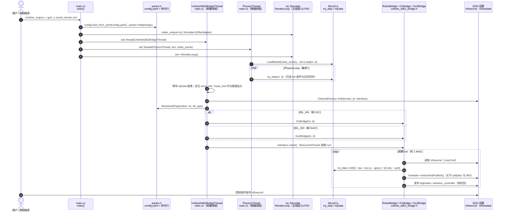

# unitree_mujoco

**unitree_mujoco** 把 **MuJoCo 物理** 与 **SDK2 DDS 接口**接在一起：用 SDK2 / ROS2 / Python SDK 写的低层控制程序，可以先在本仿真器里跑通，再迁到真机。

## 一句话定义

官方 Sim2Sim 验证环——仿真侧发布/订阅与真机同构的低层 DDS 消息，专门服务「控制器是否过拟合某一仿真器」的检查。

## 英文缩写速查

| 缩写 | 英文全称 | 简要说明 |
|------|----------|----------|
| MuJoCo | Multi-Joint dynamics with Contact | 接触丰富的刚体物理引擎 |
| Sim2Sim | Simulation to Simulation | 跨仿真器迁移验证 |
| Sim2Real | Simulation to Real | 仿真到真机 |
| DDS | Data Distribution Service | 与真机共用的通信层 |
| IDL | Interface Definition Language | Go 系 `unitree_go` / 人形 `unitree_hg` |
| SDK2 | Unitree SDK version 2 | 控制程序开发入口 |

## 为什么重要

- 官方三条 RL 线（gym / lab / mjlab）在文档中常把本仓或等价 MuJoCo 验证当作 **Play 之后、真机之前** 的一环。
- **接口同构**降低「换仿真器就要改控制器」的成本；也暴露 DDS 域冲突、电机编号等工程问题。
- 与 [`unitree_ros`](./unitree-ros.md) Gazebo 栈不同：本仓目标是 **低层力矩/位置控制验证**，不是 Gazebo 关节教学。

## 核心原理

| 目录 | 内容 |
|------|------|
| `simulate/` | C++ 仿真器（推荐） |
| `simulate_python/` | Python 仿真器 |
| `unitree_robots/` | 支持机型的 MJCF |
| `terrain_tool/` | 地形生成 |
| `example/` | 示例程序 |

**支持的 SDK2 消息（当前版本）**：`LowCmd`、`LowState`、`SportModeState`（仿真保留位姿速度供分析）、G1 的 `IMUState`（`rt/secondary_imu`）。上游写明：**当前仅支持低层开发**。

**IDL 分族**：Go2 / B2 / H1 / 轮足等用 `unitree_go`；G1 / H1-2 用 `unitree_hg`。

## 工程实践

1. 安装 `unitree_sdk2` 到 `/opt/unitree_robotics`；安装依赖 `libyaml-cpp-dev libspdlog-dev libboost-all-dev libglfw3-dev`。
2. 下载 MuJoCo release，软链到 `simulate/mujoco`（上游示例版本号以 README 为准）。
3. `cmake && make` 后运行例如：`./unitree_mujoco -r go2 -s scene_terrain.xml`，另开终端跑 `./test`。
4. 与真机同网时务必隔离 DDS 域，避免误控实机。

## 局限与风险

- **不是高层运动模式仿真器**：内置 Sport 服务关闭后的真机行为与仿真保留消息语义不同，勿假设完全一致。
- **电机编号必须对照开发者文档**与实机接线。
- C++ / Python 两套实现能力边界以上游为准，优先 C++ 路径做严肃验证。

## 源码运行时序图

官方实现 [unitreerobotics/unitree_mujoco](https://github.com/unitreerobotics/unitree_mujoco)（短 SHA `1eb6642`）：C++ 仿真器 `simulate/`（推荐）以 MuJoCo 物理步进，`simulate/src/unitree_sdk2_bridge.h` 把仿真状态经 DDS 发布为 `rt/lowstate`、把控制程序下发的 `rt/lowcmd` 转为 MuJoCo 执行器输入。`main()` 同时起三条执行线：桥接线程、物理线程与主线程渲染循环。Python 版 `simulate_python/` 结构同构（`unitree_mujoco.py` 的 `SimulationThread` 与 `unitree_sdk2py_bridge.py` 的 `UnitreeSdk2Bridge`），本图不单独展开。

入口：`./unitree_mujoco -r go2 -s scene_terrain.xml`（在 `simulate/build` 中运行；另开终端运行控制程序，如 `./test`）

图依据：unitree_mujoco@1eb6642，读过 `readme.md`（运行命令与 DDS domain 配置）、`simulate/src/main.cc`（`main`、`PhysicsLoop`、`UnitreeSdk2BridgeThread`，部分）、`simulate/src/unitree_sdk2_bridge.h`（`RobotBridge::start/run`、`G1Bridge` 声明，部分）、`simulate/src/param.h`（`ResolveIdlType` 与 IDL 常量，部分）、`simulate_python/unitree_mujoco.py`、`simulate_python/unitree_sdk2py_bridge.py`（`LowCmdHandler`、`PublishLowState`，部分）。未运行代码；`Go2Bridge` 的专属逻辑与 `mujoco` 渲染细节未读。

## 关联页面

- [unitree_sdk2](./unitree-sdk2.md)
- [unitree_rl_mjlab](./unitree-rl-mjlab.md)
- [unitree_rl_gym](./unitree-rl-gym.md)
- [MuJoCo](./mujoco.md)
- [Sim2Real](../concepts/sim2real.md)
- [Unitree](./unitree.md)

## 参考来源

- [sources/repos/unitree_mujoco.md](../../sources/repos/unitree_mujoco.md)
- 上游：<https://github.com/unitreerobotics/unitree_mujoco>
- 源码核对（2026-11-02）：unitreerobotics/unitree_mujoco@1eb6642，读过 readme.md、simulate/src/main.cc（部分）、simulate/src/unitree_sdk2_bridge.h（部分）、simulate/src/param.h（部分）、simulate_python/unitree_mujoco.py、simulate_python/unitree_sdk2py_bridge.py（部分）；时序图依据以上文件，未运行代码。

## 推荐继续阅读

- MuJoCo 文档：<https://mujoco.readthedocs.io/>

