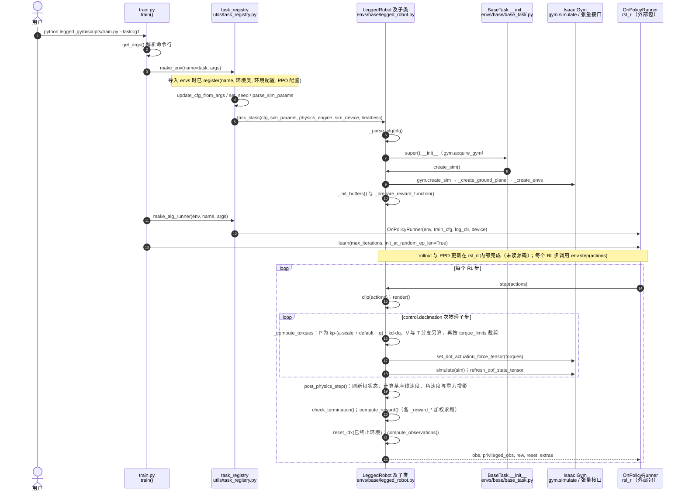

# unitree_rl_gym

**unitree_rl_gym** 是官方 **Isaac Gym** 路线的强化学习实现，任务与脚本组织接近社区 [legged_gym](./legged-gym.md)，覆盖 Unitree **Go2、H1、H1_2、G1**。

## 一句话定义

在 GPU 并行 Isaac Gym 环境里训练速度跟踪等 locomotion 策略，再经 Play / 外仿真 / 真机完成官方四段式落地。

## 英文缩写速查

| 缩写 | 英文全称 | 简要说明 |
|------|----------|----------|
| RL | Reinforcement Learning | 强化学习 |
| Isaac Gym | NVIDIA Isaac Gym | GPU 并行刚体仿真（本仓训练后端） |
| legged_gym | Legged Gym | ETH RSL 风格足式 RL 框架 |
| Sim2Sim | Simulation to Simulation | 换仿真器验证 |
| Sim2Real | Simulation to Real | 真机部署 |
| PPO | Proximal Policy Optimization | 常见策略优化算法（具体实现以上游为准） |

## 项目时间边界

官方仓库在 **2023-10-11** 的代码提交已包含实现，本路线将其标为「代码历史起点」；这不证明正式首发或首次公开日，也不表示当日已具备本页介绍的全部现有功能。提交证据见 [原始仓库时间核对](../../sources/repos/unitree_rl_gym.md)。

## 为什么重要

- **组织内星标最高**的官方 RL 入口，社区教程与复现材料最多。
- 明确写出 **Train → Play → Sim2Sim → Sim2Real**，便于对照其它两条官方线。
- 适合「先跑通一条完整链」；若团队已全面迁到 Isaac Lab 2.x / mjlab，应改选对应仓而非在本仓硬改。

## 核心原理

```text
Train (Isaac Gym) → Play (同环境可视化)
        → Sim2Sim (如 MuJoCo / 其它仿真)
        → Sim2Real (SDK2 / 真机)
```

| 阶段 | 含义 |
|------|------|
| Train | 多环境交互最大化回报；建议 headless |
| Play | 加载 checkpoint 目视/指标检查 |
| Sim2Sim | 导出网络到其它仿真，避免过拟合 Gym |
| Sim2Real | 物理机器人部署 |

训练产物默认：`logs/<experiment_name>/<date_time>_<run_name>/model_<iteration>.pt`。

## 工程实践

```bash
python legged_gym/scripts/train.py --task=go2   # 或 g1 / h1 / h1_2
python legged_gym/scripts/play.py --task=go2
```

常用参数：`--headless`、`--resume`、`--num_envs`、`--max_iterations`、`--sim_device` / `--rl_device`。安装步骤见仓库 `doc/setup_en.md` / 中文文档。

**与另外两条官方线对照**：

| 仓 | 后端 | 何时选 |
|----|------|--------|
| **本仓** | Isaac Gym | 快速复现、社区资料多 |
| [unitree_rl_lab](./unitree-rl-lab.md) | Isaac Lab 2.x | 已在 Lab/Sim 5.x 生态 |
| [unitree_rl_mjlab](./unitree-rl-mjlab.md) | mjlab + MuJoCo Warp | 要官方 ONNX→C++ 闭环 |

## 局限与风险

- **Isaac Gym 已进入维护后期**，长期项目需评估迁 Lab / mjlab 的成本。
- **观测与动作定义与其它官方仓不通用**，禁止混拷配置。
- Play 默认加载「最近一次 run」——多人共享 logs 目录时易拿错模型。

## 源码运行时序图

官方实现 [unitreerobotics/unitree_rl_gym](https://github.com/unitreerobotics/unitree_rl_gym)（短 SHA `276801e`）：基于 Isaac Gym 的 `legged_gym` 训练框架，`legged_gym/scripts/train.py` 为训练入口，策略优化由外部包 `rsl_rl` 的 `OnPolicyRunner` 完成。环境类在 `envs/base/legged_robot.py` 中实现：每个 RL 步对同一动作执行 `control.decimation` 次物理子步，子步内按 `control_type` 计算关节力矩（位置 PD / 速度 / 直接力矩）后交给 Isaac Gym 仿真。

入口：`python legged_gym/scripts/train.py --task=g1`（`--task` 可取 go2 / g1 / h1 / h1_2；回放验证用 `legged_gym/scripts/play.py`）



图依据：unitree_rl_gym@276801e，读过 `README.md`（训练与回放命令、参数）、`legged_gym/scripts/train.py`、`legged_gym/scripts/play.py`（部分）、`legged_gym/envs/__init__.py`（注册）、`legged_gym/utils/task_registry.py`（`make_env` 与 `make_alg_runner`，部分）、`legged_gym/envs/base/base_task.py`（`__init__` 片段）、`legged_gym/envs/base/legged_robot.py`（`__init__`、`step`、`post_physics_step`、`_compute_torques` 等，部分）。`rsl_rl` 为外部依赖，未读；`V` 与 `T` 控制分支的具体公式未逐行核对。未运行代码。

## 关联页面

- [unitree_rl_lab](./unitree-rl-lab.md)
- [unitree_rl_mjlab](./unitree-rl-mjlab.md)
- [unitree_mujoco](./unitree-mujoco.md)
- [legged_gym](./legged-gym.md)
- [Locomotion](../tasks/locomotion.md)
- [Unitree](./unitree.md)

## 参考来源

- [sources/repos/unitree_rl_gym.md](../../sources/repos/unitree_rl_gym.md)
- 上游：<https://github.com/unitreerobotics/unitree_rl_gym>
- 源码核对（2026-11-02）：unitree_rl_gym@276801e，读过 README.md、legged_gym/scripts/train.py、legged_gym/scripts/play.py（部分）、legged_gym/envs/__init__.py、legged_gym/utils/task_registry.py（部分）、legged_gym/envs/base/base_task.py（部分）、legged_gym/envs/base/legged_robot.py（部分）；时序图依据以上文件，未运行代码。

## 推荐继续阅读

- 仓库内 `doc/setup_en.md` 与中文 README

