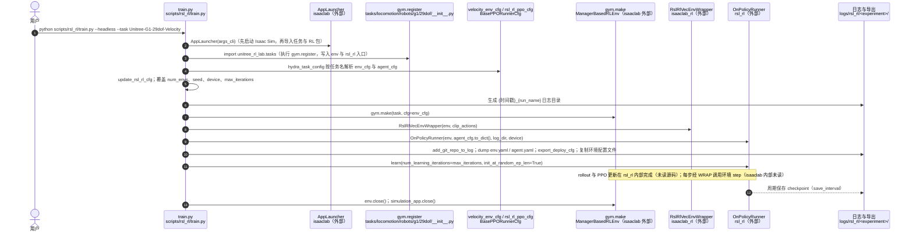

# unitree_rl_lab

**unitree_rl_lab** 在 [Isaac Lab](https://github.com/isaac-sim/IsaacLab) 之上提供 Unitree 机器人的强化学习环境；徽章显示面向 **Isaac Sim 5.1 / Isaac Lab 2.3** 一代（以仓库当时 README 为准）。

## 一句话定义

把 Go2 / H1 / G1-29dof 的官方任务环境装进 Isaac Lab 工作流，用 Lab 的 manager-based API 做并行训练，再走 MuJoCo/真机验证。

## 英文缩写速查

| 缩写 | 英文全称 | 简要说明 |
|------|----------|----------|
| Isaac Lab | NVIDIA Isaac Lab | 基于 Omniverse 的机器人学习框架 |
| Isaac Sim | NVIDIA Isaac Sim | Lab 依赖的仿真应用 |
| USD | Universal Scene Description | 资产格式；可从 HF `unitree_model` 获取 |
| URDF | Unified Robot Description Format | 可从 `unitree_ros` 引入（Isaac Sim ≥ 5.0） |
| RL | Reinforcement Learning | 强化学习 |
| Sim2Real | Simulation to Real | 仿真到真机 |

## 为什么重要

- 团队若已标准化 **Isaac Lab 2.x**，这是官方对齐入口，避免继续锁死在 Isaac Gym。
- 资产路径提供 **USD（HF）** 与 **URDF（unitree_ros）** 两套，减少「找不到机器人描述」的卡点。
- 与 gym / mjlab 形成清晰三选一，便于在 [`unitree`](./unitree.md) 枢纽做选型。

## 核心原理

| 步骤 | 说明 |
|------|------|
| 独立克隆 | 仓库放在 Isaac Lab 目录**之外** |
| 可编辑安装 | `./unitree_rl_lab.sh -i`（需已激活含 Lab 的 Python） |
| 资产 | `UNITREE_MODEL_DIR`（USD）或 `UNITREE_ROS_DIR`（URDF，推荐 Sim≥5.0） |
| 训练/推演 | 遵循仓库脚本与 Lab 惯例；官方展示 Isaac Lab / MuJoCo / Physical 对照 |

## 工程实践

1. 按 Isaac Lab 官方指南装好仿真与 Lab（徽章：**Isaac Sim 5.1 / Isaac Lab 2.3**）。
2. `git clone https://github.com/unitreerobotics/unitree_rl_lab.git` 后执行 `./unitree_rl_lab.sh -i`。
3. 配置 `source/unitree_rl_lab/.../assets/robots/unitree.py` 中的 `UNITREE_MODEL_DIR`（USD）或 `UNITREE_ROS_DIR`（URDF）。
4. 注意：GitHub [`unitree_model`](./unitree-model.md) 已 deprecated，USD 请用 Hugging Face 数据集。
5. 部署：编译 `deploy/robots/<robot>/` 的 `robot_controller`（依赖 `unitree_sdk2`）；Sim2Sim 先跑 [`unitree_mujoco`](./unitree-mujoco.md)。
6. 厂商 Lab 对照：云深处 [rl_training](./deeprobotics-rl-training.md)、直驱 [DDT_Lab](./ddt-lab.md)、ROBOTIS [cyclo_lab](./cyclo-lab.md)（偏臂/AI Worker 操作）；多厂商社区扩展见 [robot_lab](./robot-lab.md)。

## 局限与风险

- **硬件与驱动门槛高**（GPU / 驱动 / Isaac 版本矩阵）；RTX 50 系需核对 Isaac Sim 版本说明。
- 与 `unitree_rl_gym` 的任务名、观测空间**不互通**。
- 首次加载资源受网络与磁盘影响，勿在未就绪时判断「安装失败」。
- **开源状态：已开源**（Apache-2.0）。

## 源码运行时序图

官方实现 [unitreerobotics/unitree_rl_lab](https://github.com/unitreerobotics/unitree_rl_lab)（短 SHA `4960b84`）：基于 Isaac Lab 的强化学习任务库，训练入口 `scripts/rsl_rl/train.py`。任务通过 `source/unitree_rl_lab/.../robots/*/__init__.py` 中的 `gym.register` 注册，环境与 PPO 配置分别来自 `velocity_env_cfg.py` 与 `agents/rsl_rl_ppo_cfg.py`；仿真环境、包装器与 PPO 训练循环由外部包 Isaac Lab（`isaaclab`、`isaaclab_rl`）与 `rsl_rl` 提供。`deploy/` 下的 C++ 真机部署（`deploy/robots/*/main.cpp`）未纳入本图。

入口：`python scripts/rsl_rl/train.py --headless --task Unitree-G1-29dof-Velocity`

图依据：unitree_rl_lab@4960b84，读过 `README.md`（训练命令与 `unitree_rl_lab.sh` 用法）、`scripts/rsl_rl/train.py`（主流程，`AppLauncher` 与 `learn` 等调用位置）、`source/unitree_rl_lab/unitree_rl_lab/tasks/locomotion/__init__.py`、`source/unitree_rl_lab/unitree_rl_lab/tasks/locomotion/robots/g1/29dof/__init__.py`（`gym.register`）、`source/unitree_rl_lab/unitree_rl_lab/tasks/locomotion/agents/rsl_rl_ppo_cfg.py`（`BasePPORunnerCfg` 片段）。`velocity_env_cfg.py`、`export_deploy_cfg`、`hydra_task_config`、Isaac Lab 与 rsl_rl 内部实现未读。未运行代码。

## 关联页面

- [unitree_rl_gym](./unitree-rl-gym.md)
- [unitree_rl_mjlab](./unitree-rl-mjlab.md)
- [unitree_model](./unitree-model.md)
- [unitree_ros](./unitree-ros.md)
- [Unitree](./unitree.md)
- [robot_lab](./robot-lab.md)
- [Deep Robotics rl_training](./deeprobotics-rl-training.md)
- [DDT_Lab](./ddt-lab.md)
- [HumoSlope](./paper-humoslope-physics-guided-slope-locomotion.md) — 以本仓库为本体感知基线，对比陡坡专用 ZMP/BSGA 管线

## 参考来源

- [sources/repos/unitree_rl_lab.md](../../sources/repos/unitree_rl_lab.md)
- 上游：<https://github.com/unitreerobotics/unitree_rl_lab>
- [HumoSlope（arXiv:2607.07830）](../../sources/papers/humoslope_arxiv_2607_07830.md) — 论文将 Unitree RL Lab 作 proprioception-only 基线
- 源码核对（2026-11-02）：unitreerobotics/unitree_rl_lab@4960b84，读过 README.md、scripts/rsl_rl/train.py、source/unitree_rl_lab/unitree_rl_lab/tasks/locomotion/__init__.py、tasks/locomotion/robots/g1/29dof/__init__.py、tasks/locomotion/agents/rsl_rl_ppo_cfg.py（部分）；时序图依据以上文件，未运行代码。

## 推荐继续阅读

- Isaac Lab 安装指南：<https://isaac-sim.github.io/IsaacLab/>

