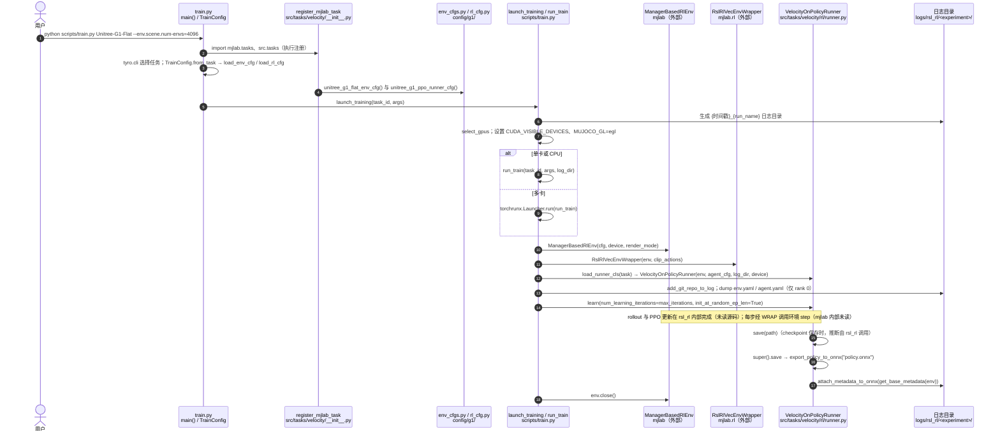

# unitree_rl_mjlab (Unitree 官方 RL 框架)

**unitree_rl_mjlab** 是由 Unitree Robotics 官方维护的强化学习训练框架，以 **mjlab**（Isaac Lab API + MuJoCo Warp）为底层，覆盖旗下 7 款机器人型号，提供从仿真训练到真机部署的完整 pipeline。

## 英文缩写速查

| 缩写 | 英文全称 | 简要说明 |
|------|----------|----------|
| Sim2Real | Simulation to Real | 把仿真中学到的策略迁移落地真机的工程主线 |
| RL | Reinforcement Learning | 通过与环境交互最大化长期回报来学习策略的范式 |
| G1 | Unitree G1 Humanoid | 宇树入门级教育科研人形平台 |
| ONNX | Open Neural Network Exchange | 跨框架神经网络模型交换格式 |
| Isaac Lab | NVIDIA Isaac Lab | 基于 Omniverse 的机器人学习训练框架 |
| API | Application Programming Interface | 应用程序编程接口 |
| MuJoCo | Multi-Joint dynamics with Contact | 接触丰富的刚体物理仿真引擎 |
| legged_gym | Legged Gym | 足式机器人 RL 训练的常用开源框架 |
| AMP | Adversarial Motion Prior | 用对抗判别约束状态转移接近专家运动分布的先验 |
| SDK | Software Development Kit | 软件开发工具包 |
| GPU | Graphics Processing Unit | 图形处理器，大规模并行仿真训练的算力基础 |
| URDF | Unified Robot Description Format | 统一机器人描述格式 |
| Locomotion | Robot Locomotion | 足式/人形等无轮移动能力的总称 |

## 为什么重要？

这是 Unitree 的**官方推荐**训练路线之一，与社区框架（legged_gym、AMP_mjlab）的关键区别：

- **官方维护**：与 Unitree SDK、ONNX 部署链路深度整合
- **多机型覆盖**：单框架支持四足（Go2）和人形（G1、H1_2、H2 等）
- **完整 Sim2Real 链路**：训练 → ONNX 导出 → C++ 编译 → 真机部署，有明确的操作步骤

## 支持机器人

Go2、A2、As2、**G1**、R1、**H1_2**、**H2**（共 7 款，含主流人形）

## 训练任务

| 任务类型 | 示例环境 |
|---------|---------|
| 速度跟踪（Velocity Tracking） | `Unitree-G1-Flat` |
| 动作模仿（Motion Imitation） | `Unitree-G1-Tracking-No-State-Estimation` |

训练规模：支持 4096 个并行环境（GPU 加速）。

## Sim2Real 部署链路

```
MuJoCo 并行训练
    ↓ ONNX 导出
C++ 控制程序编译
（cyclonedds + unitree_sdk2）
    ↓
unitree_mujoco 仿真验证
    ↓
真机部署
（以太网 192.168.123.222，调试模式）
```

关键依赖：**cyclonedds**（DDS 通信）、**unitree_sdk2**（机器人接口）。

## 与相关框架的对比

| 维度 | unitree_rl_mjlab | AMP_mjlab | legged_gym | robot_lab |
|------|-----------------|-----------|------------|-----------|
| 维护方 | Unitree 官方 | 社区 | ETH RSL | 个人 |
| 底层仿真 | mjlab（MuJoCo Warp） | mjlab | IsaacGym | IsaacLab |
| 支持机型 | Unitree 7 款 | G1 | 通用 | 26+ |
| 核心任务 | 速度跟踪 + 动作模仿 | AMP + recovery | 速度跟踪 | 速度跟踪 + AMP Dance |
| 部署链路 | ONNX → C++（官方） | ONNX | 各异 | 各异 |

**与官方其它 RL 仓的关系**：同属 [unitreerobotics](./unitree.md) 组织时，`unitree_rl_gym`（Isaac Gym）与 `unitree_rl_lab`（Isaac Lab）是并行训练入口；本仓特长是 **mjlab + 官方 ONNX→C++** 闭环。组织级仓库地图见 [sources/repos/unitree.md](../../sources/repos/unitree.md)。

**与 `unitree_ros` 的分工**：`unitree_ros` 提供 ROS1 + Gazebo8 的 URDF 与关节级仿真/控制示例（README 明确 Gazebo 不做高层行走）；`unitree_rl_mjlab` 面向当前研究常用的 **MuJoCo 并行训练 + SDK2** 部署闭环。二者同属官方开源，但中间件与仿真器代际不同，见 [unitree_ros](./unitree-ros.md)。

## 源码运行时序图

官方实现 [unitreerobotics/unitree_rl_mjlab](https://github.com/unitreerobotics/unitree_rl_mjlab)（短 SHA `1425b15`）：基于 mjlab（MuJoCo 后端）的训练与部署仓，训练入口 `scripts/train.py`（tyro 命令行）。任务在 `src/tasks/velocity/__init__.py` 中经 `register_mjlab_task` 注册，环境与 PPO 配置来自 `config/g1/env_cfgs.py` 与 `rl_cfg.py`；`VelocityOnPolicyRunner.save()` 在每次保存 checkpoint 时额外导出 `policy.onnx`（供 `deploy/` 真机部署）并写入元数据。仿真环境、包装器与 PPO 循环由外部包 mjlab 与 rsl_rl 提供，未读。

入口：`python scripts/train.py Unitree-G1-Flat --env.scene.num-envs=4096`



图依据：unitree_rl_mjlab@1425b15，读过 `README.md`（训练与回放命令）、`scripts/train.py`（`main`、`launch_training`、`run_train`）、`src/tasks/velocity/__init__.py`（`register_mjlab_task`）、`src/tasks/velocity/rl/runner.py`（`VelocityOnPolicyRunner.save`）、`src/tasks/velocity/rl/__init__.py`。`src/tasks/velocity/config/g1/env_cfgs.py`、`rl_cfg.py` 仅由注册处引用，内部参数未读；mjlab、rsl_rl 内部未读。`save` 的调用方为推断。未运行代码。

## 关联页面

- [mjlab](./mjlab.md) — 底层框架（Isaac Lab API + MuJoCo Warp）
- [Unitree](./unitree.md) — 品牌主页
- [unitree_ros](./unitree-ros.md) — 官方 ROS1 / Gazebo URDF 与关节仿真栈（与本书 MuJoCo 主线对照）
- [Unitree G1](./unitree-g1.md) — 主要人形目标机型
- [AMP_mjlab](./amp-mjlab.md) — 同基于 mjlab 的社区 AMP 实现
- [legged_gym](./legged-gym.md) — 同类框架，基于 IsaacGym
- [Locomotion](../tasks/locomotion.md) — 任务方向
- [Query：视频里的舞蹈怎么搬到 G1？](../queries/g1-video-dance-gvhmr-gmr-beyondmimic-multi-motion.md) — 在 unitree_rl_mjlab 上训 G1 舞蹈追踪策略的完整链路与多动作扩展

## 参考来源

- [sources/repos/unitree_rl_mjlab.md](../../sources/repos/unitree_rl_mjlab.md)
- [unitreerobotics/unitree_rl_mjlab GitHub Repo](https://github.com/unitreerobotics/unitree_rl_mjlab)
- 源码核对（2026-11-02）：unitreerobotics/unitree_rl_mjlab@1425b15，读过 README.md、scripts/train.py、src/tasks/velocity/__init__.py、src/tasks/velocity/rl/runner.py、src/tasks/velocity/rl/__init__.py；时序图依据以上文件，未运行代码。
