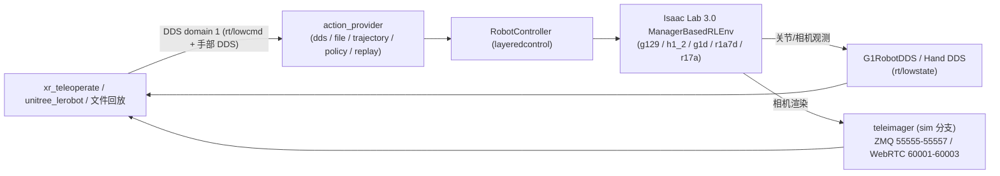
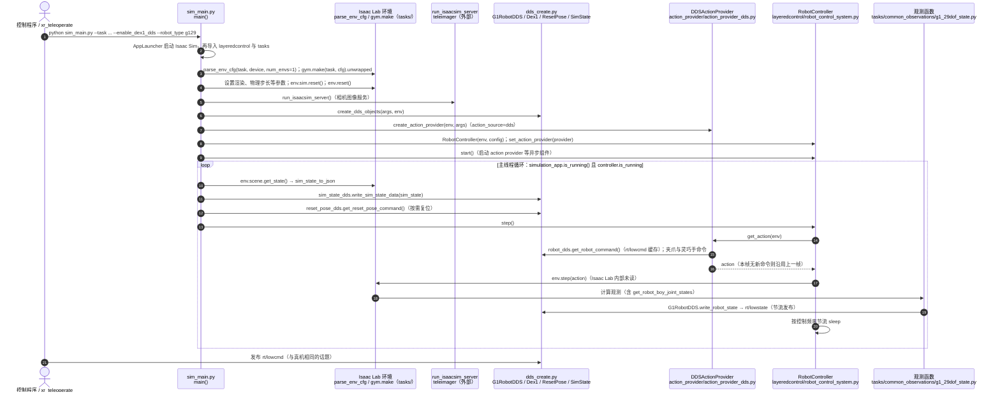

# unitree_sim_isaaclab

**unitree_sim_isaaclab** 基于 Isaac Lab，为 Unitree **G1 / H1-2**（夹爪、Dex3、Inspire 等执行器组合）提供多任务仿真，服务数据采集、回放、生成与策略验证。

## 一句话定义

「长得像真机 DDS」的 Isaac Lab 仿真场——XR 遥操作或策略节点不用改话题就能在仿真里采数/验模型。

## 英文缩写速查

| 缩写 | 英文全称 | 简要说明 |
|------|----------|----------|
| Isaac Lab | NVIDIA Isaac Lab | 仿真与学习框架 |
| DDS | Data Distribution Service | 与真机同构通信 |
| XR | Extended Reality | 常经 xr_teleoperate 接入 |
| DoF | Degrees of Freedom | 如 G1-29dof |
| IL | Imitation Learning | 采数下游用途 |
| Sim2Real | Simulation to Real | 仿真到真机 |

## 项目时间边界

官方仓库在 **2025-06-24** 的代码提交已包含实现，本路线将其标为「代码历史起点」；这不证明正式首发或首次公开日，也不表示当日已具备本页介绍的全部现有功能。提交证据见 [原始仓库时间核对](../../sources/repos/unitree_sim_isaaclab.md)。

## 为什么重要

- 解决「没真机 / 真机档期不足」时的人形操作数据瓶颈。
- **Wholebody** 任务名表示可移动操作，不仅是固定基座桌面。
- 与 [`unitree_rl_lab`](./unitree-rl-lab.md) 同属 Isaac 生态，但本仓侧重 **遥操作采数与任务场景**，不是 locomotion RL 环境包。

## 核心原理

| 要点 | 说明 |
|------|------|
| 通信 | 启动后收发与真机相同 DDS 主题（domain 1） |
| 机型×末端 | `g129`（Dex1/Dex3/Wholebody）、`h1_2`、`g1d`（Dex1/Dex3）、`r1a7d`（Dex1/Dex2-5）、`r17a`（Dex1/Dex2-5/LinkerHand O6） |
| 任务示例 | `Isaac-PickPlace-Cylinder-G129-*-Joint`、`Isaac-Move-Cylinder-G129-Dex1-Wholebody`、`Isaac-Stack-RgyBlock-R17A-O6-Joint` |
| 数据增强 | `--replay_data` + `--generate_data` + `--modify_light` / `--modify_camera` 重采集多样视觉数据 |
| 权重 | 仓库提供的权重**仅供仿真测试** |

## 工程实践

1. 默认主分支已升级至 **Isaac Sim 6.2.0 / Isaac Lab 3.0.0**（Python 3.12、PyTorch 2.11.0 `cu130`，可用 `bash auto_setup_env.sh` 一键装配）；若用 Isaac Sim 4.5 / 5.0 / 5.1 需切到 `IsaacSim5.1.0` 分支。
2. 与 [`xr_teleoperate`](./xr-teleoperate.md) 联用采数；图像经 `teleimager`（`sim` 分支）ZMQ/WebRTC 发布，DDS 用法对照 SDK2 Python G1 与 Dex3 示例。
3. 同网有真机时必须隔离（DDS domain 1），防止仿真节点误控实机。
4. 首启加载慢属预期（URDF 自动转 USD 并缓存到 `assets/robots/.urdf_cache/`）；Docker/无头模式使用 `--no_render` 启 WebRTC livestream。

## 局限与风险

- 仿真权重 ≠ 真机可部署策略。
- GPU/Isaac 版本矩阵变化快，以 README「Important Notes」为准。
- 执行器（夹爪 vs 多指手）与 [`unitree_lerobot`](./unitree-lerobot.md) 转换脚本必须一致。

## 源码运行时序图

官方实现 [unitreerobotics/unitree_sim_isaaclab](https://github.com/unitreerobotics/unitree_sim_isaaclab)（短 SHA `e30c25b`）：基于 Isaac Lab 的仿真程序，主入口 `sim_main.py`。主线程循环中 `RobotController.step()` 向环境下发动作；动作来自 `action_provider`（默认 `action_source=dds`，即 `DDSActionProvider` 读取 DDS 缓存的 `rt/lowcmd`）。关节状态由观测函数 `tasks/common_observations/g1_29dof_state.py` 中的 `get_robot_boy_joint_states` 节流后发布到 `rt/lowstate`，与真机使用同一套 DDS 话题。

入口：`python sim_main.py --device cpu --enable_cameras --task Isaac-PickPlace-Cylinder-G129-Dex1-Joint --enable_dex1_dds --robot_type g129`

图依据：unitree_sim_isaaclab@e30c25b 及 @84a15e5（2026-11-21 复核），读过 README.md（Isaac Lab 3.0 / Sim 6.2、机型参数与 DDS 主题表）、sim_main.py（`main` 主流程与 CLI 参数）、layeredcontrol/robot_control_system.py（部分）、action_provider/action_provider_dds.py（部分）、dds/dds_create.py（部分）、dds/g1_robot_dds.py（部分）、tasks/common_observations/g1_29dof_state.py（部分）。未运行代码；Isaac Lab 的 `env.step` 与观测管理器内部未读，`action_source` 的其它取值（file / trajectory / policy / replay / dds_wholebody）未画。

## 关联页面

- [Manipulation](../tasks/manipulation.md) — PickPlace 等仿真任务需要对齐末端配置、动作频率与物体成功条件。

- [xr_teleoperate](./xr-teleoperate.md)
- [unitree_lerobot](./unitree-lerobot.md)
- [unitree_rl_lab](./unitree-rl-lab.md)
- [Teleoperation](../tasks/teleoperation.md)
- [Unitree](./unitree.md)

## 参考来源

- [sources/repos/unitree_sim_isaaclab.md](../../sources/repos/unitree_sim_isaaclab.md)
- 上游：<https://github.com/unitreerobotics/unitree_sim_isaaclab>
- 源码核对（2026-11-02）：unitreerobotics/unitree_sim_isaaclab@e30c25b，读过 README.md、sim_main.py（部分）、layeredcontrol/robot_control_system.py（部分）、action_provider/action_provider_dds.py（部分）、dds/dds_create.py（部分）、dds/g1_robot_dds.py（部分）、tasks/common_observations/g1_29dof_state.py（部分）；时序图依据以上文件，未运行代码。

## 推荐继续阅读

- 仓内中文 README：`README_zh-CN.md`

