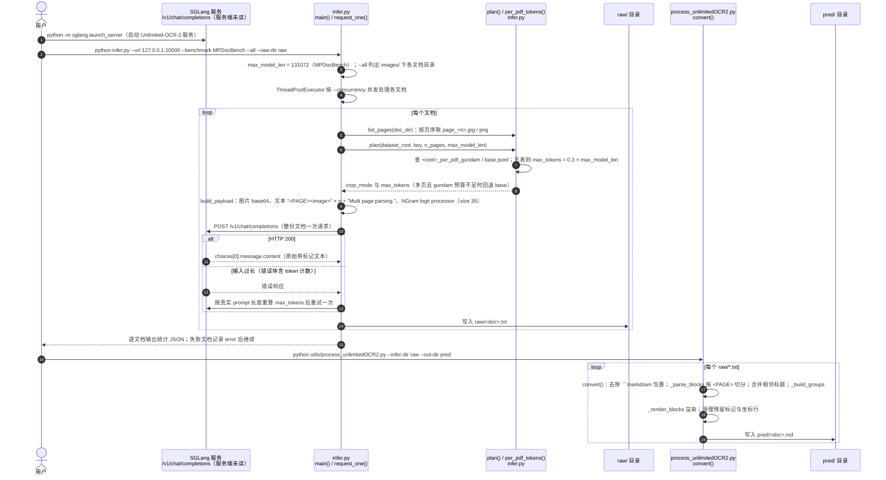

# Unlimited OCR Works 2

Unlimited OCR Works 2 是百度发布的长文档解析模型，使用稀疏引用滑动窗口注意力处理跨页上下文，可作为论文、手册等资料入库的文档解析工具。

## 英文缩写速查

| 缩写 | 英文全称 | 简要说明 |
|------|----------|----------|
| OCR | Optical Character Recognition | 光学字符识别 |
| SR-SWA | Sparse Reference Sliding Window Attention | 稀疏引用滑动窗口注意力 |
| PDF | Portable Document Format | 常见文档输入格式 |

## 核心机制

官方 README 称，SR-SWA 将超长序列的文本与视觉注意力交互压缩为固定数量的工作引用（例如 512 token），以控制解码阶段的计算与内存增长。多页输入按页序组成一个请求，模型可利用跨页上下文，并输出与输入对应的页面标记。作者报告在 MPDocBench 和 MarathonDocBench 的长文档评测中取得领先结果；具体指标与比较条件应以技术报告为准。

## 工程实践与局限

| 项目 | 内容 |
|------|------|
| 机构 | 百度（Baidu） |
| 代码 | [官方仓库](https://github.com/baidu/Unlimited-OCR)；仓库标注 MIT |
| 权重 | [Hugging Face](https://huggingface.co/baidu/Unlimited-OCR-2)；模型卡本次未能访问，许可与实际可用性需另核 |
| 推理 | Transformers 支持 `infer_multi` 和 `infer`；SGLang 提供服务化与分窗口配置 |
| 验证 | README 的测试环境为 A800 80GB；实际显存需求和解析质量需以目标文档实测 |
| 开放范围 | 仓库提供推理与评测客户端、后处理工具；完整训练代码及数据开放情况尚未核实 |

文档解析输出仍需核对公式、表格和跨页顺序，尤其在将结果作为 [知识库资料](../references/llm-wiki-karpathy.md) 输入时。与 [TeleOCR](./paper-teleocr.md) 比较时，应分别测试长文档跨页一致性与拍摄退化文档表现，不能仅比较不同基准上的总体分数。

## 源码运行时序图

官方仓库 [baidu/Unlimited-OCR](https://github.com/baidu/Unlimited-OCR)（短 SHA `ea42e6d`）中可运行的代码是两段脚本：`infer.py` 把整份文档（按页序的整组页面图）作为一次请求发给 SGLang 服务，原始输出写入 `raw/<doc>.txt`；`utils/process_unlimitedOCR2.py` 的 `convert()` 把带 `<PAGE>` / `<BLOCK>` 标记的原始输出转换为 Markdown。模型推理本身在 SGLang 服务端完成（权重 `baidu/Unlimited-OCR-2`，服务端内部未读），仓库内不含服务端实现。

入口：先启动服务 `python -m sglang.launch_server --model-path baidu/Unlimited-OCR-2 ...`，再运行 `python infer.py --url 127.0.0.1:10000 --benchmark MPDocBench --dataset-root <root> --all --raw-dir raw --concurrency 4`，最后 `python utils/process_unlimitedOCR2.py --infer-dir raw --out-dir pred`

图依据：unlimited-ocr-2 对应仓库 baidu/Unlimited-OCR@ea42e6d，读过 `README.md`（推理与服务启动命令、`infer_multi` 示例）、`infer.py`（模块说明、`plan`、`build_payload`、`request_one`、`main`）、`utils/process_unlimitedOCR2.py`（文件头说明、`convert`、`main` 的参数，部分）。README 中 Transformers 的 `infer_multi` 调用在 Hugging Face 模型端的远程代码中，仓库内未包含，未读；`_parse_blocks` 等内部函数只读了签名与片段，渲染细节未逐行核对。未运行代码。

## 关联页面

- [OXR](./somark-oxr.md)（可替换版面分析的文档解析模型）

- [TeleOCR](./paper-teleocr.md)
- [LLM Wiki](../references/llm-wiki-karpathy.md)

## 参考来源

- [Unlimited OCR 仓库归档](../../sources/repos/unlimited-ocr-2.md)
- 源码核对（2026-11-02）：unlimited-ocr-2 → baidu/Unlimited-OCR@ea42e6d，读过 README.md、infer.py、utils/process_unlimitedOCR2.py（部分）；时序图依据以上文件，未运行代码。

## 推荐继续阅读

- [官方 README 与技术报告](https://github.com/baidu/Unlimited-OCR)
