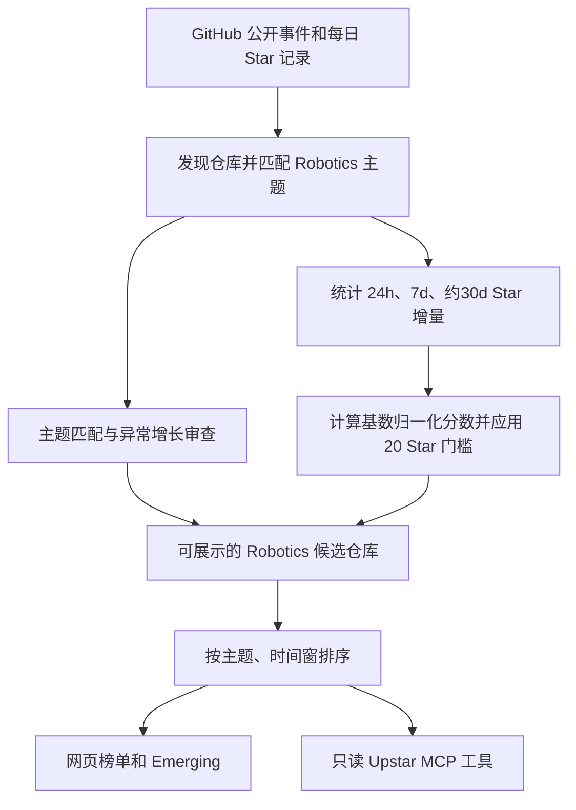

# Upstar Robotics — GitHub 机器人项目热度发现榜

## 一句话定义

[Upstar Robotics](https://upstar.dev/t/robotics) 是按照 **GitHub Star 增长速度**、而非累积总 Star，对 Robotics 主题开源仓库进行动态排名的项目发现工具，提供不同时间窗、Emerging 和只读 MCP 接口。

## 英文缩写速查

| 缩写 | 英文全称 | 简要说明 |
|---|---|---|
| API | Application Programming Interface | 通过机器可读接口访问公开排名与仓库资料 |
| MCP | Model Context Protocol | Upstar 提供 Streamable HTTP 服务，供 AI 客户端检索榜单 |
| UTC | Coordinated Universal Time | GitHub Star 每日统计的时间基准 |
| ROS | Robot Operating System | Robotics 主题描述明确覆盖的机器人软件生态 |

## 为什么重要

- **发现新项目：** 小仓库在短窗口内增长明显时，不会被累积 Star 巨大的传统项目天然挤到后面。
- **与静态策展互补：** [Physical AI 资源地图](./awesome-physical-ai-natnew.md) 按工程能力组织已筛选资源；Upstar 提供新仓库的时效性线索。
- **可复核的数据入口：** 排名方法、过滤规则和计算时间由官方公开；MCP 读取数据时可保留计算时间，利于按周人工复核。

## 核心原理

官方 [How trending works](https://upstar.dev/how-trending-works) 定义主题内相对增速分数：

`score = stars_gained / sqrt(max(stars_before, 100))`

其中 `stars_gained` 是所选时间窗（24 小时 / 7 天 / 约 30 天）新增 Star，`stars_before` 是窗口开始前 Star 总数；至少新增 **20 Star** 才能进入相应排行。24 小时增量基于 GitHub UTC 日计数估算，不能误读为精确小时数据。

**Emerging** 与普通增长榜不同：仓库需在一周前不足 1,000 Star，创建至少 30 天，本周增量至少 20 Star，并达到此前 8 周周增长中位数（按最低 10 Star 处理）的两倍。主题分类与异常增长信号另有规则及 AI/人工复核，不意味着排名本身证明项目质量。

### 流程总览

此图为官方公开排名与数据访问机制的**逻辑概览**，不是未经公开的服务端代码调用图。

## 工程实践

1. 打开 [Robotics 榜](https://upstar.dev/t/robotics)，先比较 7 天与 30 天排名，再用 [Emerging](https://upstar.dev/t/robotics?p=emerging) 发现加速的小型仓库。
2. 对候选项目记录**查询日期、窗口、官方 GitHub 地址**；只把榜单当发现线索，不把动态 Star 数写成不带日期的恒定指标。
3. 回到每个项目的 GitHub README、论文/技术报告、代码入口、许可证和最近提交核实，按研究主题分别判断是否入库。
4. 支持 MCP 的客户端可以使用官方公开端点 `https://upstar.dev/mcp`；官方列出 `topic_ranking`、`emerging`、`get_repo` 等只读工具，响应包含数据更新时间。
5. 对本知识库已有的项目先按标题、论文编号、官方仓库地址查重，再更新原节点；不要因为同一项目再次上榜而创建重复实体。

### 源码运行时序图

**不适用。** 已核查的 Upstar 官方页面提供托管榜单与公开 MCP 服务，但未列出可供验证运行路径的 Upstar 服务端源代码仓库；不能把第三方上榜仓库的运行时序冒充 Upstar 的源码分析。

## 局限与风险

- **热度不等于质量：** Star 增长不能代表论文结论、真机性能、可靠性或安全性，必须审阅一手项目资料。
- **分类与筛选有误差：** 主题规则和 AI 复核可能造成漏收、延迟展示；异常 Star 增长可能被隐藏。
- **时间窗与估算误差：** 榜单按小时重算，但 24 小时 Star 增量是估算；应标注数据更新时间。
- **开放边界：** 榜单、MCP 可公开访问，但截至 2026-11-18 在已核查官方页面未发现 Upstar 自身可运行源码入口；官方亦限制批量复制或转售排名数据。

## 关联页面

- [awesome-physical-ai（natnew）](./awesome-physical-ai-natnew.md) — 工程导向、按技术类别策展的资源地图
- [awesome-physical-ai（aichr）](./awesome-physical-ai-aichr.md) — 另一套 Physical AI 开源资源组织方式
- [Physical AI 技术地图](../overview/awesome-physical-ai-technology-map.md) — 对已发现资源做长期知识归类
- [VLA](../methods/vla.md) — 对榜单中的视觉语言动作研究归类后再深读
- [运动任务](../tasks/locomotion.md) 与 [操作任务](../tasks/manipulation.md) — 将上榜项目分别归到任务知识主线

## 参考来源

- [Upstar Robotics 官方站点及方法归档](../../sources/sites/upstar-robotics.md)
- [Upstar 官方排名方法](https://upstar.dev/how-trending-works)
- [Upstar 官方 MCP 文档](https://upstar.dev/mcp)

## 推荐继续阅读

- [Upstar Robotics 动态榜](https://upstar.dev/t/robotics)
- [Upstar 官方 About 与使用说明](https://upstar.dev/about)
