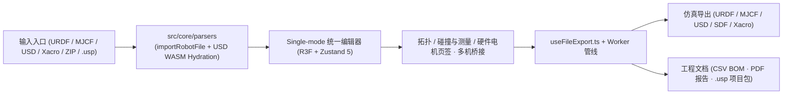
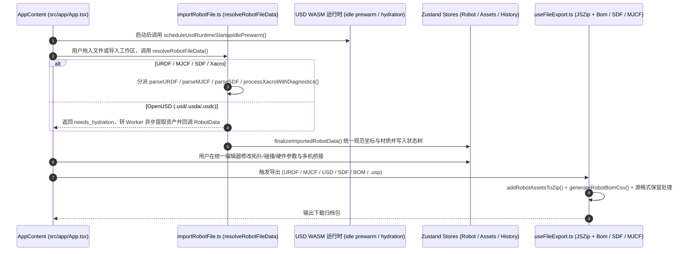

# URDF-Studio

## 一句话定义

**URDF-Studio**（`OpenLegged/URDF-Studio` v2.0.0）是以 Apache-2.0 开源的 **浏览器端统一模式机器人设计与组装工作站**，把运动树拓扑、碰撞/视觉/惯量微调、电机硬件 BOM、多机桥接与 **URDF / MJCF / USD / SDF / Xacro** 往返导出整合进 React Three Fiber 交互画布。

## 英文缩写速查

| 缩写 | 英文全称 | 简要说明 |
|------|----------|----------|
| URDF | Unified Robot Description Format | 统一机器人描述格式 |
| BOM | Bill of Materials | 物料清单，硬件零部件与电机选型列表 |
| AI | Artificial Intelligence | 人工智能（可选接入 OpenAI / Gemini 助手） |
| MJCF | MuJoCo XML Format | MuJoCo 的模型与场景描述格式 |
| USD | Universal Scene Description | OpenUSD 场景描述格式；仓内附 WASM 运行时支持 |
| CAD | Computer-Aided Design | 计算机辅助设计，硬件结构建模 |
| SDK | Software Development Kit | 软件开发工具包（`@urdf-studio/react-robot-canvas`） |

## 为什么重要

- **弥合「静态 XML 预览器」与「重型桌面 CAD/Sim」的断层：** 手工编辑 URDF/MJCF 的 `<origin rpy>`、惯量矩阵与多文件资产路径极易出错；URDF-Studio 既提供可视化变换手柄、碰撞简化工具与实时源码编辑（Monaco Editor），又能直接打包多格式工程包（`.usp`/ZIP）。
- **面向真实硬件采买与多引擎协同：** 将电机型号、减速比、阻尼、摩擦绑定到关节属性并一键导出 CSV BOM，同时用内置 USD WASM 运行时与 MJCF 规范化导出解决跨仿真器迁移痛点。
- **模块化可嵌入式设计：** 不仅有独立工作站应用（`urdf-studio@2.0.0`），还将 3D 视口抽象为可发布包 `@urdf-studio/react-robot-canvas@0.1.0`，支撑外部广场如 [BotWorld](./botworld.md) 原生嵌入。

## 核心原理与模块架构

根据仓库 `v2.0.0` 架构设计，系统严格遵循 **`app -> features -> store -> shared -> core -> types`** 单向依赖边界，将纯解析/序列化逻辑（`src/core` 无 React 依赖）与前端 UI 彻底隔离：

- **Single-mode 统一编辑器（`src/features/editor` & `urdf-viewer`）：** v2.0.0 将早期分离视图合并为单模式统一工作站，在同一工作区内通过页签协同操作 **Topology（连杆/关节运动树）**、**Geometry/Collision/Measurements（碰撞体生成、简化、对齐）** 与 **Hardware Configuration（电机参数与硬件元数据）**。
- **Multi-robot Assembly（`src/features/assembly`）：** 允许向同一工作区导入多台机器人或末端附件并通过“桥接关节（bridge joint）”组装验证。
- **Multi-format IO & WASM USD（`src/core/parsers` & `src/app/hooks/useFileExport.ts`）：** 纯前端解析 URDF / MJCF / Xacro / SDF，通过后台 Worker 对 USD 做 hydration，并在导出时支持“源格式保留（Source-preserving export）”、自动剥离 URDF 不支持的闭链约束提示及打包 STL/贴图资源。
- **可选 AI Assistant（`src/features/ai-assistant`）：** 支持自然语言生成结构、可配置准则自动巡检与导出 PDF/CSV 巡检报告；未配置 API Key 时自动静默关闭，核心编辑器仍 100% 可用。

## 源码运行时序图

以 `OpenLegged/URDF-Studio`（v2.0.0）主入口 `src/app/App.tsx`、多格式解析分派 `src/core/parsers/importRobotFile.ts` 与打包导出 `src/app/hooks/useFileExport.ts` 为核对入口：

图依据：`OpenLegged/URDF-Studio`（v2.0.0）`README.md`、`src/app/App.tsx`、`src/core/parsers/importRobotFile.ts`（756 行）与 `src/app/hooks/useFileExport.ts`（725 行，2026-11-28 通读）。

## 工程实践

- **与其他上游工具串联：** [step2urdf](./step2urdf.md) 擅长直接吃 **STEP 装配体** 做几何关节初提；建议工作流为 **`FreeCAD → STEP → step2urdf 初版 URDF → URDF-Studio 精修碰撞/硬件 BOM → 多格式导出至 MuJoCo/Isaac`**。
- **源码调试与 BYOK 安全边界：** 仓内 `.env.<mode>` 用于公开配置；个人测试 OpenAI / Gemini 密钥仅可置于 `.env.<mode>.local`（被 Vite 注入前端浏览器运行时，切勿用于托管环境密钥存储）。
- **闭链导出提示：** 编辑含 MJCF 闭链或非树状约束的模型并导出 URDF 时，注意检查 `stripClosedLoopConstraintsForUrdfExport` 剥离告警，必要时保持以 MJCF/SDF 为下游真值格式。

## 局限与风险

- **无原生 STEP/B-rep 建模内核：** 不直接解析参数化机械 STEP 装配体；机械件设计仍需依赖 [FreeCAD](./freecad.md) 等上游 CAD 或先转 STEP → STL/URDF 后再导入编辑。
- **格式转换不等价：** 虽然支持 URDF ↔ MJCF ↔ USD ↔ SDF 互转，但不同引擎的执行器增益、隐式阻尼、默认接触求解器参数无法无损映射，跨引擎迁移后仍须按 [格式对比](../comparisons/urdf-vs-mjcf-vs-sdf-vs-openusd.md) 检查仿真行为。
- **非高压物理训练环境：** 内置视图专注结构装配与轻量可视化校验，大规模 PPO/WBC 验证应导出包后交回 Isaac Lab / MuJoCo 原生环境。

## 关联页面

- [robot-viewer](robot-viewer.md) (模型快速预览)
- [robot-explorer](robot-explorer.md) (运动学分析)
- [URDD（Beyond URDF）](./paper-urdd-universal-robot-description-directory.md)（把 URDF 派生几何/拓扑落盘的预处理层；与本页「编辑 URDF」上下游衔接）
- [open-source-humanoid-hardware](open-source-humanoid-hardware.md) (开源硬件参考)
- [Articraft](./articraft.md)（agent + SDK + harness：可关节 3D 仿真资产生成，与 URDF/网格下游对照）
- [文字生成 CAD（Text-to-CAD）](../concepts/text-to-cad.md)（自然语言 → STEP 等上游几何与机器人描述衔接）
- [CAD Skills](./cad-skills.md)（Agent Skills：build123d→STEP→URDF/SRDF/SDF CLI 规约；与本页 Web GUI 对照）
- [GenCAD](./gencad.md) / [GenCAD-3D](./gencad-3d.md)（图像 / 点云 / 网格 → CAD program 的逆向工程上游，输出可推入 Part Studio，再经 URDF-Studio 转 URDF/MJCF/USD）
- [Tnkr](./tnkr.md)（开源整机项目仓库：CAD 装配流、电气文档与部署数据闭环）
- [step2urdf](./step2urdf.md)（STEP→URDF 浏览器转换，CAD 导入上游）
- [StackForce](./stackforce.md)（URDF 网页建模 / CAD2URDF / MJLab 训练工程向导）
- [BotWorld](./botworld.md)（机器人资产广场与 URDF Studio 统一 Web 入口）
- [机器人描述目录选型](../comparisons/robot-description-catalogs.md) — 现成开源 URDF/MJCF 从哪下载
- [robot_descriptions.py](./robot-descriptions-py.md)
- [Robot Model Description and Asset Integration · 机器人模型描述与资产接入](../methods/robot-model-description-workflow.md)：提供 Web 端可视化编辑运动树、惯性属性及导出 URDF/MJCF/USD/SDF 的完整机器人模型描述工作流。
- [Robot Simulation Integration · 机器人仿真环境集成](../methods/robot-simulation-integration.md)：将设计并校验后的机器人描述文件与执行器元数据一键适配至 Isaac Lab、MuJoCo 等仿真环境。

## 参考来源

- [URDF-Studio 原始资料（含 v2.0.0 源码通读）](../../sources/repos/urdf-studio.md)
- [URDF-Studio GitHub 仓库](https://github.com/OpenLegged/URDF-Studio)

## 推荐继续阅读

- URDF-Studio 在线演示：<https://urdf.enkeebot.com/>
- `@urdf-studio/react-robot-canvas` 复用包（见仓库 `packages/react-robot-canvas`）
- [机器人建模与数字孪生纵深路线](../../roadmap/depth-robot-modeling-digital-twin.md) — Stage 2 描述格式与资产管线
