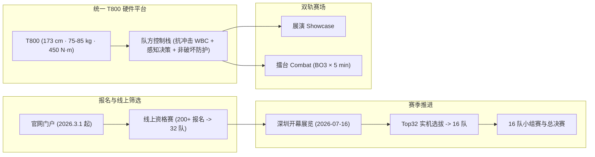

# URKL（Ultimate Robot Knock-out Legend · EngineAI 人形格斗联赛）

**URKL** 是深圳 **众擎机器人（ENGINEAI）** 发起并主办的 **全尺寸人形机器人自由格斗联赛**：全球高校、企业与科研队伍在 **同一 EngineAI T800 统一底盘** 上比拼运动控制、抗冲击平衡、视觉感知与战术决策算法，赛制设为 **展演（Exhibition Showcases）+ 擂台竞技（Combat Competition）** 双轨；2026 年 7 月于深圳南山文体中心完成开幕展览赛，冠军奖励约 **1000 万元** 纯金腰带。

## 一句话定义

**以标准化 EngineAI T800 全尺寸人形为统一物理底盘，把高冲击对抗打造成比拼运控平衡与感知决策的商业格斗联赛、耐久极限验证场及具身技术生态入口。**

## 英文缩写速查

| 缩写 | 英文全称 | 简要说明 |
|------|----------|----------|
| URKL | Ultimate Robot Knock-out Legend | EngineAI 发起的全球全尺寸人形格斗联赛简称 |
| BO3 | Best of Three | 报道正赛采用的三局两胜赛制（每局净比赛 5 min） |
| DoF | Degrees of Freedom | 自由度；T800 按版本覆盖 25、29+14=43 与 32+14=46 DoF |
| PMSM | Permanent Magnet Synchronous Motor | T800 关节驱动采用的永磁同步电机（配合交叉滚子轴承） |
| WBC | Whole-Body Control | 格斗对打中的双足抗冲击平衡与全身攻防协同控制 |
| SDK | Software Development Kit | T800 Open Source / Pro / Max 版本支持的二次开发接口 |

## 为什么重要

- **「统一硬件、算法定胜负」的联赛范式：** 不同于允许无限制改造硬件的传统破坏性机甲赛，URKL 强制使用标准化 **T800** 平台、禁止暴力硬件改装，将竞争焦点收束至 [双足运动控制](../tasks/humanoid-locomotion.md)、跌倒起身与对抗感知。
- **与 VR 遥操路线的产业对照：** 相较西方以人类 VR pilot 为主力的 [REK](./rek.md)，URKL 主打机器侧算法与「体能 × 智能」闭环（官方 FAQ 亦将实时感知、躲闪、反制定位为具身 AI 核心挑战），与学术多智能体工作 [RoboStriker](./paper-notebook-robostriker.md) 共享技术议题但面向真实商业交付。
- **极限耐久与能源约束测试：** 实机对抗中出现的剧烈冲击、快速恢复、倒地 10 s 自主起身及「局内禁止换电」设定，直接倒逼高扭矩关节散热与固态电池 3–5 h 级长时输出能力，支撑 [人形拳击纵深路线](../../roadmap/depth-humanoid-boxing.md) 评估。
- **硬件分层开放与开源承诺：** T800 细分 Basic 至 Max 四档 SKU 以隔离展示用途与开发者二次开发权限，且官方 FAQ Q5 公开承诺「将开源本届赛事相关代码」（仓库链接仍在等待公布）。

## 核心原理

### 赛制与评分结构（第一方与第三方交叉核对）

| 维度 | 核对要点 |
|---|---|
| **赛事双轨** | 官网英文门户明确区分 **Exhibition Showcases（展演）** 与 **Combat Competition（竞技）** 双轨 |
| **硬件限制** | 统一 **EngineAI T800** 平台，禁止破坏性/暴力硬件改装，仅允许运控平衡、感知决策与非破坏性结构防护 |
| **单局约束（媒体报道）** | **BO3**（每局净时 **5 min**）；倒地 **10 s** 内自主起身，超时使用 `manual reset`（每场限 **2 次**）；赛中禁止更换电池 |
| **评分四维度（媒体梳理）** | 有效击打、身体稳定性、防守/闪避能力、整体耐久（开幕战报道 *White Eagle* vs *Bullfighter* 五局 `3–2` 为现场展览赛） |

### EngineAI T800 四版本规格对照（官网 `t800_site.txt` 全文核对）

T800 全系共通物理指标：**173 cm** 身高、**75–85 kg** 整备质量、**450 N·m** 峰值关节力矩、**PMSM** 电机 + 交叉滚子轴承、腿部主动散热、固态电池 **3–5 h** 续航、最大步速 **≥ 2 m/s** 与 **8 核 CPU**；产品页脚注 `[8]` 明确限为民用（civilian use only）。

| 版本（Edition） | 自由度（DoF） | 算力配置 | 传感 / 通信 / 二次开发 |
|---|---|---|---|
| **BASIC EDITION** | **25 DoF** | Orin NX 16G | 无 3D LiDAR；不支持二次开发 SDK |
| **OPEN SOURCE EDITION** | **25 DoF** | AGX Orin 64G（可升级 Thor） | 配备 3D LiDAR；支持二次开发 SDK |
| **PRO EDITION** | **29 + 14 = 43 DoF**（含双 7-DoF 触觉灵巧手，负载 5 kg） | AGX Orin 64G（可升级 Thor） | 配备 3D LiDAR + 触觉灵巧手；支持二次开发 SDK |
| **MAX EDITION** | **32 + 14 = 46 DoF**（含双 7-DoF 触觉灵巧手） | AGX Orin 64G（可升级 Thor） | 在 PRO 基础上新增 **5G** 模块；支持二次开发 SDK |

### 赛季里程碑与「体能 × 智能」工程读法

- **「体能」侧：** 在高速位移、转身、出拳与受击外力干扰下保持不倒，依赖 PMSM + 交叉滚子轴承高刚度传动与腿部主动散热支撑连续对抗。
- **「智能」侧：** 官方 FAQ 强调格斗真正瓶颈在于真实碰撞下的 **快速感知 → 锁定与距离预判 → 攻防躲闪 → 跌倒恢复** 全闭环，而非孤立挥拳演示。
- **激励与商业化：** 报道设立约 **10 kg 纯金腰带**（约 1000 万元 RMB）、前 16 名赠整机、前 8 队员获 EngineAI 招聘快通道，并围绕赛事 IP、城市合作、赞助与机甲商用构建商业模型。

## 源码运行时序图

**不适用** — 经全文核查 EngineAI 官方英文赛事页（`urkl_site.txt`）、T800 产品页（`t800_site.txt`）与官方公众号 FAQ 全文（`2026-07-24`），**URKL** 现阶段为**商业格斗赛事平台与商用硬件 SDK 生态**，无公开可用的端到端源码仓库。尽管官方 FAQ Q5 明确表态「赛事组委会将开源本届赛事相关代码」，但截至核对日官网门户（`Online Qualifiers COMING SOON`）及 FAQ 均未附带任何 GitHub / 仓库链接；而 T800 的 `Open Source Edition` / `Pro` / `Max` 属于提供**商业二次开发 SDK** 的硬件交付版本，不等同于公开开源训练与控制器代码库。

## 工程实践

- **硬件选型边界：** 参赛与二次开发需选用 `Open Source`、`Pro` 或 `Max` 版本以获取 **3D LiDAR**、**AGX Orin 64G（可升 Thor）** 及官方 SDK 授权；`Basic Edition` 缺乏 LiDAR 与二次开发支持，不适合算法自研团队。
- **赛场控制优先项：** 在 450 N·m 峰值力矩与局内禁换电约束下，工程优先级依次为：抗冲击全身姿态稳定（[BeyondMimic](../methods/beyondmimic.md) / RL WBC 参考方向）、10 s 内自主起身状态机、跌倒保护降载及限次 `manual reset` 战术编排。
- **与遥操任务关系：** 尽管 URKL 主叙事指向机载自主/队方智能算法，现场高动态全身打击与防护策略常需借力 [Teleoperation](../tasks/teleoperation.md) 示范与 [全身移动操作](../tasks/loco-manipulation.md) 的下肢-上肢协同解耦方法，且第一方尚未完全公开开幕战的自主/干预边界比例。

## 局限与风险

- **英文门户信息滞后与规则细则缺口：** 官网英文页（`urkl_site.txt`）长期停留在 `2026.3.1` 锚点、`Online Qualifiers COMING SOON` 及失效倒计时（`-126 天`），完整裁判计分权重 PDF 与资格赛提交规范仍待官方补全。
- **开源代码仓库尚未落地：** 官方 FAQ Q5 的赛事代码开源承诺目前仅有文字宣称而无具体 URL，无法评估其包含的是仿真环境、基础运控基线还是完整对抗策略。
- **开幕战控制模式与第三方信源边界：** 独立导读站 [urkl.org](../../sources/sites/urkl-org.md) 明确提醒其自身为 `Independent fan guide` 而非 EngineAI 官网镜像，且第一方材料尚未逐场明确开幕战自主运行与场边人工干预的实际占比。
- **高冲击安全与合规限制：** T800 产品页脚注 `[8]` 限定民用并禁止危险改装；真实 75–85 kg 金属躯干在对抗中的碰撞冲击对赛场围栏距离、无线急停与结构件维护成本提出严格要求。

## 与其他页面的关联

- [REK](./rek.md) — 以 VR 真人 pilot 为核心的海外人文娱格斗联赛对照
- [RoboStriker](./paper-notebook-robostriker.md) — 自主人形拳击多智能体强化学习研究基线
- [Humanoid Locomotion](../tasks/humanoid-locomotion.md) — 双足抗扰步态与受击稳定核心任务
- [Loco-Manipulation](../tasks/loco-manipulation.md) — 下盘站立与上肢攻防协同全身控制
- [Teleoperation](../tasks/teleoperation.md) — 与全自主赛制相对照的远程遥操作控制谱系
- [BeyondMimic](../methods/beyondmimic.md) — 通用全身动作跟踪与控制框架参考
- [人形拳击纵深路线](../../roadmap/depth-humanoid-boxing.md) — Stage 0 路线分流与 Stage 5 产业赛事定位
- [LHBS](./paper-notebook-learning-human-like-badminton-skills-for-humanoi.md) — 同机构 EngineAI 在 PM01 上的敏捷全身运动控制研究

## 参考来源

- [EngineAI URKL 官网门户与 T800 四版本规格核对归档（engineai-urkl.md）](../../sources/sites/engineai-urkl.md)
- [众擎 URKL 官方常见疑问解答（01 篇）全文核对归档（wechat_urkl_faq_01.md）](../../sources/blogs/wechat_urkl_faq_01.md)
- [urkl.org 第三方独立导读站交叉核对（urkl-org.md）](../../sources/sites/urkl-org.md)

## 推荐继续阅读

- EngineAI 官方英文赛事页：<https://en.engineai.com.cn/robot-fighting-competition.html>
- EngineAI T800 产品规格页：<https://en.engineai.com.cn/product-t800.html>
- [REK 实体页](./rek.md) — VR 遥操作格斗联赛对照
- [urkl.org 独立导读](https://urkl.org/)
