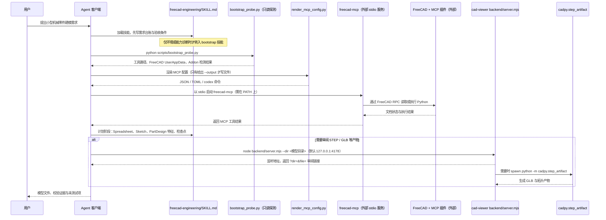

# FreeCAD Engineering（V0v1kkk/freecad-engineering）

## 一句话定义

FreeCAD Engineering（V0v1kkk/freecad-engineering）是提供可编辑、带证据的 FreeCAD 工程技能与 MCP 配置，强调每个建模步骤保留可检查依据。

## 英文缩写速查

| 缩写 | 英文全称 | 简要说明 |
|------|----------|----------|
| CAD | Computer-Aided Design | 计算机辅助设计与几何建模 |
| MCP | Model Context Protocol | 代理调用 CAD/可视化工具的协议 |
| FEM | Finite Element Method | 结构有限元分析方法 |

## 为什么重要

对 CAE 自动化而言，代理能否稳定完成任务，取决于工程步骤是否清楚、工具边界是否明确、结果是否保留可审查证据。提供可编辑、带证据的 FreeCAD 工程技能与 MCP 配置，强调每个建模步骤保留可检查依据；与直接文本生成模型区分开。

## 核心原理

**项目自身范围：** Editable, evidence-backed FreeCAD engineering skills and MCP configuration.

**工作流：** 代理按工程技能执行参数化 CAD 操作，同时保留模型修改与依据，便于审阅设计意图。

**仓库映射说明：** 文章未给出该项目完整的 owner/repository URL；此处按文章中的项目名/描述与公开 GitHub 仓库匹配。引用时请以本页链接的仓库 README 为准。

## 工程实践

1. 从目标问题识别所需的 Skill、MCP、CLI 或软件接口，不把指导文件当成求解器。
2. 依照仓库 README 检查安装前提、软件/许可证、输入文件和输出证据。
3. 小规模运行并逐项核对几何、网格、边界、求解状态和物理量，再决定是否扩大任务。

文章所述的项目特征：提供可编辑、带证据的 FreeCAD 工程技能与 MCP 配置，强调每个建模步骤保留可检查依据；与直接文本生成模型区分开。

## 局限与风险

证据链针对过程透明度，不自动证明设计通过强度、制造或法规审核。

源码状态核验：该 GitHub 仓库于 2026-10-07 可公开访问。仓库 API 报告许可证为 MIT。 涉及商业软件时，安装包和有效许可证需由使用者自行提供。

## 源码运行时序图

入口：Agent 客户端按 `plugin.json` / `mcp.json` 启动 `freecad-mcp`（外部 PyPI 包，不在本仓库内）；本仓库自带的可运行入口为 `python skills/freecad-engineering-bootstrap/scripts/bootstrap_probe.py`、`python skills/freecad-engineering-bootstrap/scripts/render_mcp_config.py` 与 `npm --prefix scripts/viewer run start -- --dir <目录>`（位于 `skills/cad-viewer/`）。

图依据：V0v1kkk/freecad-engineering@6d48362，实际读过 `README.md`、`plugin.json`、`mcp.json`、`skills/freecad-engineering/SKILL.md`、`skills/freecad-engineering-bootstrap/SKILL.md`、`skills/freecad-engineering-bootstrap/scripts/bootstrap_probe.py`、`skills/freecad-engineering-bootstrap/scripts/render_mcp_config.py`、`skills/cad-viewer/SKILL.md`、`skills/cad-viewer/scripts/viewer/package.json`、`skills/cad-viewer/scripts/viewer/backend/server.mjs`（bundled 文件，仅读取参数解析、监听与 spawn 相关段落）。

## 关联页面

- [CAE / CFD 代理工具项目总览](../overview/cae-cfd-agent-skills-landscape.md)
- [FEP Agent Hub](./s2mon123-fep-agent-hub.md)

## 参考来源

- [公众号文章原始资料归档](../../sources/blogs/wechat_cae_cfd_agent_skills_2026-10-07.md)
- [GitHub 仓库资料归档](../../sources/repos/v0v1kkk-freecad-engineering.md)
- [V0v1kkk/freecad-engineering 官方仓库](<https://github.com/V0v1kkk/freecad-engineering>)
- 源码核对（2026-11-02）：V0v1kkk/freecad-engineering@6d48362，读过 README.md、plugin.json、mcp.json、skills/freecad-engineering/SKILL.md、skills/freecad-engineering-bootstrap/SKILL.md 与 scripts/bootstrap_probe.py、scripts/render_mcp_config.py、skills/cad-viewer/SKILL.md、skills/cad-viewer/scripts/viewer/package.json、skills/cad-viewer/scripts/viewer/backend/server.mjs；时序图依据以上文件，未运行代码。

## 推荐继续阅读

- [项目 README](<https://github.com/V0v1kkk/freecad-engineering/blob/main/README.md>)