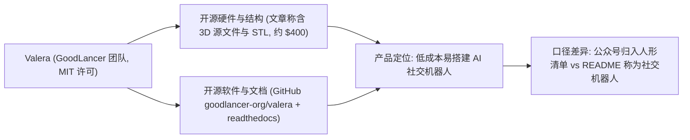

# Valera

**Valera**（[GitHub](https://github.com/goodlancer-org/valera)）是 [GitHubStore《19 款能自己造的开源人形机器人》](https://mp.weixin.qq.com/s/UUwUAcKdVrlo-N60Oar3Xg) 的第 10 项，文章标价 约 $400。

## 一句话定义

**Valera 是 GoodLancer 团队维护的开源软硬件社交机器人，目标是做出尽可能便宜、易搭建易使用、带 AI 的社交机器人。**

## 英文缩写速查

| 缩写 | 英文全称 | 简要说明 |
|------|----------|----------|
| — | — | 本项目无需额外缩写 |

## 为什么重要

- 属于文章按成本从低到高排列的「能自己造」清单；横向对比见 [能自己造的开源人形机器人 19 款：按成本与形态排序的阅读坐标](../overview/open-source-buildable-humanoids-19-technology-map.md)。
- 价格为文章标价（约 $400），入库日未核实。

## 核心信息

| 项 | 内容 |
|----|------|
| **链接** | [GitHub](https://github.com/goodlancer-org/valera) |
| **许可（核查）** | MIT（LICENSE 文件） |
| **最近提交** | 2024-05-30 |

## 文章说法核对

- **文章：** 文章称提供完整 3D 源文件与 STL，软硬件均开放（MIT），强调社交互动与可及性。
- **README / 核查：** README 标语「Open source hardware and software social robot」，项目由 GoodLancer 团队管理，文档在 readthedocs，LICENSE 为 MIT。
- **差异与保留：** **文章归入人形机器人清单，README 称其为社交机器人**，未称人形；价格与 STL 细节来自文章，未核实。

## 机制与架构图

## 关联页面

- [humanoid-robot](../entities/humanoid-robot.md)
- [open-source-humanoid-hardware](../entities/open-source-humanoid-hardware.md)
- [open-source-buildable-humanoids-19-technology-map](../overview/open-source-buildable-humanoids-19-technology-map.md)
- [Parametric CAD Workflow · 参数化 CAD 建模流程](../methods/parametric-cad-workflow.md)：项目开放 3D 结构源文件与 STL 模型，体现了低成本开源桌面机器人结构设计与增材制造准备流程。
- [Robot Software System Integration · 机器人软件系统集成](../methods/robot-software-integration.md)：作为软硬件一体开源社交机器人项目，需将结构装配、交互软件与 AI 对话模块整合为可运行系统。

## 参考来源

- [valera.md](../../sources/repos/valera.md)
- [wechat_githubstore_19_buildable_open_source_humanoids_2026-11-02.md](../../sources/blogs/wechat_githubstore_19_buildable_open_source_humanoids_2026-11-02.md)
- [原文（微信公众号）](https://mp.weixin.qq.com/s/UUwUAcKdVrlo-N60Oar3Xg)
