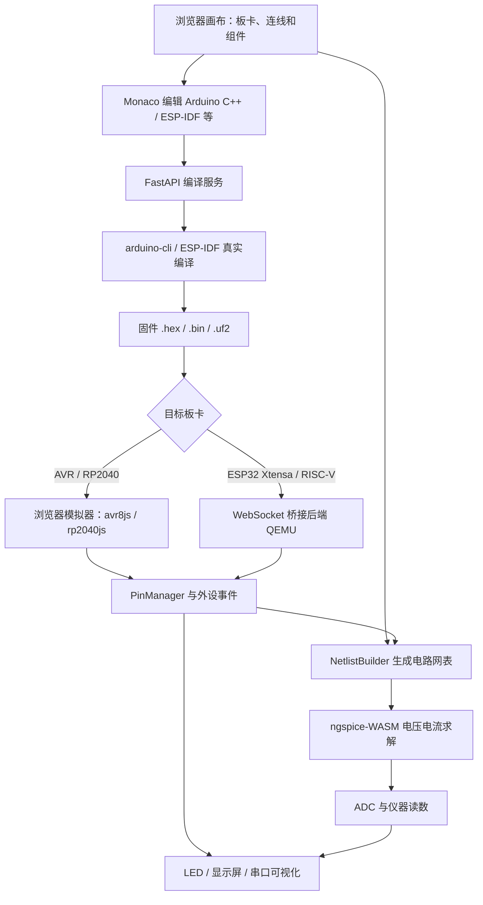
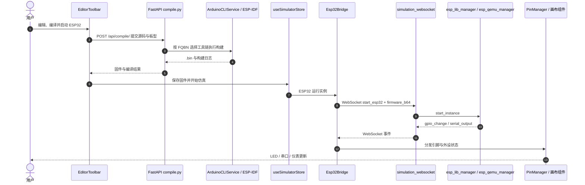

# Velxio：真实固件与 SPICE 电路协同的嵌入式仿真平台

## 一句话定义

**Velxio**（旧误拼 Vexlio）是嵌入式固件与外围电路的可视化仿真工作台：连线组装 Arduino、ESP32、Raspberry Pi Pico 等开发板，编译生成真实固件，通过指令级 CPU 仿真及 ngspice 模拟电路求解验证基本交互。它不是机器人的刚体动力学模拟器。

## 英文缩写速查

| 缩写 | 英文全称 | 简要说明 |
|---|---|---|
| MCU | Microcontroller Unit | 运行固件的微控制器 |
| ISA | Instruction Set Architecture | CPU 指令集架构，不应将 Linux 算作一种 ISA |
| SPICE | Simulation Program with Integrated Circuit Emphasis | 电路分析模型与网表求解生态 |
| WASM | WebAssembly | ngspice 在浏览器内的运行形式 |
| QEMU | Quick Emulator | ESP32 / ARM 等处理器系统仿真后端 |
| GPIO | General-Purpose Input/Output | 控制 LED、开关和外设连线 |
| ADC | Analog-to-Digital Converter | 从模拟节点电压转成数字量 |
| UART | Universal Asynchronous Receiver-Transmitter | 仿真端串口日志与通信接口 |
| I2C | Inter-Integrated Circuit | 传感器与显示屏常用两线总线 |
| SPI | Serial Peripheral Interface | 高频同步外设总线 |
| BOM | Bill of Materials | 元件物料清单，官网 Pro 导出功能 |

## 为什么重要

- 不必先采购所有板卡就能排查 GPIO、UART、I2C、SPI 与基本电路接线逻辑。
- 相比只按脚本演示的玩具仿真，使用 Arduino CLI / ESP-IDF 等真实编译产物和 CPU/寄存器模拟；可在同一画布查看 GPIO 与模拟电压耦合。
- 适合机器人传感器节点、ESP32 遥测终端、课程实验以及板级 bring-up 早期筛查；真机验收仍不可省。

## 核心原理

| 层次 | 官方实现与边界 |
|---|---|
| 编辑与编译 | React/Monaco 多文件工作区；FastAPI 调用 `arduino-cli`、ESP-IDF 等生成 .hex/.bin/.uf2 |
| 浏览器内 CPU | AVR 用 `avr8js`，RP2040 用 `rp2040js`，不需要每条指令走服务器 |
| 后端 CPU | ESP32 Xtensa、ESP32-C3 RISC-V 通过 QEMU 与 WebSocket 桥连接画布；Linux 单板与部分 STM32 属商业扩展 |
| 数字外设 | `PinManager`、`PartSimulationRegistry` 处理 GPIO / UART / I2C / SPI 和 LED、屏幕、传感器等部件 |
| 模拟电路 | `NetlistBuilder` 从导线与器件生成节点网表，ngspice-WASM 解模拟电压、电流；ADC/探针读取求解结果 |

### 官方支持数量的两种口径

截至 2026-11-10，官网目录写 **35 块板、6 类架构**；GitHub README `master@8a25410` 写 **40 块板、5 个 CPU 家族**。后者按 AVR8、ARM Cortex-M、Xtensa、RISC-V、ARM Cortex-A 统计；官网另将 Linux 列作“架构”，但 Linux 是操作系统。具体功能需逐板核对，不能将官网的 35/6 与 README 的 40/5 混作同一统计。

## 流程总览

以下路径依据官方 `docs/ARCHITECTURE.md` 与 `docs/emulator.md`：

## 源码运行时序图

对照上游 `frontend/src/components/editor/EditorToolbar.tsx`、`backend/app/main.py`、`backend/app/api/routes/compile.py`、`backend/app/api/routes/simulation.py`、`frontend/src/simulation/Esp32Bridge.ts`，以 **ESP32 固件执行路径** 为例：

AVR/Pico 走浏览器内 CPU 模拟器，不经过 `start_esp32` WebSocket；模拟电路在前端根据网表由 ngspice-WASM 求解。该图是源码入口和文档核对，不代表已实跑性能测试。

## 工程实践

1. 先用 [官方编辑器](https://velxio.dev/editor) 选择目标开发板，将 LED、电阻、按钮或 I2C 传感器放到画布并正确接线。
2. 打开或编写 Blink / 串口 / I2C 例程，启动编译与模拟，检查编译日志、串口监视器、GPIO 状态以及 SPICE 电压与探针读数。
3. 对机器人控制板原型，可先验证传感器协议、遥测、状态机的基本逻辑，再在实机测量 PWM 抖动、ADC 噪声、供电与时序边界。
4. 自部署参考 [官方 Docker README](https://github.com/davidmonterocrespo24/velxio#try-it-now)：基础镜像含前后端、编译与部分板卡仿真；需要按板型检查是否受私有增强包限制。

### 版本、许可与付费

| 官网计划 | 年付折合每月（USD） | 关键差异 |
|---|---:|---|
| Free | $0 | 基本 CPU/元件仿真、有限 AI chat/credits；部分高阶板卡为限次试用 |
| No AI | $3.00 | 无 AI；增加 STM32 / Pi Linux 仿真、私有网络等 |
| Maker | $5.75 | 增加 AI Agent/Tutor、组件/网络高级能力 |
| Pro | $15.75 | 再增加私有项目、GitHub Sync、BOM/原理图导出等 |

以上是 **2026-11-10 官方年付标价的月均值**，不是已核实的逐月支付单价。平台标注 AGPL-3.0 核心开源，同时提供商业授权，且官网私有 overlay 与基础开源仓库有差异。

## 局限与风险

- **开源边界：** GitHub 基础开源仓库不等于 velxio.dev 的全部商业功能。上游 `simulation.py` 说明 STM32 / Raspberry Pi Linux QEMU 在私有 `app.pro_boards` 中；AI、账户等功能在私有 `app.pro` 中。不能将“开源”理解为付费功能全部可自部署。
- **数值/架构口径：** 官网板卡/架构计数与 README 不一致，且 Linux 不是 ISA；采购/教学时应按实际型号验证。
- **SPICE 和仿真精度：** ngspice 求解的是指定模型的电路行为，不代表布线寄生、EMI、热、真实传感器误差与执行器完整非线性均得到验证。
- **非机器人力学模拟：** 不承担 MuJoCo / Isaac 式关节动力学、碰撞与强化学习 rollout；也不能用来认证 EtherCAT/CAN 的硬实时行为。
- **性能与兼容性：** 本次仅阅读官方文档与关键源码，**未在本地 Docker 或实机执行验证**；板卡支持范围、订阅权益可能变更。

## 关联页面

- [Wokwi](./wokwi.md) — 同类型在线 MCU 固件与电路仿真器
- [Pico.Lab](./picolab.md) — 仿真前期验证之后的实机测量和 bring-up 工具
- [UART 串行通信](../concepts/uart-serial-communication.md) — 机器人控制板串行调试
- [处理器在环 Sim2Real](../concepts/processor-in-the-loop-sim2real.md) — 更高保真部署闭环及限制

## 参考来源

- [Velxio 官方站点与定价归档](../../sources/sites/velxio.md)
- [Velxio 官方源码与架构归档](../../sources/repos/velxio.md)
- [Velxio 官方 README](https://github.com/davidmonterocrespo24/velxio/blob/master/README.md)
- [上游技术架构](https://github.com/davidmonterocrespo24/velxio/blob/master/docs/ARCHITECTURE.md)
- [作者在 Espressif 开发者站点的一手文章](https://developer.espressif.com/blog/2026/07/velxio-browser-based-esp32-simulation/)

## 推荐继续阅读

- [Velxio — Emulator Architecture](https://github.com/davidmonterocrespo24/velxio/blob/master/docs/emulator.md)
- [Velxio — Getting Started](https://github.com/davidmonterocrespo24/velxio/blob/master/docs/getting-started.md)
