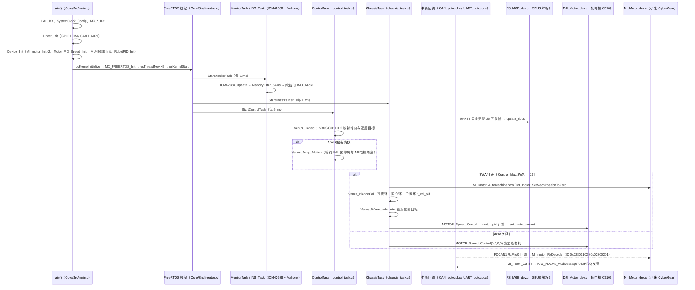

# 启明-1 Venus-1

**启明-1 Venus-1**（[GitHub](https://github.com/track-tech/Venus-1__Four-link-wheel-legged-robot)）来自 [古月居转载的四足机器人开源项目综述](https://mp.weixin.qq.com/s/pRGoPm41qYCNyHPWR6Dl6A)，属「轮足机器人」组。

## 一句话定义

**启明-1（Venus-1）是四连杆轮腿机器人的个人本科毕设开源项目：SolidWorks 机械、STM32H723 + FreeRTOS、小米 CyberGear 关节电机、DJI C610 + M2006 轮电机、全 PID 控制、SBUS 遥控。**

## 英文缩写速查

| 缩写 | 英文全称 | 简要说明 |
|------|----------|----------|
| PID | Proportional–Integral–Derivative | 比例积分微分控制 |
| SBUS | Serial Bus | 遥控接收机串行总线 |

## 为什么重要

- 综述把它放在「轮足机器人」这条技术路线下，作为可读源码的参照项目；横向对比见 [四足机器人开源项目技术地图：从极简运动学到研究级硬件（36 个 GitHub 项目）](../overview/quadruped-open-source-projects-technology-map.md)。
- 文中星标：60（文章表述，入库日未复核）。

## 核心信息

| 项 | 内容 |
|----|------|
| **仓库** | [track-tech/Venus-1__Four-link-wheel-legged-robot](https://github.com/track-tech/Venus-1__Four-link-wheel-legged-robot) |
| **最近提交** | 2025-05-09 |
| **可达性** | `git ls-remote` 可达（2026-11-01） |
| **文章归类** | 轮足机器人 |

## 文章说法核对

- **文章：** 文章称是启明-1 四连杆轮腿机器人，完整机械和控制开源。
- **README / 核查：** README 声明这是个人本科毕业设计，**存在设计缺陷，请谨慎复刻**；遵循 GPL 3.0，量产与商用需授权；结构为 3 mm 3240 环氧板，测试含重心自适应、跌落缓冲、主动悬挂、跳跃。
- **差异与保留：** GPL 3.0 且商用需授权；作者自述有设计缺陷。

## 源码运行时序图

入口：上电后 `int main(void)`（`2.Software/VenusMainProgram/VenusMainProgram_STM32H723_FreeRTOS/Core/Src/main.c`）完成外设与驱动初始化后启动 FreeRTOS 调度；工程由 Keil MDK 打开 `MDK-ARM/VenusMainProgram_STM32H723_FreeRTOS.uvprojx` 编译烧录，本仓库未提供可在 PC 上运行的仿真入口。

图依据：track-tech/Venus-1__Four-link-wheel-legged-robot@d64bdc0，实际读过 `2.Software/Readme.txt`、`Core/Src/main.c`、`Core/Src/freertos.c`、`Application/TaskLayer/system_task.c`、`control_task.c`、`chassis_task.c`、`monitor_task.c`、`return_task.c`、`Application/PotocolLayer/CAN_potocol.c`、`UART_potocol.c`、`Application/DeviceLayer/Device_dev.c`、`DJI_Motor_dev.c`、`MI_Motor_dev.c`、`ICM42688_dev.c`、`FS_IA6B_dev.c`、`Application/DriverLayer/Driver_drv.c`、`UART_drv.c`、`CAN_drv.c`、`Application/AlgorithmLayer/Mahony.c`（其中多个文件仅读取了与调用链相关的片段；`set_moto_current` 的定义与 MI 电机控制指令的上层调用点未追踪，故未画）。未编译、未在硬件上运行。

## 关联页面

- [open-source-qdd-actuator-projects](../comparisons/open-source-qdd-actuator-projects.md)
- [locomotion](../tasks/locomotion.md)
- [quadruped-open-source-projects-technology-map](../overview/quadruped-open-source-projects-technology-map.md)

## 参考来源

- [venus_1_four_link_wheel_legged_robot.md](../../sources/repos/venus_1_four_link_wheel_legged_robot.md)
- [wechat_guyueju_quadruped_opensource_deep_dive_2026-11-01.md](../../sources/blogs/wechat_guyueju_quadruped_opensource_deep_dive_2026-11-01.md)
- [原文（微信公众号）](https://mp.weixin.qq.com/s/pRGoPm41qYCNyHPWR6Dl6A)
- 源码核对（2026-11-02）：track-tech/Venus-1__Four-link-wheel-legged-robot@d64bdc0，读过 2.Software/Readme.txt、Core/Src/main.c、freertos.c、Application 下 TaskLayer 的 system/control/chassis/monitor/return_task.c、PotocolLayer 的 CAN/UART_potocol.c、DeviceLayer 的 Device/DJI_Motor/MI_Motor/ICM42688/FS_IA6B_dev.c、DriverLayer 的 Driver/UART/CAN_drv.c、AlgorithmLayer/Mahony.c；时序图依据以上文件，未运行代码。
