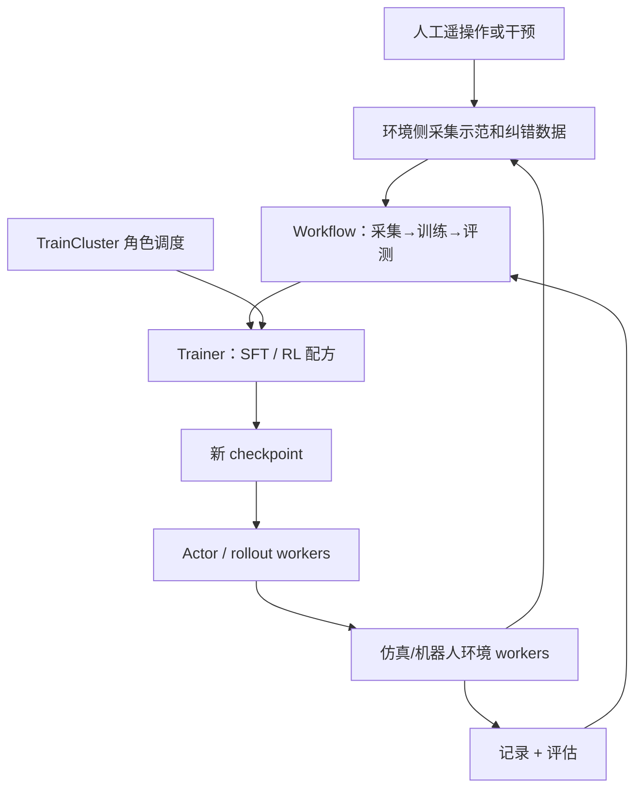
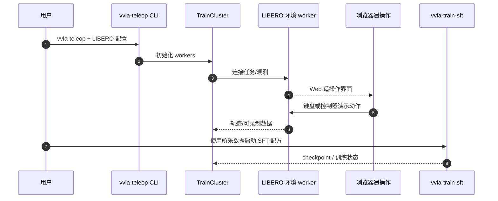

# verl-vla：连接人介入、仿真与训练集群的 VLA 后训练系统 / Unified VLA Post-Training Framework

## 一句话定义

**verl-vla** 是部署于不同机器的 VLA 数据收集、策略训练、rollout、评测与人工纠错流程的**分布式后训练框架**，在 verl 基础上将 workflow、trainer、TrainCluster 解耦复用。

## 英文缩写速查

| 缩写 | 英文全称 | 简要说明 |
|---|---|---|
| VLA | Vision-Language-Action | 要进行监督/强化后训练的机器人策略 |
| RL | Reinforcement Learning | 对机器人与环境交互反馈进行优化 |
| SFT | Supervised Fine-Tuning | 人工示范数据监督训练 |
| DAgger | Dataset Aggregation | 人机纠错/示范数据聚合策略 |
| SAC | Soft Actor-Critic | 项目提供的离策略 RL 配方之一 |
| GPU | Graphics Processing Unit | 云端策略模型与训练资源 |

## 为什么重要

VLA 的真机后训练通常跨训练卡、模拟器、硬件机器人和遥操作人员；将这些进程捆在一个进程或仅提供单个优化器不易复现。verl-vla 显式管理工作流阶段、算法和分布式计算资源，解决从失败纠正到继续训练之间的工程断点。

## 核心原理

- **Workflow**：编排采集、训练、rollout、评测和 checkpoint 同步的阶段顺序。
- **Trainer**：实现 SFT / SAC、TD3+BC、FPO、DSRL、RECAP 等算法/配方，不将这些算法与硬件部署混为一体。
- **TrainCluster**：把 actor、rollout、environment、recording、checkpoint workers 按角色分布在训练机、模拟器和机器人侧。
- **人介入**：浏览器/键盘/XR 等遥操作可以记录演示，在 rollout 失败时收集纠正动作，再进入后训练流程。

## 流程总览

## 源码运行时序图

官方 `pyproject.toml` 明确 CLI 入口 `vvla-teleop = verl_vla.entrypoints.teleop:main`，`vvla-train-sft = verl_vla.entrypoints.train.sft:main`；README 给出 LIBERO teleop 命令。此图限于已核对的流程职责，并不假定任意 RL 算法都已成功部署。

Quick Start 的 teleoperation CLI 能通过控制台启动数据采集界面，**不是**论文已经在所有 VLA 上完成全链路 RL 实验的证据。

## 实验与评测

项目提供 LIBERO、Isaac Lab Arena、Piper 等环境和 ACT、π₀.₅、GR00T 等策略的 SFT/RL 示例；不同配方覆盖度取决于 README 版本和特定模型接口。它是软件系统，不存在可与 TurboVLA 直接排列的单一模型成功率。

## 结论

**verl-vla 的贡献是把分布式机器人后训练中的数据与执行职责变成可复用模块，而不是发明新的通用动作骨干。**

1. 先跑单环境 teleop/recording，再接 SFT 或 RL worker。
2. 检查训练机与环境的网络、动作时序、数据序列化与权重同步。
3. 只有对应配方/任务的官方示例可称已有运行入口，其余组合需要验证。
4. 人工干预必须与自主动作及成功率口径分开统计。
5. 不把 README 中列举的整合能力当作全部实验已经复现。

## 工程实践

源码官方安装后可运行 `vvla-teleop`，选择 LIBERO spatial task 0 和 keyboard；浏览器查看 18000 端口画面。经 `pyproject.toml` 验证有 `vvla-train-sft`、`vvla-train-sac` 等独立 CLI。实机部署须额外处理安全、时延与权限。

## 局限与风险

大型分布式训练需要外部模型资产与模拟器资源；采集/训练/部署的运行时条件不同。仓库提供的数据采集演示不能当成对物理机器人安全性或收敛性保证。

## 关联页面

- [VLA](../methods/vla.md)
- [Hy-VLA](./paper-hy-embodied-05-vla.md)
- [统一评测](./vla-evaluation-harness.md)
- [2026 对比](../comparisons/vla-open-source-ecosystem-2026-three-shifts.md)

## 参考来源

- [verl-vla 官方源码文档通读归档](../../sources/repos/verl-vla.md)

## 推荐继续阅读

- [官方 GitHub](https://github.com/verl-project/verl-vla)
- [Quick Start](https://verl-vla.readthedocs.io/en/latest/getting-started/)
