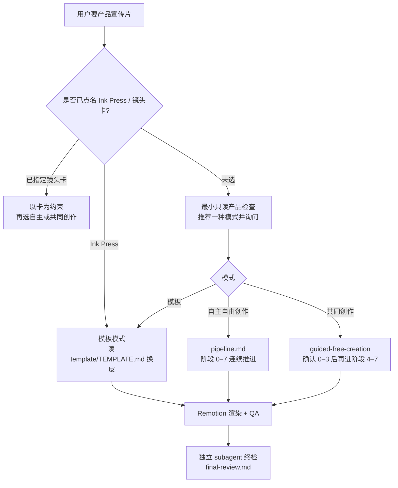
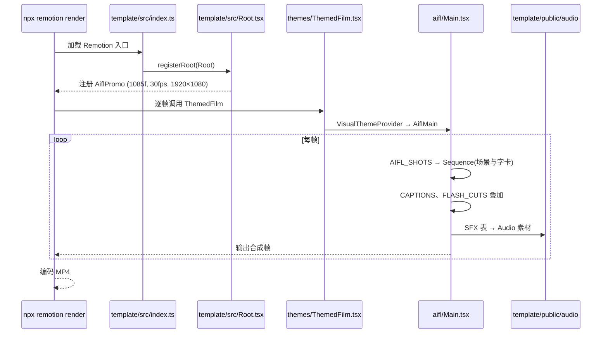

# video-shotcraft（Vincentwei1021/video-shotcraft）

**video-shotcraft** 是 [Vincentwei1021/video-shotcraft](https://github.com/Vincentwei1021/video-shotcraft)（Apache-2.0）分发的 **Agent Skill**：把 **镜头配方卡 + [Remotion](./remotion.md) 参考实现 + 音频资产 + 制作方法论** 打包成可安装规约，使 Claude Code / Codex 能对 Web/桌面产品做分镜、2.5D 运镜动画与节拍对齐音效，产出电影感宣传片 / 发布片 / 功能演示。

> **地址说明：** 外链偶写作 `trendshift/video-shotcraft`（**不存在**）；那是 [Trendshift](https://trendshift.io/repositories/88911) 榜单入口。官方仓与 Gallery 见上。

## 一句话定义

用 **可安装 `SKILL.md` + 124 张镜头卡 + 已验收 Ink Press 模板**，把「产品截图 → 分镜 → Remotion 实现 → SFX/BGM 卡点 → 独立终检」固化为代理可执行的动效制片流水线，而不是让模型凭空编 UI 动画。

## 英文缩写速查

| 缩写 | 英文全称 | 简要说明 |
|------|----------|----------|
| SFX | Sound Effects | 音效层；仓内按 16 类材质/场景组织，与运镜/转场钉帧对齐 |
| BGM | Background Music | 背景音乐；强节奏片须先做拍号网格再分镜，成片常交带/不带 BGM 两版 |
| FPS | Frames Per Second | 帧率；Ink Press 模板锁定 **30fps**、1920×1080 |
| UI | User Interface | 用户界面；复刻产品页时以真实截图为纹理，禁止廉价手搓替代 |

## 为什么重要（对本知识库读者）

- **Agent Skills 生态的「成片交付」样本：** 与 [GSAP Skills](./gsap-skills.md)（DOM/Scroll 交互）、[img2threejs](./img2threejs.md)（程序化 Three.js）、[CAD Skills](./cad-skills.md)（STEP/URDF）并列，代表 **运动设计 / 产品视频** 垂直技能——把 **配方卡 + 调校过的 demo TSX + 独立 subagent 终检** 写成规约，而不是只给提示词。
- **对本站与研究 demo 的直接价值：** 机器人/仿真项目常需 **几分钟级产品或结果宣传片**；本技能提供可复用镜头语法与 Ink Press 换皮路径，降低代理「炫技动画、无呼吸、无音效句式」的概率。
- **与 LLM Wiki 维护同构：** [Karpathy LLM Wiki](../references/llm-wiki-karpathy.md) 把研究知识编译进 `wiki/`；video-shotcraft 把 **镜头语言与验收清单** 编译进 `SKILL.md` / `references/`——都是 **人类策展 + 代理执行**。
- **开源状态清晰：** 技能库与 Gallery **已开源**；渲染引擎 Remotion、音频 Mixkit 有 **独立许可**，商用前必须单独核验（见局限）。

## 核心机制与架构

| 层次 | 内容 |
|------|------|
| **分发** | `npx skills add Vincentwei1021/video-shotcraft`；或 clone 后 symlink 到 `~/.claude/skills/` / `~/.codex/skills/` |
| **入口** | 根目录 [`SKILL.md`](https://github.com/Vincentwei1021/video-shotcraft/blob/main/SKILL.md)：模式选择、核心理念、读哪些 reference |
| **镜头库** | `references/shots/<category>/` **124** 张镜头卡 + 对应 `demos/<category>/` Remotion TSX 实现 |
| **Gallery** | [官方样片画廊](https://vincentwei1021.github.io/video-shotcraft/)：**150** 样式 / **150** 动态预览；可复制镜头卡名 |
| **模板** | **Ink Press**：36.2s · 10 镜头 · 纸墨琥珀风，换产品截图最快出片 |
| **流水线** | `pipeline.md` 阶段 0–7：产品理解 → styleframe → 镜头映射 → 分镜 → 采集 → 实现 → 声音 → **独立终检** |
| **音频** | `assets/audio/bgm/` 提供 BGM 备选；新片改从 Freesound 按需获取 SFX，不再使用旧共享音效库 |

### 三种完整宣传片模式（互不合并）

### 版本与计数口径（2026-11-12 复核）

| 版本 | 镜头卡 | 样式 / 动态预览 |
|---|---:|---:|
| 当前官方 README 与 Gallery（2026-10 刷新） | **124** | **150 / 150** |
| 2026-07-31 入库历史快照 | 104 | 161 / 161 |

官方同时记录：2026-08 增加可编辑 **JianYing / 剪映草稿导出**，2026-09 上线 **Motion Workbench** 浏览器编辑器；2026-10 从打磨过的 216 个 demo 中筛选出当前镜头库。
## 工程实践

| 步骤 | 做法 |
|------|------|
| 安装 | 向代理发送仓库 URL，或 `npx skills add Vincentwei1021/video-shotcraft` |
| 最快出片 | 「用 Ink Press 模板给某产品做宣传片」→ 替换截图/文案/品牌 tokens |
| 按卡创作 | 先查 `gallery/api/library.json` 的卡名与 `style-key`，再完整读镜头卡和对应 demo TSX，不凭名字重写 |
| 素材 | 复刻真实页面：起本地 dev server → 无头浏览器 2× 全页纹理 + 元素抠图 + `layout.json`；敏感数据先脱敏 |
| Headless CI | `--concurrency=1`；chrome-headless-shell；必要时 `--browser-executable=` |
| 验收 | 每镜头 `npx remotion still`，变更后重渲 MP4 并抽帧；独立 subagent 对照 `final-review.md` 审查 |

### 新版交付链路

- **音效来源**：用 `python3 assets/scripts/sfx-source.py search/get/analyze` 对 Freesound 检索、下载并测量，保留 `audio-manifest.json` 与 `FREESOUND-CREDITS.md`；MP3 试听预览不等于无损原文件。
- **交付后可编辑**：`node workbench/scripts/open.mjs <工程目录>`；源工程需要 `src/workbench.ts`，复用 `SHOTS` / `CAPTIONS` / `SFX` 的唯一时间表；按 `references/workbench.md` 验证 parity。
- **剪映草稿**：可选导出分镜、字幕和音轨可编辑草稿；官方验证环境为 macOS 剪映专业版 11.2，不能据此声称 Windows 已验证。

## 源码运行时序图

以下逐层对应 [模板运行入口](https://github.com/Vincentwei1021/video-shotcraft/blob/main/template/TEMPLATE.md)、[`template/src/index.ts`](https://github.com/Vincentwei1021/video-shotcraft/blob/main/template/src/index.ts)、[`Root.tsx`](https://github.com/Vincentwei1021/video-shotcraft/blob/main/template/src/Root.tsx)、[`ThemedFilm.tsx`](https://github.com/Vincentwei1021/video-shotcraft/blob/main/template/src/themes/ThemedFilm.tsx) 与 [`aifl/Main.tsx`](https://github.com/Vincentwei1021/video-shotcraft/blob/main/template/src/aifl/Main.tsx)。只描述**Ink Press 模板实际可运行路径**，不泛化为所有自由创作项目。

**Workbench 旁路**：[`workbench/scripts/open.mjs`](https://github.com/Vincentwei1021/video-shotcraft/blob/main/workbench/scripts/open.mjs) 链接成片工程、生成索引并启动 Vite；[`template/src/workbench.ts`](https://github.com/Vincentwei1021/video-shotcraft/blob/main/template/src/workbench.ts) 复用 `AIFL_SHOTS`、`CAPTIONS`、`SFX` 并重建可编辑轨道。

## 局限与风险

- **误区：这是机器人/仿真视频生成器。** 输出是 **Remotion 时间线成片**（产品 UI 叙事），不是策略 rollout、MuJoCo 可视化或 [Manim](./manim.md) 公式片；与 [Character Animation vs Robotics](../concepts/character-animation-vs-robotics.md) 问题不同层。
- **误区：装了技能就等于「几分钟电影级」保证。** 质量取决于素材真实性、模式选择、Remotion/Chrome 环境和终检是否执行；营销语不能替代 `final-review`。
- **误区：仓库 Apache-2.0 = 整条链路随意商用。** **Remotion** 对公司规模有额外许可；新版 Freesound 音效按素材逐条查 CC0/CC BY、保留署名；BGM 与历史模板音频另查 `ATTRIBUTION.md`；模板内演示截图发布前必须换成自有产品并脱敏。
- **局限：** 主场景是 Web/桌面产品片；真机机器人运镜、多机位实拍剪辑不在库内；强依赖宿主 agent 与本机渲染算力。

## 关联页面

- [GSAP AI Skills](./gsap-skills.md) — **Web UI / Scroll** 动效 Agent Skills（交互层；本页是 **离线成片** 层）
- [img2threejs](./img2threejs.md) — **图像→程序化 Three.js** 垂直 Agent Skill
- [Skills For Real Engineers（mattpocock）](./mattpocock-skills.md) — **编码工程** Agent Skills 对照
- [SenseNova-Skills](./sensenova-skills.md) — **办公产出** Agent Skills
- [CAD Skills](./cad-skills.md) — **硬件/CAD/URDF** 垂直技能
- [Manim](./manim.md) — **离线数学示意动画**（Python）；同属「脚本化视频」，栈与镜头语法不同
- [Draw.io Scientific Illustrator](./drawio-scientific-illustrator.md) — **可见科研插图**（MCP + Skill）
- [Superpowers（obra）](./superpowers-obra.md) — 重流程交付技能库（与本库 **垂直制片** 互补）
- [Character Animation vs Robotics](../concepts/character-animation-vs-robotics.md) — 表演意图 vs 物理可控边界（弱交叉）
- [LLM Wiki（Karpathy 模式）](../references/llm-wiki-karpathy.md) — 知识编译范式对照
- [Ingest Workflow](../../schema/ingest-workflow.md) — 本仓库维护规范

## 参考来源

- [Vincentwei1021/video-shotcraft 仓库源归档（本站）](../../sources/repos/video-shotcraft.md)
- [video-shotcraft Gallery 站点归档（本站）](../../sources/sites/video-shotcraft-gallery.md)
- [Vincentwei1021/video-shotcraft（GitHub）](https://github.com/Vincentwei1021/video-shotcraft)
- [官方 SKILL.md](https://github.com/Vincentwei1021/video-shotcraft/blob/main/SKILL.md) · [八阶段制作流水线](https://github.com/Vincentwei1021/video-shotcraft/blob/main/references/pipeline.md) · [Freesound 音效规范](https://github.com/Vincentwei1021/video-shotcraft/blob/main/references/sfx-sourcing.md)

## 推荐继续阅读

- [Live Gallery](https://vincentwei1021.github.io/video-shotcraft/) — 搜索/筛选 150 条动态样片并复制卡名
- [Remotion（实体页）](./remotion.md) — React 可编程视频框架与许可说明；官方文档 <https://www.remotion.dev/docs>
- [Agent Skills 规范](https://agentskills.io/) — `SKILL.md` 约定
- [skills.sh](https://skills.sh/) — 跨 harness 技能安装
