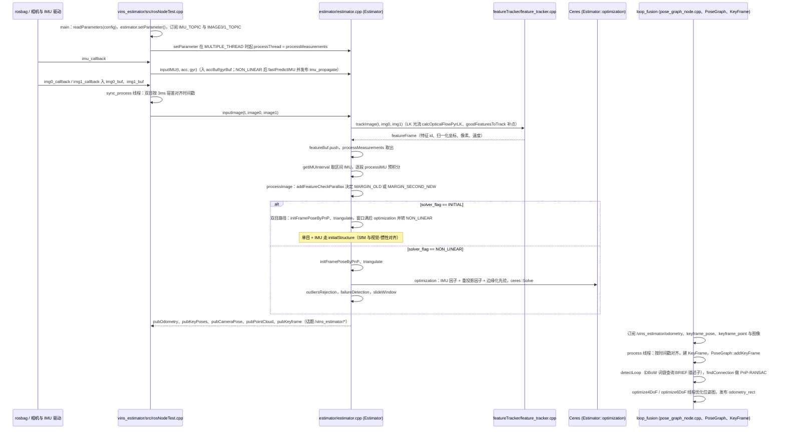

---

type: entity
tags: [repo, vio, visual-inertial, optimization, uav, hku]
status: complete
updated: 2026-09-15
related:
  - ../entities/open-vins.md
  - ../entities/paper-co-calib-multi-fisheye-calibration.md
  - ../entities/orb-slam3.md
  - ../comparisons/lidar-slam-lio-vio-selection.md
sources:
  - ../../sources/repos/vins_fusion.md
summary: "VINS-Fusion 是优化式多传感器状态估计器：单目/双目+IMU，可选 GPS 全局融合，适合无人机与手持平台。"
---

# VINS-Fusion

**VINS-Fusion** 提供 **滑动窗口优化** 的视觉-惯性里程计与可选 GPS 融合。

## 英文缩写速查

| 缩写 | 英文全称 | 简要说明 |
|------|----------|----------|
| IMU | Inertial Measurement Unit | 惯性测量单元，提供加速度与角速度 |
| VIO | Visual-Inertial Odometry | 视觉-惯性里程计，融合相机与 IMU 估计位姿 |
| LiDAR | Light Detection and Ranging | 激光雷达，地形感知与建图主传感器 |
| LIO | LiDAR-Inertial Odometry | 激光-惯性里程计 |

## 为什么重要

- **工程常用 VIO**：HKUST 空中机器人实验室生态成熟。
- **多传感器扩展**：相机、IMU、GPS 组合灵活。

## 核心结构/机制

| 模式 | 说明 |
|------|------|
| **VIO** | 单目/双目 + IMU |
| **Global fusion** | GPS 与回环 |
| **输出** | 里程计、路径、地图点 |

## 常见误区或局限

- **标定敏感**：相机-IMU 外参与时间偏移需离线标定。
- **对比**：[OpenVINS](./open-vins.md) 偏滤波器研究路线。

## 源码运行时序图

入口（README §3.2）：`rosrun vins vins_node config/euroc/euroc_stereo_imu_config.yaml`，可选 `rosrun loop_fusion loop_fusion_node <同一 yaml>`，再 `rosbag play MH_01_easy.bag`；rviz 用 `roslaunch vins vins_rviz.launch`。

图依据：HKUST-Aerial-Robotics/VINS-Fusion@be55a93，读过 README.md、vins_estimator/src/rosNodeTest.cpp、vins_estimator/src/estimator/estimator.cpp、vins_estimator/src/featureTracker/feature_tracker.cpp、vins_estimator/src/utility/visualization.cpp、vins_estimator/launch/vins_rviz.launch、loop_fusion/src/pose_graph_node.cpp、loop_fusion/src/pose_graph.cpp、loop_fusion/src/keyframe.cpp（后三者只读到函数签名与主循环，未逐行读 DBoW 与 findConnection 内部）。

## 参考来源

- [sources/repos/vins_fusion.md](../../sources/repos/vins_fusion.md)
- [HKUST-Aerial-Robotics/VINS-Fusion](https://github.com/HKUST-Aerial-Robotics/VINS-Fusion)
- 源码核对（2026-11-02）：HKUST-Aerial-Robotics/VINS-Fusion@be55a93，读过 README.md、vins_estimator/src/rosNodeTest.cpp、vins_estimator/src/estimator/estimator.cpp、vins_estimator/src/featureTracker/feature_tracker.cpp、vins_estimator/src/utility/visualization.cpp、loop_fusion/src/pose_graph_node.cpp、loop_fusion/src/pose_graph.cpp（部分）、loop_fusion/src/keyframe.cpp（函数列表）；时序图依据以上文件，未运行代码。

## 关联页面

- [OpenVINS](../entities/open-vins.md)
- [CO-Calib](../entities/paper-co-calib-multi-fisheye-calibration.md) — 同 HKUST Aerial Robotics 组的多鱼眼标定 plug-in
- [ORB-SLAM3](../entities/orb-slam3.md)
- [Kalibr：相机与 IMU 标定](./kalibr.md) — 相机-惯性时空标定与噪声参数来源
- [LiDAR / LIO / VIO 选型](../comparisons/lidar-slam-lio-vio-selection.md)

## 推荐继续阅读

- https://github.com/HKUST-Aerial-Robotics/VINS-Fusion/blob/master/support_files/paper/VINS-Mono: A Robust and Versatile Monocular Visual-Inertial State Estimator.pdf
