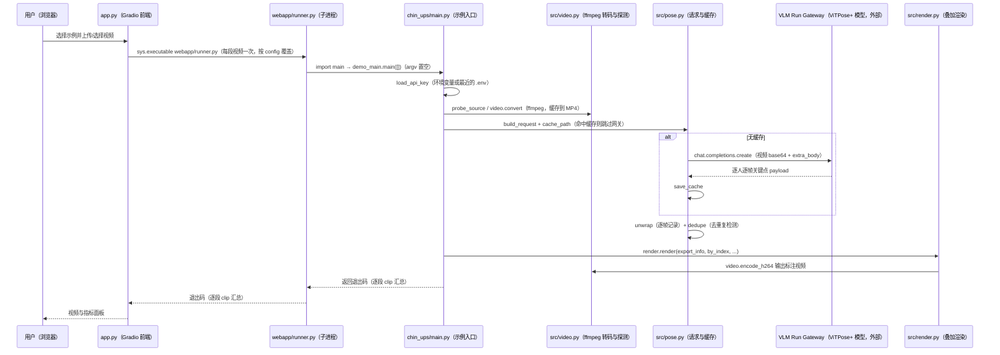

# vision-demos（视频运动分析示例）

**vision-demos** 是 Jeremy Park 的开源计算机视觉示例集，从运动视频提取姿态或物体分割结果，再计算健身、跑步、舞蹈和攀岩指标。

## 英文缩写速查

| 缩写 | 英文全称 | 简要说明 |
|------|----------|----------|
| API | Application Programming Interface | 通过 Gateway 调用视觉模型的接口 |
| ROM | Range of Motion | 单次动作的运动幅度，俯卧撑示例据阈值判定 |
| LiDAR | Light Detection and Ranging | 3D 攀岩示例中用于获取深度的传感方式 |
| CSV | Comma-Separated Values | 保存俯卧撑逐帧和逐次指标的表格格式 |

## 为什么重要

它展示如何把通用视觉模型输出转换成具体任务指标：同一姿态估计模型可服务次数、时间和姿态评估；攀岩还结合分割与深度。对机器人研究，可借鉴其视频信号处理和可视化流程，但结果需要另行校验才适合作为运动数据。

## 核心原理

俯卧撑示例使用 ViTPose+ Large 提取关键点，选择视频中置信度较高的一侧；以肩相对手腕的高度除以手臂长度得到信号，用上下两个阈值计数，计数与幅度评分分开。肩部接近手腕的程度和回到起始高度的比例分别判定下、上端；肩—髋—踝偏离直线的角度用于背部评分。默认下端阈值为 0.40 倍臂长、上端为初始高度的 90%，背部容差为 ±15°，可调整。

| 示例 | 输入与输出 | 主要模型 |
|------|------------|----------|
| 俯卧撑 / 引体向上 | 视频 → 次数、耗时与动作幅度 | ViTPose+ Large |
| 攀岩 | 视频 → 岩点分割与使用顺序；3D 版本另用深度和标定测量路线 | SAM 3.1、ViTPose+ Large |
| 硬拉 | 视频 → 次数及背部姿态分类 | SAM 3.1、ViTPose+ Large、Gemma |
| 跑步 / 舞蹈 | 视频 → 步频与触地时刻 / 动作同步度 | ViTPose+ Large |

## 工程实践

- 俯卧撑要求横屏侧拍、相机大致与地面齐平、全身入镜；独立目录 README 要求设置 `VLMRUN_API_KEY`，创建其 conda 环境后从 `push_ups` 目录运行 `python main.py`。
- 结果包括叠加视频、图表、逐次和逐帧 CSV、JSON，以及记录配置和费用的 `run.json`；姿态响应会缓存，可在不重新调用模型时调整评分阈值。
- 根目录浏览器应用依赖 ffmpeg，可匿名限速运行或配置 API key；俯卧撑和 3D 攀岩需使用各自的独立流程。

## 局限与风险

- 俯卧撑规则适用于单人侧视：地面接触由肩相对手腕高度近似，未直接检测胸部触地，也不评价手的位置或肘外展。关键点误差、遮挡与拍摄角度会影响结果，阈值需按实际样本验证。
- 示例代码以 Apache-2.0 发布，模型推理依赖外部 Gateway；单独部署与服务费用、视频上传和隐私要求应按实际使用核查。3D 攀岩需要视频、逐帧深度和相机标定，采集应用及数据是否公开不能从 README 确认。
- 视频关键点与评分并不等同于机器人关节轨迹或物理可行性验证；接入模仿学习前仍需重建、重定向和质量检查。

## 源码运行时序图

入口：`python app.py`（仓库根目录，Gradio 前端，`demo_app.queue(...).launch(...)`）；单个示例的入口为各目录下的 `python main.py`（以 `chin_ups/` 为例，先 `conda activate chin_ups`）。

图依据：jeremyipark/vision-demos@d28ca19，实际读过 `README.md`、`app.py`（入口与 subprocess 调用 `webapp/runner.py` 的段落）、`webapp/runner.py`（`main()` 与 clip 循环）、`chin_ups/main.py`（`main()` 的 1–6 步）、`chin_ups/src/pose.py`（请求、缓存与 unwrap/dedupe 的函数签名）、`chin_ups/src/video.py`（函数名）、`chin_ups/src/env.py`（API key 加载顺序）、`chin_ups/src/render.py`（函数签名）。`reps.py` 的计数与 `timing.py` 的耗时统计未在图中逐行追踪，未画入调用顺序；未运行代码。

## 关联页面

- [FreeMoCap](./freemocap.md) — 多相机动作捕捉平台，适合对照采集与重建流程。
- [Exercises Dataset](./exercises-dataset.md) — 健身动作目录，与视频分析工具的定位不同。
- [动作数据质量](../concepts/motion-data-quality.md) — 检查运动数据用于机器人时的可行性。

## 参考来源

- [vision-demos 仓库归档](../../sources/repos/jeremyipark-vision-demos.md)
- 源码核对（2026-11-02）：jeremyipark/vision-demos@d28ca19，读过 README.md、app.py、webapp/runner.py、chin_ups/main.py、chin_ups/src/pose.py、video.py、env.py、render.py；时序图依据以上文件，未运行代码。

## 推荐继续阅读

- [俯卧撑实现与局限](https://github.com/jeremyipark/vision-demos/blob/main/push_ups/how-it-works.md)
- [3D 攀岩输入与运行说明](https://github.com/jeremyipark/vision-demos/blob/main/rock_climbing_3d/README.md)
