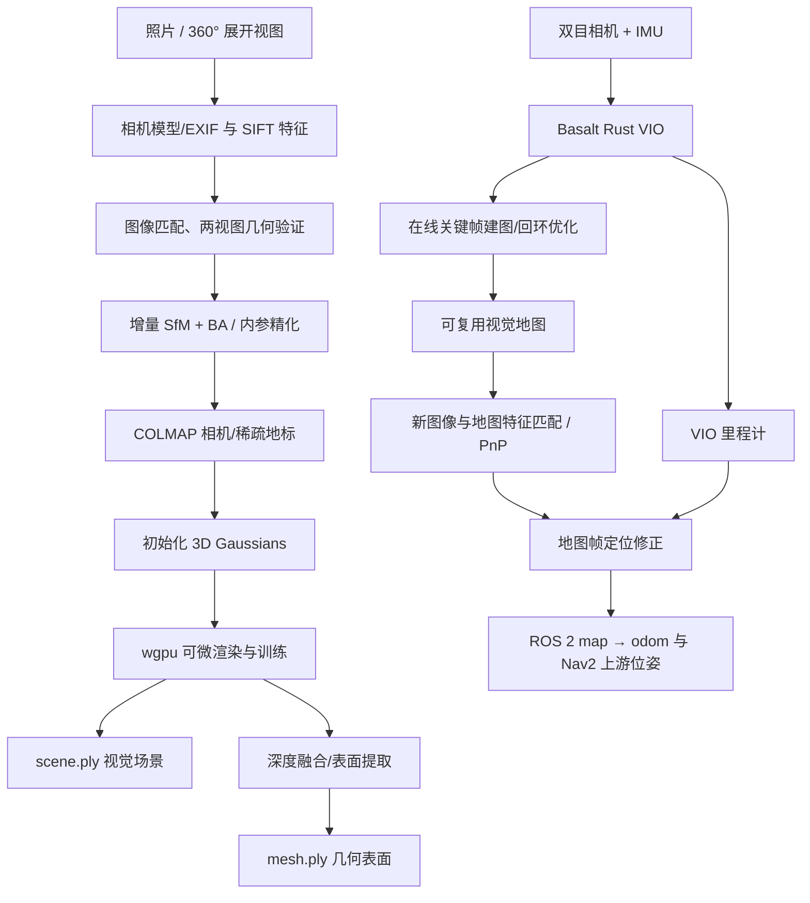
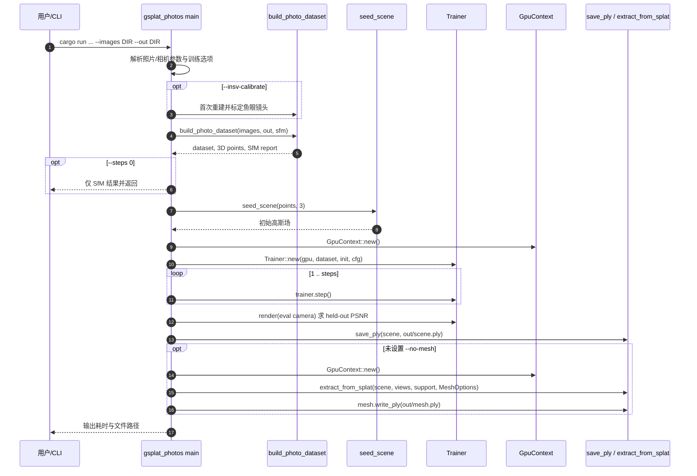

# visloc-rs：Rust 视觉定位、SfM 与 3D Gaussian Splatting 重建（Visual Localization & Reconstruction）

## 一句话定义

**visloc-rs**（[官方 GitHub](https://github.com/rsasaki0109/visloc-rs)）将单目/双目图片及可选 IMU 输入转成 **相机位姿、稀疏视觉地图、3D Gaussian Splatting 场景和 mesh**，并能利用保存的地图对新图像/机器人位姿重定位；它是定位与几何/外观重建底座，不是自动生成完整动力学环境的通用仿真器。

## 英文缩写速查

| 缩写 | 英文全称 | 简要说明 |
|---|---|---|
| SfM | Structure from Motion | 多张图片联合恢复相机位姿与稀疏三维结构 |
| VIO | Visual-Inertial Odometry | 相机与 IMU 协同估计度量位姿 |
| SLAM | Simultaneous Localization and Mapping | 同步定位与建图 |
| IMU | Inertial Measurement Unit | 加速度和角速度传感器 |
| BA | Bundle Adjustment | 联合优化相机参数与三维地标 |
| 3DGS | 3D Gaussian Splatting | 以可渲染高斯集合表达场景外观 |
| MVS | Multi-View Stereo | 多视角稠密重建 |
| PnP | Perspective-n-Point | 依据 2D–3D 对应求相机位姿 |
| ROS 2 | Robot Operating System 2 | 机器人系统的通信与集成框架 |

## 为什么重要

- **一个工具覆盖重建与再定位**：SfM 的相机/点云可以进一步训练 3DGS，已保存的视觉地图还可用于机器人定位和跨会话复用。
- **工程依赖边界清晰**：主要算法为 Rust，GPU 路线使用 wgpu；浏览器提供 SfM / VIO WebAssembly 演示，图像 SfM 可导出 COLMAP。
- **与物理 Real2Sim 有明确接缝**：可作为几何/外观重建上游，进一步变成“可训练、可接触”的资产仍需物性、碰撞和关节约束等附加工作。

## 核心原理与流程总览

按 [官方 README 与源码通读归档](../../sources/repos/visloc-rs.md)，核心有两条互补路径：**离线照片重建**与**在线视觉惯性 SLAM / 地图重定位**。



**注意**：上图照片重建与 VI-SLAM 是不同的运行入口，并非每次运行都按图中两支执行；`gsplat_photos` 的 mesh 不具有自动标定的质量、摩擦或可接触动态物体。

### 算法模块

1. **SfM**：SIFT 特征/候选匹配、两视图验证、COLMAP-port 增量 mapper、BA；输出相机姿态与稀疏点云（可写 COLMAP 格式）。
2. **3DGS + mesh**：对稀疏点初始化 3D Gaussian，采用 wgpu 执行训练并评估 held-out PSNR，渲染深度后经融合提取三角 mesh。
3. **VIO/地图**：Basalt Rust 移植的紧耦合双目惯性 VIO + 在线 mapper；持久地图支持跨会话匹配，配合 VIO/轮式里程计提供地图坐标系校正。
4. **系统集成**：支持 Python bindings 与独立 ROS 2 节点；`visual_map_to_occupancy` 给 Nav2 供应 occupancy grid，Nav2 执行规划/控制。

## 源码运行时序图

已核对 `crates/gsplat-train/examples/gsplat_photos.rs::main` 及其调用的训练/导出 API（以下为**该入口**实际顺序，非 VIO 的流程）：



另一个最小复现入口 `examples/localize_dummy.rs` 实际建立相机 + 3D landmarks + 2D keypoints/descriptors，调用 `localize(query, map)` 返回 PnP 定位结果；它与上图的重建程序不是同一执行路径。

## 实验与评测（作者报告，未独立复现）

| 场景 | 官方结果 | 口径与限制 |
|---|---|---|
| SmallCity 3D 重建 | 5,822 图 → 5,583 位姿 → 4.7M 3DGS → 5.9M mesh，2.5 小时 | Colab A100、特定黑色像素 mask / 训练流程；不是“360° 相机走一圈都能在 2.5 h 完成” |
| ETH3D Electro 1,200 图 | 3.46× 于 COLMAP CPU8，camera-centre RMSE 降 25.2% | 同输入作者测评，不是所有 SfM 数据均占优 |
| EuRoC 双目惯性在线 SLAM | 作者机器 11/11 实时、9/11 ATE 胜 ORB-SLAM3 | MH_04 与 MH_05 仍输；需核对 profile 与标定 |
| OpenLORIS rig 地图定位 | 1,250 held-out 帧中 98.96% 定位，median 2.9 mm | 特定地图/数据划分，不代表所有机器人定位都达毫米级 |
| Nav2 仿真闭环 | 公寓 5/5 goals、3.8 cm RMSE；Gazebo 场景也报告 5/5 | **仿真结果**；作者尚未报告真机上用 Nav2 驱动导航 |

官方还报告 LaMAria test 五赛道 mean score 57.8、排第六；部分 GPU SfM 场景 COLMAP 更准、更多帧成功注册。请勿将不同数据集 ATE、PSNR、重定位成功率做跨任务横比。

## 工程实践

- **开源状态**：已开源，主仓许可 MIT OR Apache-2.0；不要求本地 C++/OpenCV/CUDA 工具链，但使用 GPU 时要检查 wgpu 设备、驱动与数据规模。
- **最小定位验证**：`cargo run --example localize_dummy`（合成地图，不需要下载数据集）。
- **从照片重建**：

```bash
cargo run --release -p visloc-gsplat-train --features gpu,euroc --example gsplat_photos -- \
  --images /path/to/my_photos --out runs/my-scene
```

- **关键文件**：`out/sparse/0`（COLMAP 稀疏模型）、`scene.ply`（高斯）、`mesh.ply`（mesh）。
- **ROS 2 导航路径**：`ros2/visloc-ros2` 供定位与 `map -> odom`；`visual_map_to_occupancy` 供地图，Nav2 负责规划。上游 README 明确指出 RustDDS 内测不等于已验证所有 ROS 2 实际分布的 DDS 互通。
- **Web 演示**：[照片 SfM](https://rsasaki0109.github.io/visloc-rs/sfm/) · [手机 VIO](https://rsasaki0109.github.io/visloc-rs/slam/) · [高斯浏览器](https://rsasaki0109.github.io/visloc-rs/splat/)；手机内参、传感器权限、WebGPU 可用性影响实测。

- **Python 安装入口补充（2026-11-24 README 复核）**：官方 README 给出 `pip install visloc`；本次未实际安装，使用前核对 Python 版本、wheel 平台及所需功能是否已绑定。

## 局限与风险

1. **视觉重建 ≠ 物理仿真**：3DGS 和 mesh 不自动等于可碰撞/可操作的 USD/MJCF 资产；项目确有 `real2sim.py` 的 360° 街景+Nav2/动态人群仿真演示，但不是任意场景任意物理交互的完整生成器。
2. **受退化条件影响**：弱纹理、遮挡、运动模糊、错误内参或 IMU 时间偏移会影响位姿和重建；作者对 EuRoC 和 LaMAria 的较弱样本有具体失败报告。
3. **评测有边界**：SmallCity 2.5 h 是 A100 上指定数据结果；OpenLORIS 98.96% 不能等同普适稳定性；跨论文时不能不控制数据/硬件直接排名。
4. **ROS 2/真机需要独立验证**：官方说明 ROS 2 节点已在 RustDDS 上测试，但没有真实 ROS 2 安装互通保证；Nav2 目标结果当前来自仿真。
5. **本次未执行编译或 benchmark**：下述引用记录了原文阅读范围而非执行复现，版本升级应重新核验。

## 结论

visloc-rs 值得作为 **视觉定位 + 几何外观重建** 的单仓多模块实践入口；典型的 Real2Sim 使用方式是把 SfM / 3DGS 产物当作上游，而不是跳过物理资产建模。

- 想验证算法链，可先用 `localize_dummy` 做最小 smoke test。
- 想将照片变成可视化场景，跑 `gsplat_photos` 并核对相机注册率、held-out PSNR、mesh 空洞。
- 想给机器人用，保留可复用视觉地图并检查地图坐标系、PnP 内点和 `map -> odom` 更新延迟。
- 想用于物理训练，先补碰撞、质量、摩擦、关节及场景动力学，不将高斯渲染帧误当碰撞真值。

## 关联页面

- [RigVis：C++ 双目稀疏 SLAM 与松耦合 ESKF](rigvis.md) — 对照 visloc-rs Basalt 移植的紧耦合双目惯性 VIO。
- [ORB-SLAM3](orb-slam3.md) — 比较视觉惯性优化、回环与多地图机制。
- [Gauss-Newton](../methods/gauss-newton.md) — BA 非线性最小二乘的数值基础。
- [自主探索](../tasks/autonomous-exploration.md) — 把定位结果进一步交给规划层。
- [LiDAR / LIO / VIO 选型](../comparisons/lidar-slam-lio-vio-selection.md) — 传感器路线与 ROS 系统集成取舍。
- [导航纵深 Stage 1](../../roadmap/depth-navigation.md) — 视觉 SLAM 与状态估计入口。
- [Real2Sim 纵深 Stage 1](../../roadmap/depth-real2sim.md) — 从照片恢复几何和外观，不是 Stage 2 的物理场景资产。

## 参考来源

- [官方 GitHub README / 源码及运行时序核对](../../sources/repos/visloc-rs.md) — `rsasaki0109/visloc-rs@6a63f7f`，含评测证据、局限与指令。
- [官方项目站点与 Web 演示核对](../../sources/sites/visloc-rs.md) — SfM / VIO / 3DGS 页面。
- [官方源码：gsplat_photos](https://github.com/rsasaki0109/visloc-rs/blob/main/crates/gsplat-train/examples/gsplat_photos.rs)
- [官方导航实验与限制](https://github.com/rsasaki0109/visloc-rs/blob/main/docs/navigation.md)

## 推荐继续阅读

- [visloc-rs Photos to Splat and Mesh 官方文档](https://github.com/rsasaki0109/visloc-rs/blob/main/docs/photos_to_splat.md)
- [visloc-rs VI-SLAM Benchmarks](https://github.com/rsasaki0109/visloc-rs/blob/main/docs/vi_slam_benchmarks.md)
- [Basalt 官方仓库](https://github.com/VladyslavUsenko/basalt)
