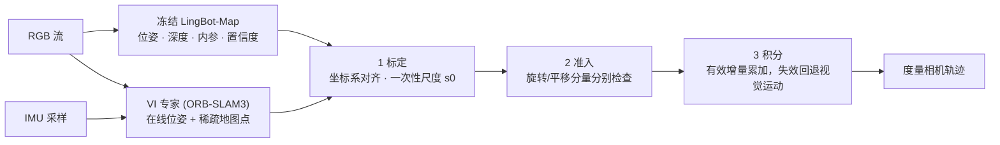

# VIStream：给流式几何基础模型接上惯性运动

**一句话定义：** VIStream 是一种免训练的视觉-惯性运动积分方法：保持 [LingBot-Map](./paper-lingbot-map.md) 等流式视觉几何模型不动，把标定后的视觉-惯性估计器（论文实现用 ORB-SLAM3）的运动增量按“有效性检查”融入，得到带度量尺度的相机轨迹。

## 英文缩写速查

| 缩写 | 英文全称 | 简要说明 |
|------|----------|----------|
| VI | Visual–Inertial | 相机 + IMU 联合估计运动 |
| IMU | Inertial Measurement Unit | 惯性测量单元，提供角速度与比力 |
| ATE | Absolute Trajectory Error | 绝对轨迹误差；论文用 SE(3) 与 Sim(3) 两种对齐 |
| Sim(3) | Similarity transform in 3D | 含尺度的相似变换对齐，只评估轨迹形状而非绝对尺度 |
| SLAM | Simultaneous Localization and Mapping | 同时定位与建图 |
| RPE | Relative Pose Error | 相对位姿误差 |

## 为什么重要

- 流式视觉几何模型（DUSt3R / VGGT / LingBot-Map 一类）几何先验强，但相机运动是纯视觉的，**没有持久的度量参考**；VIStream 给出一条不重训上游模型的补法，对只有相机的 3D 感知栈是相对独立的状态估计模块，背景见[状态估计](../concepts/state-estimation.md)。
- 它在 RP1 总览 README 的“Related papers”里被列出（署名 Mingzhe Liu，标注 ICRA），但**不是 RP1 的子系统**：仓库不在 Roboparty 组织下，仓库与项目页也没有提到 RP1 或人形机器人（本页据此判断，未见作者说明二者关系）。

## 流程总览

## 核心原理

据项目页 PDF（匿名稿，第 1–2 页）：

1. **标定**：把专家位姿经相机-IMU 外参变换到同一相机系；用同相机深度对应点估计一次长度换算 `s_t = exp(median(log D_visual − log z_expert))`，至少 32 个支持点，中位对数偏差不超过 log 1.5 才接受，首个接受值 `s0` 之后固定为**持久尺度**。
2. **准入**：只接受连接相邻相机到达、处于同一地图纪元的专家增量；旋转角速度 ≤ 8 rad/s 才用专家旋转；平移还需尺度已固定、位移速度 ≤ 5 个 z_med/s 且至少 5 个稳定正深度。旋转与平移**分量分别**判断。
3. **积分**：有效分量用专家增量（平移乘 `s0`），否则用视觉增量，逐步累乘得到轨迹；专家连接丢失时回退到视觉运动。深度放置只是辅助输出。

项目页与论文给出的数字（匿名稿 / 项目页自述）：

| 评测 | 结果 |
|------|------|
| 17 条 EuRoC + TUM-VI 序列 × 3 次重复，Sim(3) ATE | LingBot-Map 2.08 m → VIStream 0.73 m（降低 64.97%） |
| 同一专家位姿 + 同样视觉回退（控制实验） | SE(3) ATE 降低 69.33%，平移 RPE 降低 91.00% |
| 持久尺度 vs 每次重置重新估计尺度 | ATE 降低 41.32% |
| EuRoC MH05 单序列回放 | 5.93 m → 0.32 m |
| KITTI 00–10 完整重跑（后期离线修复配置，另行报告） | LingBot-Map 32.49 m；VIStream 回环关 15.25 m / 开 9.10 m |

## 工程实践

**开源状态核查（2026-10-27）：** **部分开源（仅源码）**。2026-10-14 的 `core-code-20261014` 发布含 VIStream 包、固定配置、推理与评测脚本、LingBot-Map 骨干源码及 DPVO / DROID-SLAM / PyPose / ORB-SLAM3 构建源；**不含**权重、数据集、预测轨迹、编译产物和离线环境，源码本身不能直接做端到端推理（[归档](../../sources/repos/vistream.md)）。

- 先读 `core/docs/SETUP_EN.md` 与 `DATASET_LAYOUT_EN.md`；`python3 validate_source.py` 做 CPU 静态检查（仅校验哈希并解析源码，不跑模型）。
- 此前验证过的环境为 Ubuntu 22.04、Python 3.10、PyTorch 2.8.0+cu128、NVIDIA H20 GPU；需要自行编译 DPVO 与 DROID 的 CUDA 扩展和 ORB-SLAM3。
- KITTI 复现需自备图像、时间戳、标定和原始 IMU；记录配置中序列 03 无匹配 IMU，发布说明要求不要用零或别的序列填充。
- 论文主表（EuRoC + TUM-VI 队列）与 KITTI 重跑使用**不同配置**，不要混用数字。

## 局限与风险

- **没有人形机器人场景的验证**：评测数据为 EuRoC、TUM-VI、KITTI，本页不推断其在人形机器人上的效果（推测需要额外的相机-IMU 标定与同步，参见 [IMU 原理与相机同步](../concepts/imu-principles-algorithms-camera-sync.md)）。
- **依赖外部 VI 专家**：方法的运动质量来自 ORB-SLAM3 的估计器；论文也说明系统对比不能单独归因于 IMU。
- **复现未闭环**：作者自己的完整运行未精确复现更早的修复结果（15.25 / 9.10 m 对 15.08 / 10.41 m），且源码发布未做新的 GPU 验证。
- **署名与发表状态**：PDF 为匿名稿，未在仓库中见 arXiv 编号或会议录用证明；README 的 ICRA 标注来自 RP1 总览。
- **许可不统一**：根目录无 LICENSE，第三方组件各自许可，商用前需逐项核对。

## 关联页面

- [LingBot-Map（冻结的视觉骨干）](./paper-lingbot-map.md)
- [ORB-SLAM3](./orb-slam3.md)
- [OpenVINS](./open-vins.md)
- [EuRoC MAV 数据集](./euroc-mav-datasets.md)
- [KITTI 基准](./kitti-stereo-benchmark.md)
- [状态估计](../concepts/state-estimation.md)
- [RoboParty RP1（总览）](./roboparty-rp1.md)
- [RoboParty（公司）](./roboparty.md)

## 参考来源

- [VIStream 仓库与项目页归档](../../sources/repos/vistream.md)
- [RP1 总览仓库归档](../../sources/repos/roboparty_rp1.md)

## 推荐继续阅读

- [VIStream 项目页](https://cn-mingzheliu.github.io/vistream/)
- [VIStream 核心源码发布](https://github.com/CN-MingZheLiu/vistream/releases/tag/core-code-20261014)
- [OpenVINS 文档](https://docs.openvins.com/)
