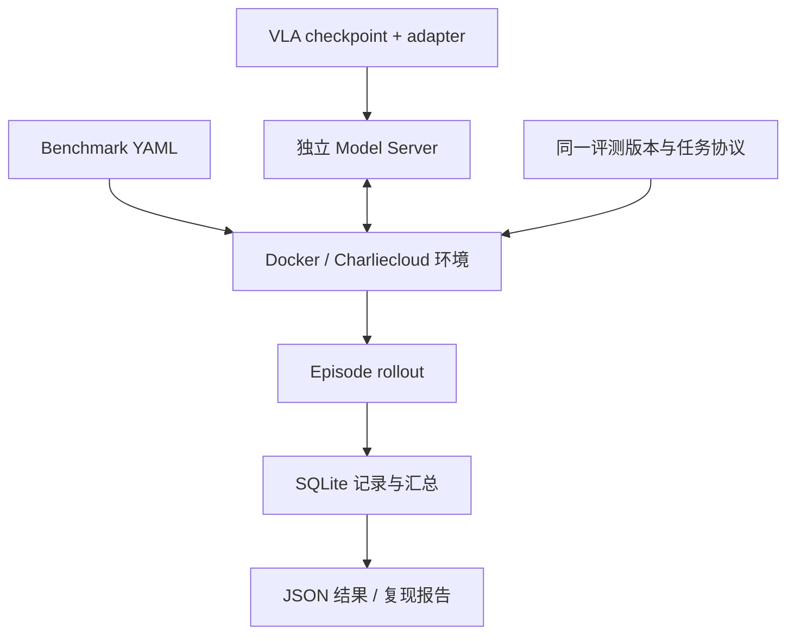
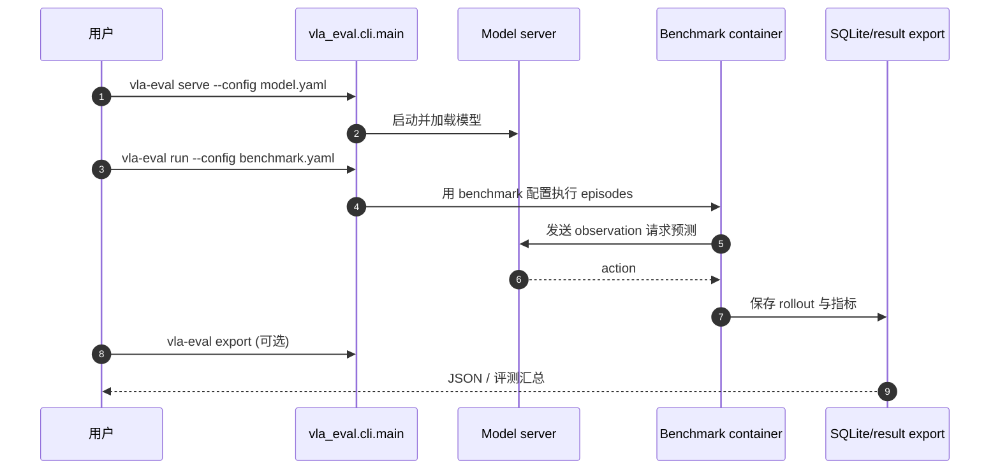

# vla-evaluation-harness：可复现的 VLA 统一评测框架 / Uniform VLA Evaluation Harness

## 一句话定义

**vla-evaluation-harness** 是 Ai2（Allen Institute for AI）开源的**机器人策略评测基础设施**，将模型服务和 benchmark 环境封装成独立适配模块，通过统一评测接口、隔离依赖和记录系统横向比较 VLA 策略。

## 英文缩写速查

| 缩写 | 英文全称 | 简要说明 |
|---|---|---|
| VLA | Vision-Language-Action | 待评测的策略类别 |
| API | Application Programming Interface | 训练期间启动评测的 Python 接口 |
| CLI | Command-Line Interface | `vla-eval serve/run/export` 命令 |
| GPU | Graphics Processing Unit | 模型推理和部分仿真环境的硬件 |
| OOD | Out-of-Distribution | 未见环境与不同扰动评测 |
| CI | Continuous Integration | 项目自身的自动化测试/复现门禁 |

## 为什么重要

不同模型的输出规范、相机视角和动作单位不同；不同模拟器又有各自依赖和版本，直接拼 benchmark 脚本容易出现环境冲突及看似可比、实际协议不同的成功率。该框架将模型与 benchmark 各自接入一次，降低多模型跨环境回归和部署式评估成本。

## 核心原理

- **模型服务：** 每个 checkpoint 用独立的 model-server config 和推理脚本提供动作接口。
- **环境适配：** Benchmark 有独立配置，默认 Docker 容器固定依赖，也提供 Charliecloud 方案；环境按 episode 与策略服务交互。
- **运行与记录：** `vla-eval run` 启动与模型对接的 rollout；SQLite 存储 episode/step/状态与输出，可 `vla-eval export` 汇总；支持 sharding 和训练过程 Python API。
- **复现证据：** README 中 ✓ 表示已复现，◇ 表示已集成等待复现，· 表示计划；**不等于全部矩阵均被验证**。

## 流程总览

## 源码运行时序图

对照项目 `pyproject.toml` 的 CLI entry `vla-eval = vla_eval.cli.main:main`，以及 README 的 `serve` 与 `run` 双终端命令，所示为**可验证的 CLI 层时序**。

README 的真实快速测试配置使用 `configs/model_servers/db_cogact/libero.yaml` 和 `configs/benchmarks/libero/smoke_test.yaml`。未在本次环境实际拉取容器/运行基准。

## 实验与评测

这是**评测工具**而非单一模型，无应被当作它的“模型成功率”的数字。README 的模型矩阵与 benchmark 支持矩阵会随 release 变动；可复现报告须注明 commit、环境配置、任务数、种子与模型权重。批量加速报告建立在特定 H100/episode 配置上，不代表每张卡固定 47 倍。

## 结论

**把“同模型同环境能否重现”从独立脚本提升成统一协议，是该框架的主要工程价值。**

1. 先用 smoke test 验证 server/环境契约再展开正式任务。
2. 把 ✓/◇ 状态和作者论文结果严格分离。
3. 对比模型时应冻结 benchmark 容器、rollout、动作尺度和指标口径。
4. 训练中在线评测可调用 Python API，但需控制资源竞争。
5. 容器许可、benchmark 资产和模型 checkpoint 均需单独确认。

## 工程实践

`pip install vla-eval`；先运行一个模型服务，再运行 benchmark 配置，可对 SQLite 做批量导出。项目代码、CLI 和配置公开，部分资源可能要求独立许可证及下载。

## 局限与风险

仓库集成列表大于已复现列表。跨机器人/仿真器协议没有自动消除观测与动作语义差异；不能只凭框架输出一个 success-rate 数字就声明跨模型公平。隔离环境也不等于已执行硬件安全验证。

## 关联页面

- [StarVLA 框架](./paper-starvla-framework.md)
- [VLA](../methods/vla.md)
- [MolmoAct2](./paper-molmoact2.md)
- [2026 开源对比](../comparisons/vla-open-source-ecosystem-2026-three-shifts.md)

## 参考来源

- [Ai2 官方 GitHub / README 通读归档](../../sources/repos/vla-evaluation-harness.md)

## 推荐继续阅读

- [GitHub](https://github.com/allenai/vla-evaluation-harness)
- [复现报告](https://github.com/allenai/vla-evaluation-harness/tree/main/docs/reproductions)
