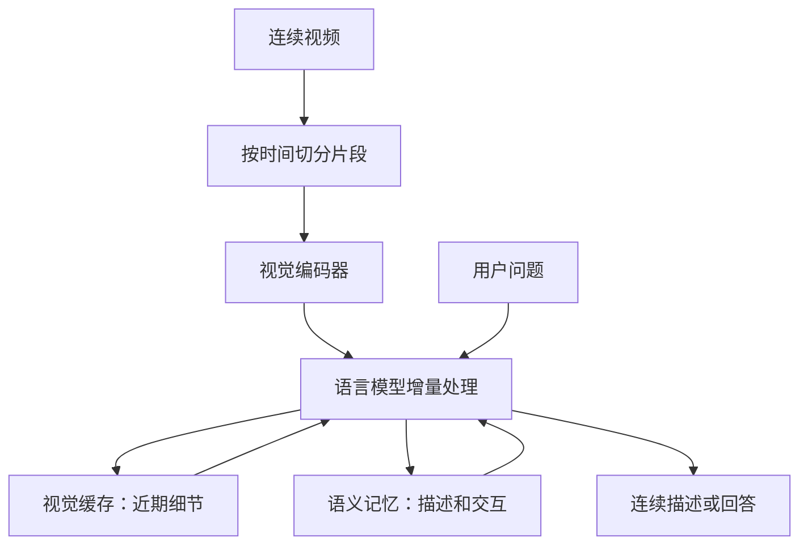

# VLX-Flow：面向实时多模态交互的连续视频理解

## 一句话定义

VLX-Flow 是 Om AI Lab 提出的流式视觉语言模型：按时间处理视频片段，维护视觉与语义状态，以支持随时提问和连续描述。

## 英文缩写速查

| 缩写 | 英文全称 | 简要说明 |
|------|----------|----------|
| VLM | Vision-Language Model | 视觉语言模型 |
| KV | Key-Value | 注意力机制的键值缓存 |
| TTFT | Time to First Token | 首 token 生成时延 |
| QA | Question Answering | 问答 |

## 流程总览

依据 [官方技术文章](https://om-ai-lab.github.io/2026_06_26_vlx_flow_zh.html)及 [README](https://github.com/om-ai-lab/VLX-Flow)：图是公开描述的概念流程，并非源码调用图。

## 核心机制

- **两层记忆：** 视觉缓存保存近期画面细节；语义记忆累积描述、问题、回答和对话上下文。多轮文本合并、裁剪或回放时，文章称会同步内部缓存。
- **增量推理：** 语言模型包含线性注意力模块，以递推状态承载历史；每个新片段无需重算全部视频。文章展示首 token 延迟趋势图，但未给出足以复现的测试配置和数值。
- **训练范式：** 时间顺序排列短片段及对应描述，随后提出问题；模型基于累积记忆回答，不能回看视频。描述监督历史压缩，问答检验记忆是否支持推理。

## 工程实践与局限

截至 2026-11-04，官方仓库公开 README 和素材，尚未见训练或推理代码；权重标为即将发布。官方文章未提供数据下载和完整评测配置，因此无法独立验证延迟、显存、长时记忆质量或端侧部署效果。事件提醒在 README 中是可扩展方向，不应视为已验证的部署能力。VLX-Flow 输出视频理解结果，官方资料未说明机器人动作策略或闭环控制实现。

## 源码运行时序图

不适用：当前仓库未提供可运行模型实现或运行入口；上述流程图仅依据官方文档。

## 关联页面

- [VideoLLM-online](./paper-sa-2406-11816-videollm-online-online-video-large-language-mode.md) — 另一项在线流式视频理解工作。
- [视觉–语言–动作模型](../methods/vla.md) — 将视觉语言理解与机器人动作连接的相关方向。

## 参考来源

- [官方仓库归档](../../sources/repos/vlx-flow.md)
- [官方技术文章归档](../../sources/sites/vlx-flow-official.md)

## 推荐继续阅读

- [VLX-Flow 官方技术文章](https://om-ai-lab.github.io/2026_06_26_vlx_flow_zh.html)
