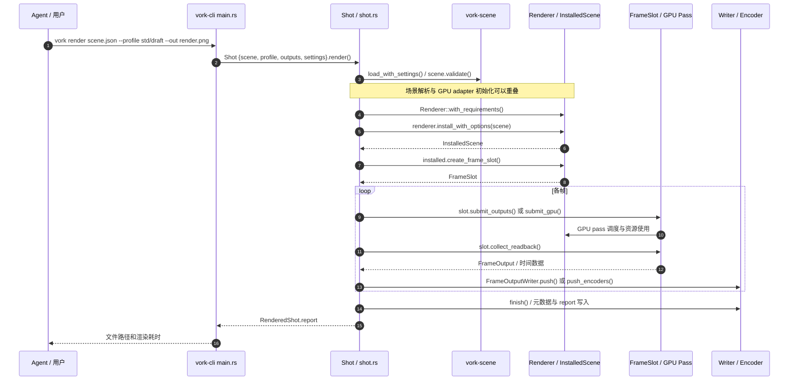

# Vork — Agent-native 3D and VFX engine / 面向 AI Agent 的无界面 3D 与影视特效引擎

## 一句话定义

**Vork** 是 Voyager 推出的 **headless（无 GUI）3D 与 VFX GPU 渲染引擎**：Agent 用场景 JSON / Python 或 TypeScript SDK 和按需的 Slang 程序定义镜头、材质、光传播、计算模拟与合成，再调用 CLI 输出图像或视频并迭代；它**不是**通用机器人动力学仿真引擎，也不是一键文本生成视频模型。

## 英文缩写速查

| 缩写 | 英文全称 | 简要说明 |
|---|---|---|
| VFX | Visual Effects | 影视后期特效：实拍素材、三维物体、遮挡和光照合成 |
| GPU | Graphics Processing Unit | Slang 程序和光线查询的执行硬件 |
| CLI | Command-Line Interface | Agent 用 `vork init` / `vork render` / `vork help` 调度引擎 |
| API | Application Programming Interface | 场景编辑与自定义着色/传播/合成的编程入口 |
| RT | Ray Tracing | 引擎利用硬件射线查询估计可见性和照明 |
| OIDN | Open Image Denoise | 官方 draft/final 小采样数输出所用的降噪器 |
| SDK | Software Development Kit | Python / TypeScript 可用于生成场景 JSON |

## 为什么重要

传统 DCC 工作台通常将编辑能力放在按钮和手工视口操作中，Agent 还需学习不稳定的图形交互。Vork 将场景和可定制效果明确呈现为**可读写、可版本管理、可调用的程序**，适合离线批量生成镜头预览、尝试非标准视觉规律或将实拍和渲染叠合。它关心的是“场景如何描述和输出图像”，不是刚体接触求解、机械惯量或控制策略训练。

这个“代码即可定义场景”的方向，可与 [Sand3D](./sand3d.md) 的程序化几何资产和 [3D-as-Code / 机器人仿真选型](../comparisons/3d-as-code-to-robot-simulation.md) 对照：前者聚焦**模型/关节资产表示**，Vork 聚焦**GPU 可视化/光传输/合成**；两者都不能自动替代有效的机器人动力学场景。

## 核心原理

| 层 | 官方实现与语义 | 证据 |
|---|---|---|
| Agent 侧 | Agent 编写 `scene.json`，可借 SDK 生成功能相同的场景 JSON；镜头特殊行为可加 Slang 程序。观看输出并修改属于上层 Agent 工作流 | README「Paste this to your agent」「Give it to an agent」 |
| Rust 场景层 | `vork-scene` Scene v2 加载/校验场景、分离声明式内容与渲染质量 Profile；宿主 CPU 承担解析、动画、I/O | `crates/vork-scene/src/lib.rs`、`crates/vork-render/src/shot.rs` |
| GPU 内核 | Rust / Slang；NVIDIA 经 Vulkan、Apple Silicon 经 Metal。默认光栅可见性 + 硬件光追照明，也有路径追踪。可编程钩子控制相机射线、材质响应、光传播、film response 和合成 | README「Under the hood」及 `crates/vork-render/src/` |
| GPU 驻留/帧调度 | `InstalledScene` 保留资源；`FrameSlot` 提交各帧的 GPU pass 并收集结果 | `crates/vork-render/src/lib.rs`、`shot.rs`、`frame.rs` |
| 成片 | 支持 PNG / EXR 与 MP4 / MOV；输出可包含控制通道和 metadata / camera sidecar；视频使用原生编码（满足条件时）或回读后备路径 | `crates/vork-cli/src/main.rs`、`crates/vork-render/src/shot.rs` |

“最小内核只做几何和光线查询”是官方设计取向，**不是**说宿主没有材质、计划、动画、编码、视频与 CPU 管理代码；不能将“agent 可改物理规则”误读成引擎自动满足任意物理真实性。

## 流程总览

下图是根据官方 README 和 `Shot::render` 构建的可追溯**场景渲染/Agent 反馈循环**；它不代表 Vork 内置自主 Agent。


## 源码运行时序图

官方可执行入口是 `vork render scene.json --profile std/draft --out render.png`。以下对照了 **`crates/vork-cli/src/main.rs` 的 `Command::Render` 和 `crates/vork-render/src/shot.rs` 的 `Shot::render_scoped`**，并参考 `frame.rs`、`lib.rs` 的真实职责。由于未执行二进制，这是**源码静态核查**，不是实测 trace。



重要：`Renderer::with_requirements` 的设备初始化在源码中实际被提前启动为线程并等待 scene requirements；时序图将其表现为逻辑步骤，不声称线程严格串行。原始模块入口、数据流和输出收尾见 [源码归档](../../sources/repos/vork-voyager.md)。

## 评测与性能（仅官方测量；非独立复现）

| 测试 | 官方结果 | 正确解读 |
|---|---|---|
| **百万鸟 skim**，NVIDIA L4，1080p24，192 帧，draft 4 samples + OIDN | `vork` **96.942 s**，三次完整成片中位数 | **不含** setup **243.809 s**、低分辨率 warmup **166.030 s** 和素材准备；加 setup+warmup 约 **506.781 s** |
| 同一个 skim，EEVEE **4 samples** | 外推 **773.7–1082.5 s** | 对 Vork warm command 约 **8–11×**；由少量热帧外推，**不是** Blender 完整片实测或严格等质比较 |
| skim，EEVEE **16 samples** | 外推 **1511.108 / 1817.625 s** | 两引擎样本数不同；宣传“24×同质加速”无充分证据 |
| 默认 final8 + OIDN 静帧对照 EEVEE 64 samples 无降噪 | 10 个可比较静帧 **1.15–1.90×** | 画质、采样数、时序条件不同 |
| 七个 240 帧完整短片 | final **1.14–2.32×** | 依赖 EEVEE 留存基线，非同步重测 |
| 路径追踪与 Cycles，旧构建 | Vork 部分场景 **慢 1.99–5.81×** | 不能概括为普遍快于 Blender |

来源是 [官方 Benchmark](https://github.com/voyager-so/vork/blob/main/benchmarks/RESULTS.md)，报告说明没有公开全部 raw logs/contact sheets；重跑脚本与测量版的部分参数不同，且 Blender 5.2.1 对比工具在相机准备环节存在已知问题。**禁止将“97 秒”“最高 24×”包装为独立验证的同画质结论。**

## 工程实践

最短开始路径（来自官方 README；这里未实际运行）：

```bash
vork init my-shot
cd my-shot
vork render scene.json --profile std/draft --out render.png
vork help
vork help programs --all
```

- **预览到交付：** `std/previs` 快速试构图；`std/draft` 为 4 samples + OIDN 的默认草稿；`std/final` 通常使用 8 samples + OIDN；`std/path` 走路径追踪。更多 samples 并不自动补回有限传输模式省略的光照效果。
- **实拍合成：** `examples/vfx-artifact/` 与 `examples/vfx-neon/` 展示外部相机跟踪、遮挡 matte、代理几何与局部照明；并非仅输入文字就自动完成真实素材配准。
- **自定义物理视觉效果：** `examples/black-hole/` 在公共光线传播钩子上加入 Schwarzschild 光路的**数值近似**；`examples/murmuration/` 用 Slang compute 更新鸟群；`examples/water/` 是有粒子预算和耦合限制的实验实现。
- **设备：** Linux / Windows 要求具有 Vulkan hardware ray queries 的 NVIDIA GPU；Apple Silicon 采用 Metal，官方预览版附带的 Slang toolchain 以 macOS 26 为最低目标。纯场景创建和 `vork help` 不需要 GPU。
- **机器人使用定位：** 可以考虑渲染验证、视觉预演、Agent 生成 3D 场景的镜头输出；没有证据说明 Vork 已通过 MuJoCo / Isaac Sim 的刚体、碰撞接触或政策学习精度基准，不应将其渲染 FPS 当作 Sim2Sim / Sim2Real 性能。

## 局限与风险

1. **许可证不是开源：** Vork Preview License 是 **source-available**，允许研究预览版内部改造、商业作品，但限制未授权的修改版分发、再许可和对外提供 hosted rendering；Blender bridge 单独采用 GPL-3.0-or-later。
2. **渲染保真仍依赖设定：** 4/8 samples 的极限速度可能造成边缘、焦外、稀疏亮点与谱光细节变化；不能将不同 profile 与不同 samples 的比较视为质量等价。
3. **环境与功能边界：** fog / participating volumes 预览版被忽略，大型场景与密集透明可 OOM；某些程序第一次运行需显著编译预热。示例水模拟并非成熟的通用流体/刚体耦合求解器。
4. **Agent 不是内置智能导演：** Vork 提供机器可调用的代码和渲染接口；镜头审美、素材授权、迭代策略和结果审查仍需上层 Agent/人类完成。
5. **Benchmark 独立性：** 官方 97 秒为有条件测量，不包含素材/预热；Blender 比较包含外推和不同硬件/计时边界，官方复现工具当时还有阻塞。未经本页独立 GPU 复跑。
6. **研发阶段：** 0.1.0 research preview 不意味着已完成大规模工作室级生产验证；未来更新及许可证可能调整。

## 关联页面

- [Sand3D](./sand3d.md) — 使用 Python 函数描述可编辑几何、部件与关节；与 Vork 的渲染程序层互补，不代表已集成。
- [3D-as-Code、网格与机器人仿真描述选型](../comparisons/3d-as-code-to-robot-simulation.md) — 解释“可编辑 3D 程序、可见网格、可运行物理仿真”三者不同。
- [前沿模型 × 3D / CAD / 机器人综述](../overview/frontier-models-3d-cad-robotics-survey.md) — 评估 agent harness、可编辑资产和人工验收。
- [ParaView MCP](./llnl-paraview-mcp.md) — Agent 操控已有视觉软件 vs Vork 原生无 GUI 的编程渲染。

## 参考来源

- [官方主页、创始人博客的通读归档](../../sources/sites/vork-voyager.md)
- [官方 README、CLI 源码、Benchmark 与 LICENSE 归档](../../sources/repos/vork-voyager.md)
- [官方 Vork README](https://github.com/voyager-so/vork/blob/main/README.md)
- [官方 Benchmark 全量结果表](https://github.com/voyager-so/vork/blob/main/benchmarks/RESULTS.md)
- [Vork Preview License](https://github.com/voyager-so/vork/blob/main/LICENSE)

## 推荐继续阅读

- [Vork 官方主页与演示](https://voyager.so/vork)
- [Voyager 开发者技术讲解：What is vork?](https://voyager.so/blog/what-is-vork)
- [官方鸟群场景及准备方法](https://github.com/voyager-so/vork/tree/main/examples/murmuration)
- [官方源码路径：CLI 入口](https://github.com/voyager-so/vork/blob/main/crates/vork-cli/src/main.rs) · [Shot 渲染生命周期](https://github.com/voyager-so/vork/blob/main/crates/vork-render/src/shot.rs)
