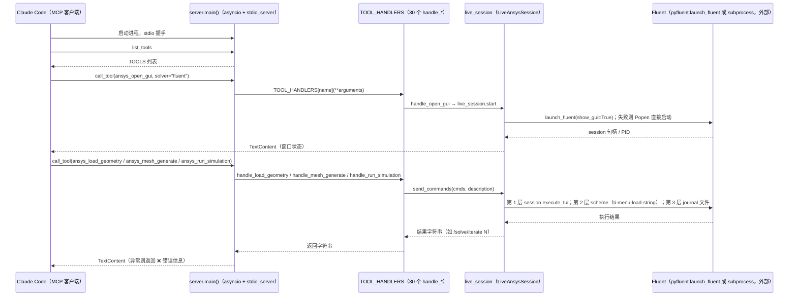

# Ansys MCP Server（PyAnsys）（vorobjewsen30-max/ansys-mcp-server）

## 一句话定义

Ansys MCP Server（PyAnsys）（vorobjewsen30-max/ansys-mcp-server）是PyAnsys 路线的 Ansys MCP 服务，文章概述约 24 个工具，覆盖 CFD、FEA、网格和后处理，并提供多语言文档。

## 英文缩写速查

| 缩写 | 英文全称 | 简要说明 |
|------|----------|----------|
| MCP | Model Context Protocol | 代理与工程软件工具的交互协议 |
| CAE | Computer-Aided Engineering | 计算机辅助工程软件与分析 |
| API | Application Programming Interface | 软件可供自动化调用的接口 |

## 为什么重要

对 CAE 自动化而言，代理能否稳定完成任务，取决于工程步骤是否清楚、工具边界是否明确、结果是否保留可审查证据。PyAnsys 路线的 Ansys MCP 服务，文章概述约 24 个工具，覆盖 CFD、FEA、网格和后处理，并提供多语言文档。

## 核心原理

**项目自身范围：** MCP server for Ansys engineering simulations via PyAnsys.

**工作流：** 代理经 MCP 选择仿真、网格和后处理工具；PyAnsys 将调用传递给对应 Ansys 产品。

## 工程实践

1. 从目标问题识别所需的 Skill、MCP、CLI 或软件接口，不把指导文件当成求解器。
2. 依照仓库 README 检查安装前提、软件/许可证、输入文件和输出证据。
3. 小规模运行并逐项核对几何、网格、边界、求解状态和物理量，再决定是否扩大任务。

文章所述的项目特征：PyAnsys 路线的 Ansys MCP 服务，文章概述约 24 个工具，覆盖 CFD、FEA、网格和后处理，并提供多语言文档。

## 局限与风险

需具备相应 Ansys 安装、许可证和兼容 PyAnsys 环境；任意脚本能力应限制在可信本机环境。

源码状态核验：该 GitHub 仓库于 2026-10-07 可公开访问。仓库 API 未报告 SPDX 许可证，应检查仓库内 LICENSE 与依赖许可。 涉及商业软件时，安装包和有效许可证需由使用者自行提供。

## 源码运行时序图

入口：`ansys-mcp-server`（`pyproject.toml` 的 `[project.scripts]` 指向 `ansys_mcp_server.server:main`），或直接 `python src/ansys_mcp_server/server.py`（末尾 `asyncio.run(main())`）；由 Claude Code 以 stdio 方式拉起。

图依据：vorobjewsen30-max/ansys-mcp-server@36b18a9，实际读过 `README.md`（工具与安装说明）、`pyproject.toml`（`[project.scripts]`）、`src/ansys_mcp_server/__init__.py`、`src/ansys_mcp_server/server.py`（`LiveAnsysSession.start` 与 `send_commands` 的三层投递、`TOOL_HANDLERS`、`main()` 与 `__main__` 入口、`handle_run_simulation` 的命令序列）。`handle_load_geometry` 与 `handle_mesh_generate` 发送的具体 TUI 命令内容未逐条核对，图中仅标注为「导入 CAD / 生成网格」；未运行代码，也未连接 Ansys 许可证。

## 关联页面

- [CAE / CFD 代理工具项目总览](../overview/cae-cfd-agent-skills-landscape.md)
- [Ansys MCP Server（多产品版）](./knewnothing-git-ansys-mcp-server.md)

## 参考来源

- [公众号文章原始资料归档](../../sources/blogs/wechat_cae_cfd_agent_skills_2026-10-07.md)
- [GitHub 仓库资料归档](../../sources/repos/vorobjewsen30-max-ansys-mcp-server.md)
- [vorobjewsen30-max/ansys-mcp-server 官方仓库](<https://github.com/vorobjewsen30-max/ansys-mcp-server>)
- 源码核对（2026-11-02）：vorobjewsen30-max/ansys-mcp-server@36b18a9，读过 README.md、pyproject.toml、src/ansys_mcp_server/__init__.py、src/ansys_mcp_server/server.py；时序图依据以上文件，未运行代码。

## 推荐继续阅读

- [项目 README](<https://github.com/vorobjewsen30-max/ansys-mcp-server/blob/main/README.md>)