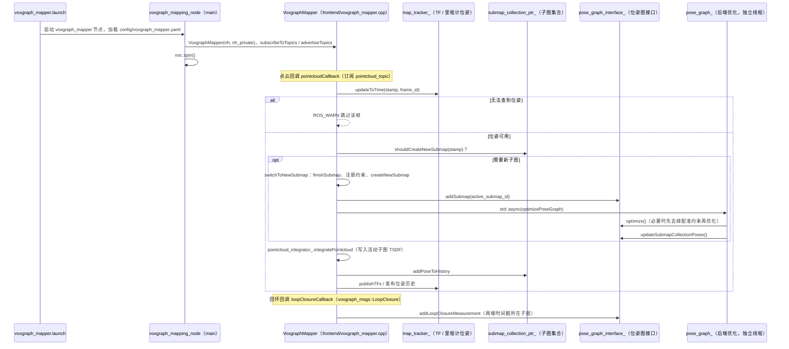

# Voxgraph

**Voxgraph** 在 **TSDF 子图** 上进行 **位姿图优化**，适合多会话对齐与稠密地图融合。

## 英文缩写速查

| 缩写 | 英文全称 | 简要说明 |
|------|----------|----------|
| LIO | LiDAR-Inertial Odometry | 激光-惯性里程计 |
| GPU | Graphics Processing Unit | 图形处理器，大规模并行仿真训练的算力基础 |
| CPU | Central Processing Unit | 中央处理器 |
| LiDAR | Light Detection and Ranging | 激光雷达，地形感知与建图主传感器 |
| VIO | Visual-Inertial Odometry | 视觉-惯性里程计，融合相机与 IMU 估计位姿 |
| SLAM | Simultaneous Localization and Mapping | 同步定位与建图 |

## 为什么重要

- **ETHZ ASL 路线**：与 Voxblox 稠密建图生态一致。
- **多会话**：适合重复巡检场景地图合并。

## 核心结构/机制

| 概念 | 说明 |
|------|------|
| **Submap** | TSDF 局部块 |
| **PGO** | 子图间位姿约束 |
| **Voxblox** | 底层体积建图 |

## 常见误区或局限

- **生态规模**：社区小于 FAST-LIO/LIO-SAM。
- **算力**：TSDF 融合消耗 GPU/CPU 资源。

## 源码运行时序图

入口：`roslaunch voxgraph voxgraph_mapper.launch pointcloud_topic:=<点云话题>`（可选 `rosbag_path:=` 回放数据）；启动的节点为 `voxgraph/src/voxgraph_mapping_node.cpp` 编译出的 `voxgraph_mapping_node`，主线程进入 `ros::spin()`。

图依据：ethz-asl/voxgraph@bd802b5，实际读过 `README.md`（安装与运行说明）、`voxgraph/launch/voxgraph_mapper.launch`、`voxgraph/src/voxgraph_mapping_node.cpp`（`main`）、`voxgraph/src/frontend/voxgraph_mapper.cpp`（构造、`pointcloudCallback`、`loopClosureCallback`、`switchToNewSubmap`、`optimizePoseGraph`）、`voxgraph/src/frontend/pose_graph_interface/pose_graph_interface.cpp`（`optimize`、`updateRegistrationConstraints` 段落）。点云被 `pointcloud_integrator_` 写入子图的内部细节、回环检测的上游来源（本仓库不负责检测，仅接收 `voxgraph_msgs::LoopClosure`）未逐行追踪。未编译、未运行 ROS 节点。

## 参考来源

- [sources/repos/voxgraph.md](../../sources/repos/voxgraph.md)
- [ethz-asl/voxgraph](https://github.com/ethz-asl/voxgraph)
- 源码核对（2026-11-02）：ethz-asl/voxgraph@bd802b5，读过 README.md、voxgraph/launch/voxgraph_mapper.launch、voxgraph/src/voxgraph_mapping_node.cpp、voxgraph/src/frontend/voxgraph_mapper.cpp、voxgraph/src/frontend/pose_graph_interface/pose_graph_interface.cpp；时序图依据以上文件，未运行代码。

## 关联页面

- [LiDAR / LIO / VIO 选型](../comparisons/lidar-slam-lio-vio-selection.md)
- [导航·SLAM·自动驾驶栈总览](../overview/navigation-slam-autonomy-stack.md)

## 推荐继续阅读

- https://arxiv.org/abs/1910.00229
