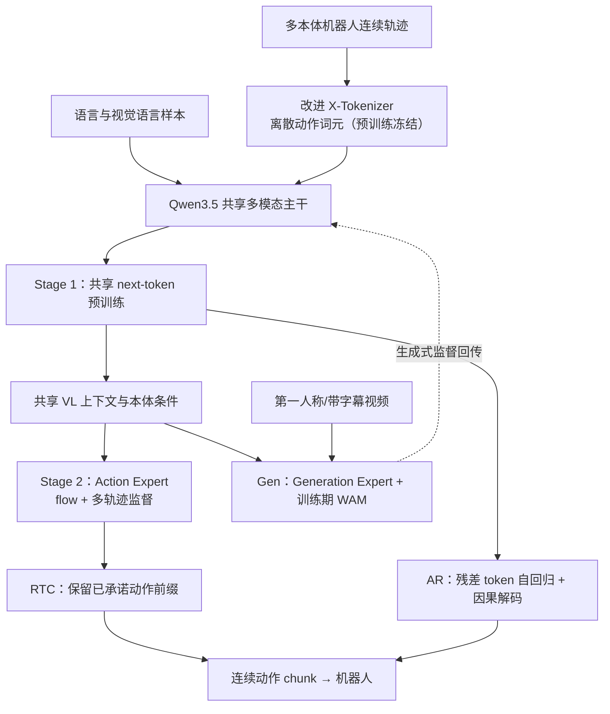
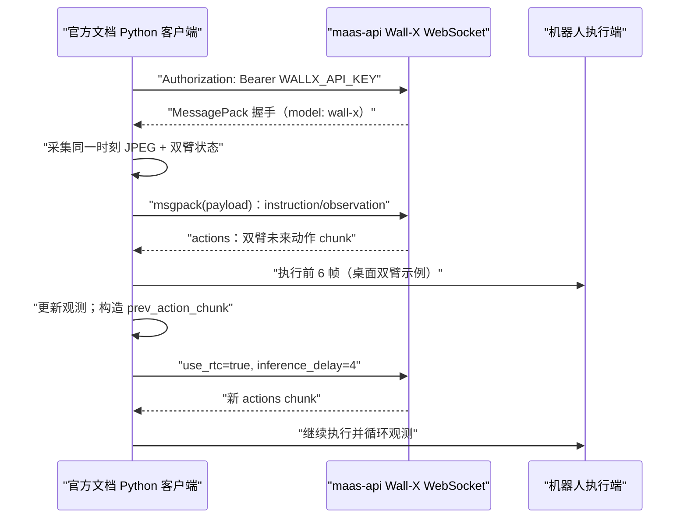

# WALL-OSS-1.0：Understand More, Act Better｜知深，行远

**官方技术报告式博客**：[WALL-OSS-1.0](https://x2robot.com/blog/wall-oss-1)，X Square Robot Team，**2026-11-23**。不是已知 arXiv 独立论文；不要把初代 [WALL-OSS](./cn-os-wall-x.md) 或 [WALL-OSS-0.5](./paper-wall-oss-0-5.md) 的论文编号、权重与结果套到本代。

## 一句话定义

**WALL-OSS-1.0** 是自变量机器人以 Qwen3.5 为基础、在预训练阶段原生联合学习视觉、语言、机器人轨迹的 VLA 模型家族：通过离散动作词元形成共享理解底座，再针对连续控制、低成本部署、人类视频与自回归动作推理提供不同分支。

## 英文缩写速查

| 缩写 | 英文全称 | 简要说明 |
|---|---|---|
| VLA | Vision-Language-Action | 视觉、语言、动作的统一建模 |
| VLM | Vision-Language Model | 视觉语言语义底座；本代由 Qwen3.5 扩展 |
| RTC | Real-Time Chunking | 在下一段生成期间继续执行已承诺动作，平滑衔接 |
| WAM | World Action Model | Gen 分支仅训练期使用的生成式世界-动作监督 |
| UMI | Universal Manipulation Interface | 官方在 Gen 数据监督中提到的可靠操作轨迹来源 |
| AR | Autoregressive | 自回归动作 token 生成的模型分支 |
| OOD | Out-of-Distribution | X2Real 中与训练场景不同的评测条件 |
| RAP | Robot Agent Protocol | XR Harness 的系统与机器人控制接入协议 |

## 为什么重要

- 从「先训练 VLM、再把动作头接上并微调」转向**原生共享语言、视觉和机器人动作的预训练**；目标是预训练 checkpoint 直接执行未知任务。
- 将 **理解能力保留**（通用多模态基准 79.2% vs 基座 79.4%）和 **开放式真机零样本执行**（312 个自由选任务）放在同一个研究问题里，但不能跨评测协议比较。
- 将模型结构与部署约束分开：Lite、Nano 面向适配/成本，Gen 用非精确动作视频补充监督，AR 尝试降低纯自回归控制的生成等待时间。

## 核心原理

### 两个建模层次

1. **原生 VLA 统一预训练（Stage 1）**：Qwen3.5 + 视觉编码器 + 模态投影 + 动作词表；改进版 [X-Tokenizer](./cn-os-x-tokenizer.md) 将跨本体连续轨迹压缩为离散动作 token。文本、图像/视频和轨迹在共享主干上用 next-token prediction 联合训练；动作 tokenizer 在该阶段冻结。
2. **精确连续动作与滚动执行（Stage 2）**：Action Expert 使用不同轨迹条件和目标训练状态、状态/控制与正逆动力学预测。上下文只编码一次，由多个相互隔离的轨迹训练块共用。部署通过 flow updates 生成连续动作块，RTC 把待执行命令作为无噪前缀约束后续 chunk。

### 模型家族的功能差异

| 变体 | 官方描述的机制 | 工程目标 |
|---|---|---|
| WALL-OSS-1.0 主线 | 原生 VLA + 连续动作专家 | 零样本泛化与动作精度 |
| Lite（4B） | 小参数变体 | 降低下游微调与迭代成本 |
| Nano（2B） | 小参数 + XInfer 服务优化 | 高并发、低算力部署 |
| Gen | Generation Expert + 训练期 WAM；质量分流的动作/未来视觉生成监督 | 利用 human ego / captioned video，改善灵巧操作训练覆盖 |
| AR | 时间压缩 + 分层残差 token，时间优先增量自回归解码、因果解码器与 RTC | 不借助独立 flow/diffusion expert 尽早输出可执行片段 |

**Gen 的边界**：Action Expert 仍由精确机器人轨迹与 UMI 数据直接监督；无动作标签视频经未来视觉预测向主干传递训练信号。WAM 不在 Gen 推理时运行；不能写成部署中实时生成世界视频。

### 原文核对的项目主流程

此图合并了博客的训练/推理层次，不代表这五种变体全部在同一个 checkpoint 上同时执行。

## 工程实践

### 复现与部署的可执行路径

- **代码边界**：官方 [wall-x](https://github.com/X-Square-Robot/wall-x) README 仍列 WALL-OSS-0.5 的 Qwen2.5 训练/推理与权重；本次没有核实到 1.0 的独立训练/推理源码和 checkpoint，**不能按 0.5 脚本假定 1.0 可复现**。
- **API 申请**：依据 [Wall-X API 官方文档](../../sources/sites/x2robot-wallx-api.md)，邮件至 `wallxapi@x2robot.com`，提供真实姓名、机构、职业、GitHub、测试环境和本体等信息。得到密钥后通过 `WALLX_API_KEY` 环境变量传入，不放入代码或页面。
- **客户端协议**：`wss://maas-api.x2robot.com/v1/vla/wallx`，Bearer 鉴权，MessagePack；握手先读取，再发送包含 `embodiment`、`instruction`、同步 JPEG 和末端绝对位姿的请求；响应是 `actions`。
- **动作单位**：双臂末端 xyz 以米为单位，RPY 以弧度表示，夹爪范围随 G/H 类型变化；文档双臂 `action_horizon=32`、`row_dt_s=0.0337 s`，RTC 示例执行 6 帧后再发新请求，`inference_delay` 只能 1–4。**这些是 Wall-X API 文档参数，不是 1.0 模型已实测的控制频率**。
- **本体范围**：TeleTwin Desktop、Quanta X1 Pro、YAM、AgileX 与 Franka 有各自字段约定；Quanta 的底盘/头/升降动作仍需谨慎，文档建议优先双臂测试。

### 官方 API 客户端运行时序图（不是 1.0 模型源码）

> 该时序**严格对应用户给出的云 API 客户端示例**，不是对未公开 WALL-OSS-1.0 服务端代码的反向推断。Franka 官方示例不使用 RTC。

## 实验与评测

| 官方披露的设置 | 结果 | 解释边界 |
|---|---|---|
| 开放式真机任务（312 个不同任务，评估者自由选择） | **55.1% 零样本成功率**；平均 **6.45/10** | 未任务专属微调；和固定 15 任务 ManipArena 对照是两套不同实验 |
| 通用 VLA–VLM 基准（8 项均值） | Stage 1 **79.2%**，Qwen3.5 基座 **79.4%** | 只表示在指定评测口径下接近基座 |
| X2Real 桌面仿真（40+ 任务） | **67.55/100**，Lingbot-VLA-2.0 **40.94/100** | 参评模型除博客明确例外者，接受 1 epoch 仿真微调，**不是零样本真机率** |
| X2Real 移动操作 OOD（3 任务） | **44.17** vs π0.5 **24.83** | 相同仿真测试分数，不能外推真实产线良率 |
| Nano + XInfer 生产场景 | 单块 Blackwell 消费级 GPU 支持 **18 台** | 同一特定服务环境的吞吐指标，不代表每台设备所有时延指标 |

## 结论

**1.0 的实质进展是让机器人经验进入多模态预训练底座，同时把精确执行交给动作专家与异步分块；“零样本”与“API 开放”必须分别验证。**

1. 比较不同 VLA 时区分**通用能力保留、零样本真机任务、仿真微调后得分**三个口径。
2. 接入新本体前先校验动作坐标系、夹爪归一化、三相机时间同步和 RTC 衔接，不可直接把示例数值当控制命令。
3. Gen 的训练期 WAM 与 AR 的无独立 flow 专家是**不同分支**，不要合并成单一执行图。
4. Wall-X API 有公开申请方法，但握手 `wall-x` **不提供可核验的 1.0 版本号**；向提供方确认模型版本后才能开展可复现基准。

## 与其他工作对比

| 版本 | 主干与训练 | 动作方案 | 已核验公开状态 |
|---|---|---|---|
| [WALL-OSS 初代](./cn-os-wall-x.md) | Qwen2.5-VL-3B；Inspiration→Integration | FAST + flow | wall-x 旧版本和对应权重 |
| [WALL-OSS-0.5](./paper-wall-oss-0-5.md) | Qwen2.5-VL-3B 扩展 MoT；单阶段共训 | RVQ token + flow | wall-x 1.1.0 与 0.5 权重 |
| **WALL-OSS-1.0** | **Qwen3.5；原生 V-L-A next-token 预训练** | **Action Expert / RTC；Gen 和 AR 独立分支** | 官方技术博客；1.0 专属源码/权重尚未通过公开入口核实 |

## 局限与风险

- **开放程度不等于项目名后缀 OSS**：本次官方技术博客没有提供足以复核 1.0 训练/部署栈的公开代码和预训练数据链接；既有 wall-x README 截至本次检查仍是旧版。
- **评测口径不同**：312 任务是开放式真机、不微调；X2Real 为仿真训练后评测。若不了解任务抽样、失败统计与机器配置，不应以一项结果外推所有场景。
- **安全与控制**：生成的动作块需要机械限位、碰撞保护、超时降级与实时控制器；API 文档不是安全认证。
- **远程服务不透明**：API 握手和文档未标注服务端具体 checkpoint，版本、限速、配额和隐私条款需申请时确认。

## 关联页面

- [VLA 方法](../methods/vla.md) · [机器人操作任务](../tasks/manipulation.md)
- [WALL-OSS-0.5](./paper-wall-oss-0-5.md) · [WALL-OSS 与 wall-x](./cn-os-wall-x.md)
- [X-Tokenizer](./cn-os-x-tokenizer.md) · [X2Real](./x2real-project.md)
- [世界动作模型](../concepts/world-action-models.md)

## 参考来源

- [WALL-OSS-1.0 官方博客归档](../../sources/sites/x2robot-wall-oss-1-0.md)（官方原文与测试口径）
- [Wall-X API 官方文档归档](../../sources/sites/x2robot-wallx-api.md)（申请、字段、RTC 与本体范围）
- [wall-x 旧版代码归档](../../sources/repos/wall-x.md)（供辨别开放版本，**不是** 1.0 代码）

## 推荐继续阅读

- [官方 WALL-OSS-1.0 技术博客](https://x2robot.com/blog/wall-oss-1)
- [官方 Wall-X API 申请与推理说明](https://x2robot.com/docs/quantax1pro/v1/model-development/wallx-api/api-usage-instruction)
- [X2Real 仿真评测背景](./paper-x2real.md)
