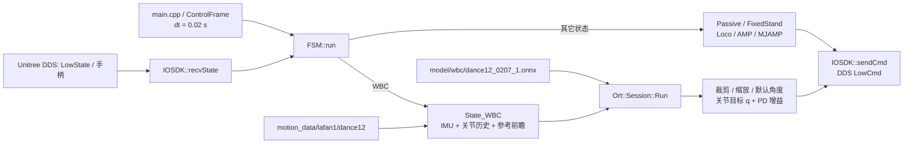
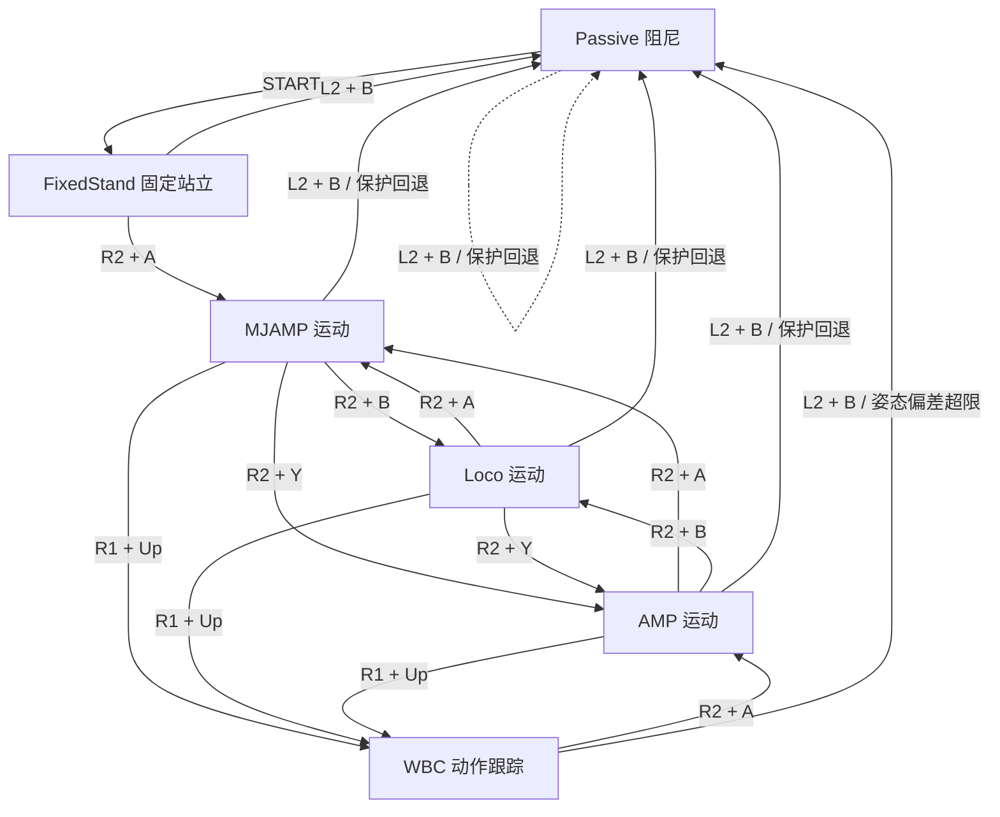
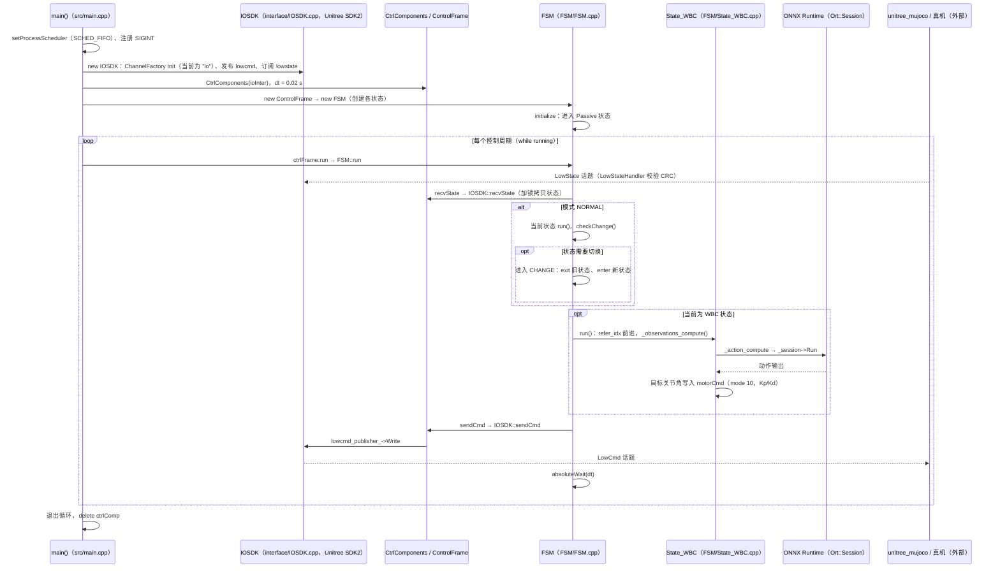

# wbc_fsm (G1 全身控制 FSM 部署框架)

**wbc_fsm** 是 **ccrpRepo / ZSTU Robotics** 针对 **Unitree G1** 人形机器人开发的 C++ 部署框架，以**有限状态机（FSM）**组织六个运行状态，WBC 状态加载 ONNX 动作跟踪策略及 LAFAN1 参考序列；这里的 WBC 是仓库的状态名，不应直接等同于传统基于任务优化的 QP-WBC。

## 一句话定义

用有限状态机组织阻尼保护、固定站立、多个运动状态与全身动作追踪，内置预训练 ONNX 策略，C++ 原生部署，无 ROS 依赖。

## 英文缩写速查

| 缩写 | 英文全称 | 简要说明 |
|------|----------|----------|
| Sim2Real | Simulation to Real | 把仿真中学到的策略迁移落地真机的工程主线 |
| G1 | Unitree G1 Humanoid | 宇树入门级教育科研人形平台 |
| WBC | Whole-Body Control | 协调全身关节满足多任务/约束的控制基础设施 |
| ONNX | Open Neural Network Exchange | 跨框架神经网络模型交换格式 |
| AMP | Adversarial Motion Prior | 用对抗判别约束状态转移接近专家运动分布的先验 |
| MoCap | Motion Capture | 动作捕捉，参考动作与演示数据的主要来源 |
| RL | Reinforcement Learning | 通过与环境交互最大化长期回报来学习策略的范式 |
| Retargeting | Motion Retargeting | 将人体/动物动作映射到目标机器人骨架 |
| GMR | General Motion Retargeting | 把人体/视频动作重定向为机器人可执行参考 |
| Locomotion | Robot Locomotion | 足式/人形等无轮移动能力的总称 |

## 为什么重要

- **FSM 作为运动控制运行时架构**：`FSM.cpp` 创建六个状态，按 `run() → checkChange()` 决定下一状态；先执行 `exit()`、`enter()` 再开始新状态控制，便于隔离阻尼、站立、行走和动作跟踪逻辑
- **ONNX C++ 推理闭环**：`State_WBC.cpp` 从 IMU、关节状态、动作历史及参考序列构造观测，经 `Ort::Session::Run` 得到动作，再转成关节目标位置与 PD 增益输出；代码提供的是部署侧，不能视为已复现训练过程
- **与 AMP_mjlab 的互补关系**：同属 ccrpRepo 的训练栈与部署栈可对照学习，但此部署仓没有证明其内置模型可由某一具体训练配置无修改地复现

## 核心机制

- **状态调度**：`main.cpp` 将周期设为 `dt=0.02 s`（名义 50 Hz）；`ControlFrame::run` 调用 `FSM::run`，按 NORMAL/CHANGE 两阶段完成状态切换与 DDS 指令发送。
- **观测**：WBC 读取本体 IMU、关节位置/速度、上次动作和状态历史；从运动参考文件提取多个前瞻帧（关节目标、anchor 位姿变化），完成坐标对齐、归一化与裁剪。
- **动作**：`Ort::Session::Run` 输出经过 clip 和 `action_scale`，叠加默认关节角，再用 `motorCmd.q/Kp/Kd` 发关节位置控制命令；不是显式 QP 求解器。
- **安全边界**：多个运动状态支持 `L2+B` 返回 Passive，WBC 将参考与实际 projected-gravity 的偏差超阈值作为返回 Passive 的触发条件；这些软件检查不能替代真机独立急停、上电前悬吊与实测安全验证。



## FSM 状态机设计

源码在 `src/FSM/FSM.cpp` 中注册 **Passive、FixedStand、Loco、AMP、MJAMP、WBC 六个状态**；README 用 Passive / Loco / WBC 概括主要功能，但不是全部实际状态。



切换条件依据 `State_Passive/FixedStand/Loco/Amp/MJAmp/WBC.cpp::checkChange()`；`R2` / `L2` 在 WBC 内对应不同的动作暂停方式，不是硬件急停。

## 主要技术路线

**资料与部署链路：LAFAN1 参考动作 →（外部完成的模型训练与导出）→ ONNX / 二进制参考数据 → C++ 状态机部署**

1. **动捕数据**：[LaFAN1](./lafan1-dataset.md) MoCap 数据集 → 重定向到 G1 骨架关节空间
2. **策略训练**：代码仓只提供部署资产，训练与导出具体配置需从独立训练项目核实；不能仅凭同组织推断模型来源
3. **ONNX 导出**：当前 `config/wbc.json` 指向 `model/wbc/dance12_0207_1.onnx`（README 示例仍含旧模型名）
4. **C++ 推理**：ONNX Runtime 1.22.0 在 x64 仿真环境或 G1 PC2（aarch64）上执行策略推理，驱动全身关节

## 工程实践

- **版本基线**：核对官方仓库 `ccrpRepo/wbc_fsm@4b9afa27`（2026-10-23）；本页引用路径以源码和仓库内实际 JSON 为准，不直接照抄 README 示例。
- **实际 WBC 配置**：`config/wbc.json` 使用 `model_path=model/wbc/dance12_0207_1.onnx`、`motion_path=motion_data/lafan1/dance12`、`start_idx=0`、`end_idx=-1`、`pause_idx=350`、`safe_projgravity_threshold=0.6`。README 示例中的 `folder_path` / `enter_idx` 与当前 `State_WBC.cpp` 解析的 `motion_path` / `start_idx` 不一致。
- **启动顺序**：按官方 README 分别配置 x64 / aarch64 的 ONNX Runtime 和 `IOSDK.cpp` 网络接口（仿真 `lo`，真机示例 `eth0`）；先运行 Unitree Mujoco 仿真再启动 `build/wbc_fsm`。真机应先验证硬件、悬吊与急停，不直接照搬仿真参数。
- **数据闭环**：`IOSDK::LowStateHandler` 检验 DDS 状态 CRC 并解析 IMU、关节与手柄；`recvState` 带锁复制状态；`sendCmd` 构造 LowCmd、计算 CRC 并发布。源码中的控制周期是名义 50 Hz，**并非**对最坏执行时间或真机时延的实测保证。

## 部署架构

```
G1 板端 (PC2 / aarch64)
├── wbc_fsm 主进程
│   ├── FSM 控制器          ← 状态转换逻辑
│   ├── ONNX Runtime        ← dance12_0207_1.onnx 策略推理
│   ├── BinaryArrayReader   ← motion_data/lafan1/dance12 参考数据
│   └── Unitree SDK2 接口   ← 关节指令下发 / 传感器读取
└── 手柄输入               ← 模式切换触发
```

**关键参数**：
- 推理引擎：ONNX Runtime 1.22.0（aarch64 / x64 双版本）
- 通信接口：真机 `eth0` / 仿真 `lo`
- 构建：CMake ≥ 3.14，C++ 17，`-O3 -pthread`

## 与 AMP_mjlab 的互补关系

| 维度 | AMP_mjlab | wbc_fsm |
|------|-----------|---------|
| 语言 | Python | C++ |
| 阶段 | 策略训练（仿真） | 策略部署（真机） |
| 框架 | mjlab + rsl_rl | Unitree SDK2 |
| 输出 | ONNX 模型文件 | 关节指令流 |
| 同组织 | ✅ ccrpRepo | ✅ ccrpRepo |

## 局限性

- **仅提供部署侧**：仓库无可复现该 ONNX 权重的完整训练配方，AMP_mjlab 只能作为相关训练工程对照
- **依赖 G1 + Unitree SDK2**：移植需适配关节映射、通讯、模型观测维度和下发协议
- **动作与配置限制**：随仓库提供的是 dance12 参考与对应模型；README 中的旧模型名、旧配置字段与当前源码不一致；并未在本次检查中编译、运行仿真或真机

## 源码运行时序图

入口：控制器 `controller/build/wbc_fsm`（`src/main.cpp` 的 `main`，先 `cmake .. && make -j4` 构建）；仿真时 `unitree_mujoco` 与之并行运行，通过 DDS 话题（`HG_CMD_TOPIC` / `HG_STATE_TOPIC`）交换数据。



图依据：ccrpRepo/wbc_fsm@4b9afa2，实际读过 `README.md`（构建与仿真运行步骤）、`config/wbc.json`、`src/main.cpp`、`src/control/ControlFrame.cpp`、`src/FSM/FSM.cpp`（`run`、`initialize`、`getNextState`）、`src/FSM/State_WBC.cpp`（`run`、`enter` 与 `_action_compute` 的调用段落，ONNX 会话加载）、`src/interface/IOSDK.cpp`（构造、`recvState`、`sendCmd`、`LowStateHandler` 的段落），以及 `include/control/CtrlComponents.h`。本次补核了 `State_WBC::_observations_compute`、`_action_compute`、`checkChange` 及 Passive/FixedStand/Loco/AMP/MJAMP 状态转移条件。未编译、未在仿真或真机上运行。


## 参考来源

- [sources/repos/wbc_fsm.md](../../sources/repos/wbc_fsm.md) — 仓库原始归档
- [sources/repos/ubisoft-laforge-animation-dataset.md](../../sources/repos/ubisoft-laforge-animation-dataset.md) — LaFAN1 数据集与评估脚本一手归档
- [LaFAN1 动捕数据集](./lafan1-dataset.md) — 许可、规模与工程要点（实体页）
- [ccrpRepo/wbc_fsm GitHub](https://github.com/ccrpRepo/wbc_fsm/tree/4b9afa27ad4eeab8e95584c67c91275b9831fc4d) — 源码快照（2026-10-23）
- [官方 README.md](https://github.com/ccrpRepo/wbc_fsm/blob/4b9afa27ad4eeab8e95584c67c91275b9831fc4d/README.md)、[config/wbc.json](https://github.com/ccrpRepo/wbc_fsm/blob/4b9afa27ad4eeab8e95584c67c91275b9831fc4d/config/wbc.json)、[State_WBC.cpp](https://github.com/ccrpRepo/wbc_fsm/blob/4b9afa27ad4eeab8e95584c67c91275b9831fc4d/src/FSM/State_WBC.cpp) — 与模型路径和运行逻辑核对
- Harvey et al., *Robust Motion In-Betweening*, SIGGRAPH 2020 — LAFAN1 数据集来源论文
- 源码核对（2026-11-02）：ccrpRepo/wbc_fsm@4b9afa2，读过 README.md、config/wbc.json、src/main.cpp、src/control/ControlFrame.cpp、src/FSM/FSM.cpp、src/FSM/State_WBC.cpp、src/interface/IOSDK.cpp、include/control/CtrlComponents.h；时序图依据以上文件，未运行代码。

## 关联页面

- [机器人安全状态机](../concepts/robot-safety-state-machine.md) — 硬件/通信故障安全态的通用概念
- [AMP_mjlab](./amp-mjlab.md) — 同组织，策略训练侧对应物
- [Unitree G1](./unitree-g1.md) — 目标硬件平台
- [unitree_rl_mjlab](./unitree-rl-mjlab.md) — Unitree 官方 RL+ONNX 部署参考
- [Whole-Body Control](../concepts/whole-body-control.md) — WBC 理论概念页
- [Motion Retargeting GMR](../methods/motion-retargeting-gmr.md) — LAFAN1 → G1 重定向方法
- [LaFAN1 动捕数据集](./lafan1-dataset.md) — MoCap 源数据与许可边界
- [Locomotion](../tasks/locomotion.md) — 上层任务场景
- [系统工程知识链](../overview/hub-systems-engineering.md)

## 推荐继续阅读

- [机器人安全状态机](../concepts/robot-safety-state-machine.md)：区分软件控制状态切换与完整安全体系。
- [Whole-Body Control](../concepts/whole-body-control.md)：对照任务空间/优化式 WBC 与本仓库的 RL 动作跟踪部署。
- [AMP_mjlab](./amp-mjlab.md)：了解独立训练框架，再验证观测、动作与权重的一致性。
- [官方仓库 README](https://github.com/ccrpRepo/wbc_fsm/blob/4b9afa27ad4eeab8e95584c67c91275b9831fc4d/README.md)：仿真与 G1 PC2 部署环境配置。
