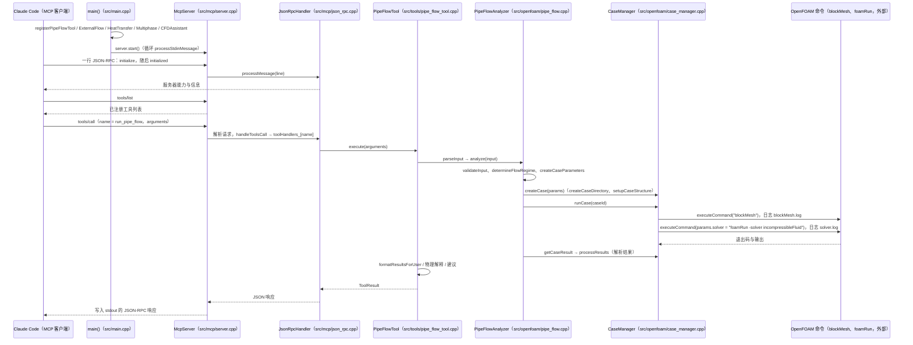

# OpenFOAM MCP Server（webworn/openfoam-mcp-server）

## 一句话定义

OpenFOAM MCP Server（webworn/openfoam-mcp-server）是OpenFOAM 执行层 MCP 服务，突出苏格拉底式教学问答：带用户逐步搭建算例并解释边界条件选择，同时提供报错排查。

## 英文缩写速查

| 缩写 | 英文全称 | 简要说明 |
|------|----------|----------|
| CFD | Computational Fluid Dynamics | 计算流体力学计算流程 |
| MCP | Model Context Protocol | 让代理发现并调用外部工具的协议 |
| y+ | Dimensionless Wall Distance | 壁面网格分辨率相关的无量纲距离 |

## 为什么重要

对 CAE 自动化而言，代理能否稳定完成任务，取决于工程步骤是否清楚、工具边界是否明确、结果是否保留可审查证据。OpenFOAM 执行层 MCP 服务，突出苏格拉底式教学问答：带用户逐步搭建算例并解释边界条件选择，同时提供报错排查。

## 核心原理

**项目自身范围：** LLM-powered OpenFOAM MCP server for CFD education and error resolution.

**工作流：** MCP 客户端调用服务暴露的工具，围绕算例配置与运行进行交互；对话会提示用户解释物理设置，而非只返回命令。

## 工程实践

1. 从目标问题识别所需的 Skill、MCP、CLI 或软件接口，不把指导文件当成求解器。
2. 依照仓库 README 检查安装前提、软件/许可证、输入文件和输出证据。
3. 小规模运行并逐项核对几何、网格、边界、求解状态和物理量，再决定是否扩大任务。

文章所述的项目特征：OpenFOAM 执行层 MCP 服务，突出苏格拉底式教学问答：带用户逐步搭建算例并解释边界条件选择，同时提供报错排查。

## 局限与风险

MCP 连接只解决工具调用，不自动验证模型物理性；执行安全、算例备份和求解器环境仍由用户负责。

源码状态核验：该 GitHub 仓库于 2026-10-07 可公开访问。仓库 API 报告许可证为 NOASSERTION。 涉及商业软件时，安装包和有效许可证需由使用者自行提供。

## 源码运行时序图

入口：`./build/openfoam-mcp-server`（完整版，需 OpenFOAM 环境）或 `./build/openfoam-mcp-server-test`（精简测试版）；`src/main.cpp` 注册工具后调用 `server.start()`，由 Claude Code 通过 stdin/stdout 上的 JSON-RPC 2.0 连接。

图依据：webworn/openfoam-mcp-server@8d14e20，实际读过 `README.md`（运行与 MCP 配置说明）、`src/main.cpp`（`main`）、`src/mcp/server.cpp`（`handleToolsCall`、`processStdinMessage`）、`src/mcp/json_rpc.cpp`（`processMessage` 开头）、`src/tools/pipe_flow_tool.cpp`（`execute` 与注册入口）、`src/openfoam/pipe_flow.cpp`（`analyze` 与求解器名设置）、`src/openfoam/case_manager.cpp`（`runCase` 中 `blockMesh` 与求解器两次 `executeCommand` 调用；`executeCommand` 经 `/bin/sh -c`）。图中只画了管道流工具这一条调用链，其余工具未展开；`processResults` 内部解析与 `formatResultsForUser` 的细节未逐行追踪。未编译，未运行 OpenFOAM 算例。

## 关联页面

- [CAE / CFD 代理工具项目总览](../overview/cae-cfd-agent-skills-landscape.md)
- [OpenFOAM Claude Suite](./swtbkim-openfoam-claude-suite.md)

## 参考来源

- [公众号文章原始资料归档](../../sources/blogs/wechat_cae_cfd_agent_skills_2026-10-07.md)
- [GitHub 仓库资料归档](../../sources/repos/webworn-openfoam-mcp-server.md)
- [webworn/openfoam-mcp-server 官方仓库](<https://github.com/webworn/openfoam-mcp-server>)
- 源码核对（2026-11-02）：webworn/openfoam-mcp-server@8d14e20，读过 README.md、src/main.cpp、src/mcp/server.cpp、src/mcp/json_rpc.cpp、src/tools/pipe_flow_tool.cpp、src/openfoam/pipe_flow.cpp、src/openfoam/case_manager.cpp；时序图依据以上文件，未运行代码。

## 推荐继续阅读

- [项目 README](<https://github.com/webworn/openfoam-mcp-server/blob/main/README.md>)