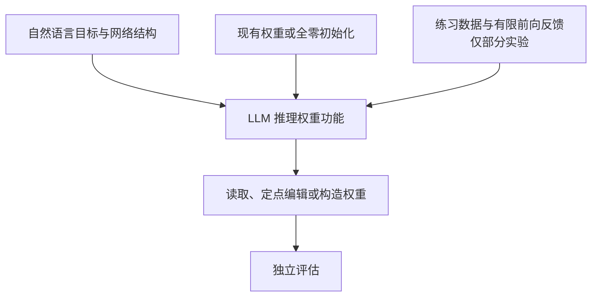
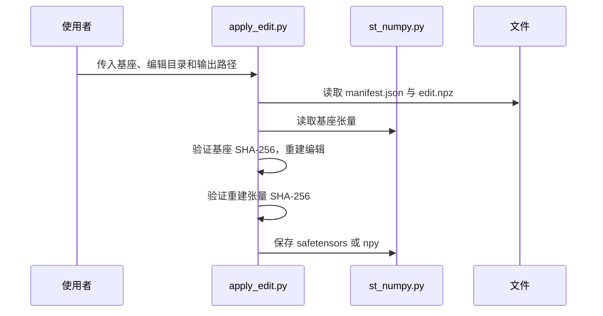

# Sparks of Weight-Space Programming / 权重空间编程的初步探索

## 一句话定义

通用大模型依据任务描述推理神经网络的计算，直接读取、编写或修改权重，而不通过梯度训练；是否允许前向反馈取决于实验设置。

## 英文缩写速查

| 缩写 | 英文全称 | 简要说明 |
|------|----------|----------|
| LLM | Large Language Model | 读取或编辑权重的通用语言模型 |
| PPO | Proximal Policy Optimization | 游戏和控制实验中的强化学习基线 |
| MLP | Multilayer Perceptron | 小型策略网络及 Transformer 中的多层感知机 |
| DDPM | Denoising Diffusion Probabilistic Model | 图形识别实验中的扩散模型 |

## 核心信息

| 项目 | 内容 |
|------|------|
| 作者与机构 | Rikiya Takehi、Jayden Teoh、Alex Zhang、Omar Khattab；麻省理工学院 CSAIL |
| 原文 | [作者博客](https://rikiyat.github.io/blog/weight-space-programming/)，2026-11-02；2026-11-03 通读网页正文 |
| 开放材料 | [实验日志与部分代码](https://github.com/RikiyaT/lm_understand-logs)、[Qwen 编辑权重](https://huggingface.co/RikiyaT/Qwen3.5-0.8B-weight-space-programming)；agent harness 和部分中间文件未发布 |

## 流程总览

不同实验的权限不同：MinAtar 构造实验无工具和环境 rollout；围棋和 Qwen 实验允许受预算限制的前向反馈。

## 实验与发现

| 实验 | 设置和作者报告 |
|------|----------------|
| 读取 | 从同结构小型策略权重辨认四种游戏；识别三种 DDPM 形状，但画出轮廓而非实心；用中间层分析三种字符模型的训练语言与复制头。 |
| 修复控制策略 | Kinetix 小车给定场景和一次失败轨迹，单次修改 3.5% 权重，原策略 0/256 成功，修改后 1024/1024 成功。不同批次与任务规模限制了泛化判断。 |
| 从零构造 | 三种 MinAtar 游戏中，一次生成的权重在设定的评测下均超过训练 1 亿步的 PPO；9×9 围棋在 50 次前向反馈预算下超过同规模 PPO。 |
| 辨别谄媚 | 仅看两组 Gemma 权重的四次尝试失败；提供注意力模式后辨认三组模型。 |
| Qwen 修复 | 50 次前向反馈预算下，修改第 15 和 19 层 MLP 输出的 131,072 个权重，MATH-500 从 7.9% 到 48.1%，GSM8K 从 13.8% 到 67.1%，IFEval 从 21.0% 到 62.3%；MATH-500 触及 32,768 token 上限比例从 93.0% 到 33.1%。 |

Qwen 实验使用 thinking 模式及指定采样参数、练习集和多次采样；结果不应脱离这些条件比较。作者认为主要消除了循环，使原有能力得以表现。对很少循环的 Gemma 3 270M，编辑未带来确立的数学能力提升。

## 源码运行时序图

以下描述**已公开的权重重建入口**，而非未公开的 agent harness：

入口及张量重建逻辑见 [apply_edit.py](https://github.com/RikiyaT/lm_understand-logs/blob/main/exp8_math/code/apply_edit.py)。官方 README 指出完整 agent harness 未公开；评测脚本还引用未包含的模块，完整复现需另行解决依赖。

## 局限与工程判断

- 这是作者报告的早期研究，不是机器人实机验证；不能把玩具环境控制结果直接推断到机器人安全部署。
- 权重直接分析在谄媚实验中失败，且对 Gemma 数学推理错误的编辑未得到明确提升。
- Qwen 结论与基线循环及特定解码设置有关；需同时报告完成率、准确率和其他任务回归，不能只看参数改动比例。
- 日志仓库只包含报告中的运行，早期提示词试验未收录；部分运行时材料缺失。

## 关联页面

- [Robotics Weight Editing](robotics-weight-editing.md)：将权重空间编辑用于 π₀.₅ 机器人策略，包含 YAM 初步真机评估。

- [CapVector 能力向量](paper-capvector-capability-vectors-vla.md)：同属参数空间操作，但依赖微调模型差分。
- [强化学习](../methods/reinforcement-learning.md)：PPO 是部分实验中的训练基线。

## 参考来源

- [原文归档](../../sources/blogs/weight_space_programming.md)
- [项目页归档](../../sources/sites/weight-space-programming.md)
- [实验仓库归档](../../sources/repos/lm_understand_logs.md)

## 推荐继续阅读

- [实验 8 的设置、日志与复现说明](https://github.com/RikiyaT/lm_understand-logs/tree/main/exp8_math)
