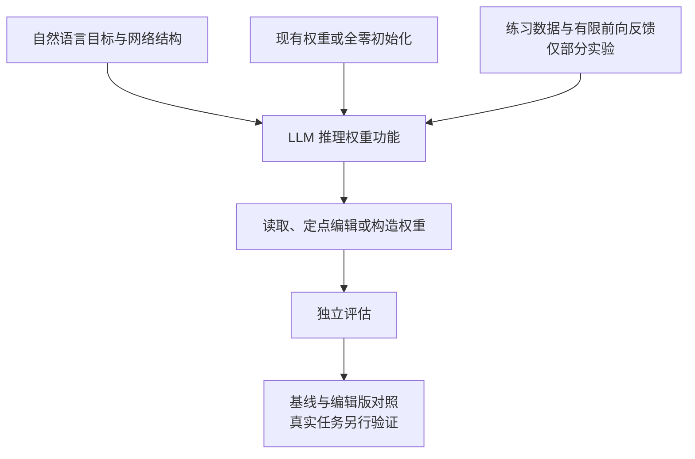
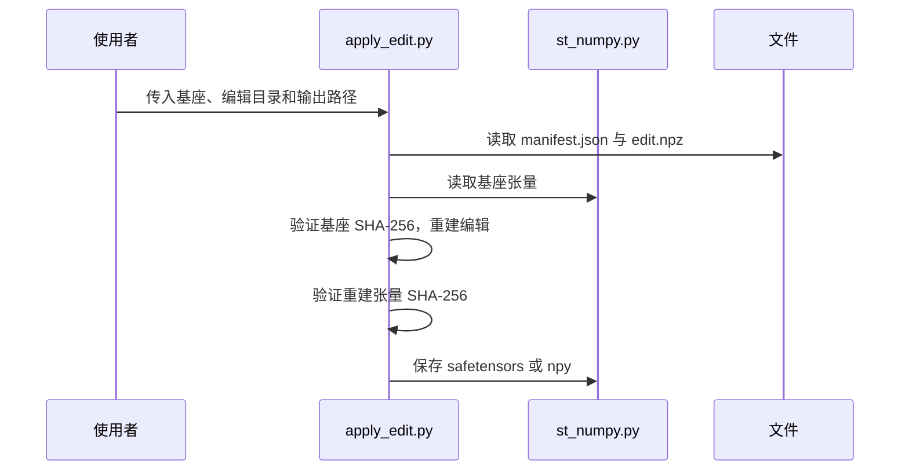

# Sparks of Weight-Space Programming / 权重空间编程的初步探索

## 一句话定义

权重空间编程（Weight-Space Programming）指把神经网络权重视为可读、可写的程序，由通用大模型根据任务目标推理并修改其计算；本博客实验刻意禁止梯度训练，但这一**概念本身不排斥梯度**。

## 英文缩写速查

| 缩写 | 英文全称 | 简要说明 |
|------|----------|----------|
| LLM | Large Language Model | 读取或编辑权重的通用语言模型 |
| PPO | Proximal Policy Optimization | 游戏和控制实验中的强化学习基线 |
| MLP | Multilayer Perceptron | 小型策略网络及 Transformer 中的多层感知机 |
| DDPM | Denoising Diffusion Probabilistic Model | 图形识别实验中的扩散模型 |

## 核心信息

| 项目 | 内容 |
|------|------|
| 作者与机构 | Rikiya Takehi、Jayden Teoh、Alex Zhang、Omar Khattab；麻省理工学院 CSAIL |
| 原文 | [作者博客](https://rikiyat.github.io/blog/weight-space-programming/)，2026-11-02；2026-11-03 通读网页正文 |
| 开放材料 | [实验日志与部分代码](https://github.com/RikiyaT/lm_understand-logs)、[Gemma 反例日志](https://github.com/RikiyaT/lm_understand-logs/tree/main/exp8_math/gemma_followup)、[Qwen 编辑权重](https://huggingface.co/RikiyaT/Qwen3.5-0.8B-weight-space-programming)、[在线比较 Demo](https://huggingface.co/spaces/akhaliq/weight-space-programming-demo)；agent harness 和部分中间文件未发布 |
| 核对版本 | 2026-11-15 再核对作者博客（含 11-12 Response to Comments）、实验 8 与 Gemma README、HF 模型卡及权重重建源码 |

## 为什么重要

它验证了一种不同于“让 Agent 修改训练脚本，再用优化器更新权重”的工作方式：LLM 可直接推理权重所实现的行为，从失败模式定位到局部编辑。不过它只是**新兴能力概念**，并非标准化的单一优化方法；具体实验也不构成对传统训练或可解释性技术的公平全面替代比较。

## 核心原理与流程总览

不同实验的权限不同：MinAtar 构造实验无工具和环境 rollout；围棋和 Qwen 实验允许受预算限制的前向反馈。

## 实验与发现

| 实验 | 设置和作者报告 |
|------|----------------|
| 读取 | 从同结构小型策略权重辨认四种游戏；识别三种 DDPM 形状，但画出轮廓而非实心；用中间层分析三种字符模型的训练语言与复制头。 |
| 修复控制策略 | Kinetix 小车给定场景和一次失败轨迹，单次修改 3.5% 权重，原策略 0/256 成功，修改后 1024/1024 成功。不同批次与任务规模限制了泛化判断。 |
| 从零构造 | 三种 MinAtar 游戏中，一次生成的权重在设定的评测下均超过训练 1 亿步的 PPO；9×9 围棋在 50 次前向反馈预算下超过同规模 PPO。 |
| 辨别谄媚 | 仅看两组 Gemma 权重的四次尝试失败；提供注意力模式后辨认三组模型。 |
| Qwen 修复 | 50 次前向反馈预算下，修改第 15 和 19 层 MLP 输出的 131,072 个权重，MATH-500 从 7.9% 到 48.1%，GSM8K 从 13.8% 到 67.1%，IFEval 从 21.0% 到 62.3%；MATH-500 触及 32,768 token 上限比例从 93.0% 到 33.1%。 |

Qwen 实验使用 thinking 模式及指定采样参数、训练集练习题和多次采样；50 次前向反馈调用**不等于 50 道题**，每次调用可容纳多道题，不能脱离预算与解码设置比较。作者认为主要削弱了输出循环，使已有能力得以表现，不能把它解释为凭空创造数学推理能力。

### Gemma 对照：没有循环瓶颈时的失败案例

| Gemma 3 270M IT / MATH-500 | 基座 | 5 次前向 | 10 次前向 | 25 次前向 | 50 次前向 |
|---|---:|---:|---:|---:|---:|
| 成绩（%，每题 4 样本、宽松答案提取） | 6.8 | 7.0 | 7.6 | 7.7 | 7.0 |

Gemma 基座达到 8,192 token 上限的比例为 8.5%，与 Qwen 的 93% 不同。编辑尝试针对数字相关神经元或少量列缩放，但未取得作者认为可信的数学能力增益；这些是作者实验结果，不是关于所有 Gemma 版本或所有权重编辑法的不可能性定论。详见 [Gemma follow-up README](https://github.com/RikiyaT/lm_understand-logs/blob/main/exp8_math/gemma_followup/README.md)。

### Qwen 检查点独立重测

HF 模型卡记录：对编辑版进行了完整 MATH-500 复测，500 题 × 4 次采样，得分 51.0%，达到长度上限 31.6%；相同页面对基础版仅测试 25 道题（5.0%），属于 smoke test，**不可把这两组数值当成等规模独立复测对照**。作者博客的完整基线/编辑版 7.9%→48.1% 仍采用文中原始评测协议。

## 工程实践

1. **观察现象：** 用相同 thinking、采样、生成长度与评测器复测基础/编辑模型；关注答案正确率、生成截断比例和指令遵循指标，而不是只比较修改参数数量。
2. **验证差异：** 官方 Qwen 版本基于 `Qwen/Qwen3.5-0.8B` 指定 revision；通过 `exp8_math/runs/p50c/edit/manifest.json` 与 `edit.npz` 用 `apply_edit.py` 重建差分并逐张量校验 SHA-256，重点检查第 15、19 层 MLP `down_proj.weight`。
3. **比较 Demo：** [Hugging Face 在线体验](https://huggingface.co/spaces/akhaliq/weight-space-programming-demo) 可观察两版输出，但人工挑选问题的演示不能替代预注册、隐藏集、多种采样种子的统计评测。
4. **机器人迁移：** 该工作没有自己部署真机策略；[Robotics Weight Editing](robotics-weight-editing.md) 是另一个研究团队的延伸案例，不能将其真机结论归于 MIT 本文。

## 源码运行时序图

以下描述**已公开的权重重建入口**，而非未公开的 agent harness：

入口及张量重建逻辑见 [apply_edit.py](https://github.com/RikiyaT/lm_understand-logs/blob/main/exp8_math/code/apply_edit.py)。官方 README 指出完整 agent harness 未公开；评测脚本还引用未包含的模块，完整复现需另行解决依赖。

## 局限与工程判断

- 这是作者报告的早期研究，不是机器人实机验证；不能把玩具环境控制结果直接推断到机器人安全部署。
- 权重直接分析在谄媚实验中失败，且对 Gemma 数学推理错误的编辑未得到明确提升；需要区分“消除原有瓶颈”和“形成新的可泛化能力”。
- Qwen 结论与基线循环及特定解码设置有关；需同时报告完成率、准确率和其他任务回归，不能只看参数改动比例。作者明确指出这篇博客不是一个新优化算法，也未宣称优于所有人类可解释性研究者。
- 日志仓库只包含报告中的运行，早期提示词试验未收录；部分运行时材料缺失。

## 关联页面

- [Robotics Weight Editing](robotics-weight-editing.md)：将权重空间编辑用于 π₀.₅ 机器人策略，包含 YAM 初步真机评估。

- [CapVector 能力向量](paper-capvector-capability-vectors-vla.md)：同属参数空间操作，但依赖微调模型差分。
- [强化学习](../methods/reinforcement-learning.md)：PPO 是部分实验中的训练基线。
- [paper-compounding-physical-rsi](paper-compounding-physical-rsi.md) — Compounding Physical RSI（权重空间候选筛选的一个应用实例）

## 参考来源

- [原文归档](../../sources/blogs/weight_space_programming.md)
- [项目页归档](../../sources/sites/weight-space-programming.md)
- [实验仓库归档](../../sources/repos/lm_understand_logs.md)

## 推荐继续阅读

- [实验 8 的设置、日志与复现说明](https://github.com/RikiyaT/lm_understand-logs/tree/main/exp8_math)
- [Gemma 270M 反例：运行、评测与权重差分](https://github.com/RikiyaT/lm_understand-logs/tree/main/exp8_math/gemma_followup)
- [Hugging Face 编辑权重、评测与在线体验入口](https://huggingface.co/RikiyaT/Qwen3.5-0.8B-weight-space-programming)
