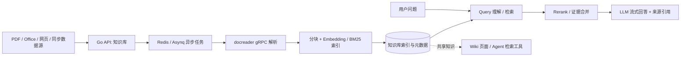
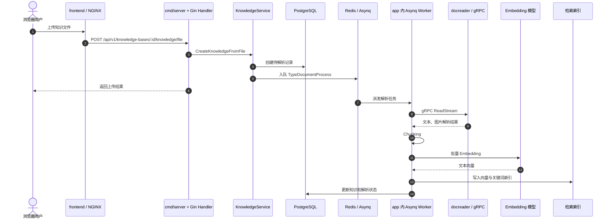

# WeKnora：开源 RAG、Agent 与 Wiki 知识平台（Open-source Knowledge Management Framework）

## 一句话定义

**WeKnora** 是腾讯开源的知识管理平台：将文档和外部数据源解析、索引到知识库，再通过有引用的 RAG 问答、带工具的 Agent 与可维护的 Wiki 消费同一份知识。

## 英文缩写速查

| 缩写 | 英文全称 | 简要说明 |
|---|---|---|
| RAG | Retrieval-Augmented Generation | 检索知识片段再增强模型回答 |
| LLM | Large Language Model | 用检索证据生成问答内容的大语言模型 |
| OCR | Optical Character Recognition | 从扫描件或图片中提取文本 |
| MCP | Model Context Protocol | Agent 与外部工具/知识服务对接的协议 |
| SSE | Server-Sent Events | 服务端流式推送答案、引用与进度 |
| RBAC | Role-Based Access Control | 工作空间与资源级别的角色权限控制 |

## 为什么重要

机器人研发团队的论文、实验说明、硬件手册、故障记录与项目文档经常分散在不同系统。WeKnora 提供一条**可私有化、可维护、可追溯证据的知识问答链路**，便于比较「原始文档搜索」与「Agent/Wiki 持续整理」的工程取舍。

它解决的是知识检索和协作问题，**不是** 机器人运动控制器、VLA 训练框架或真机在线执行栈。

## 核心原理

### 官方组件分工

| 层 | 官方实现 | 作用 |
|---|---|---|
| 前端与 API | `frontend/`：Vue 3 + NGINX；`cmd/server/`、`internal/`：Go + Gin | 上传、会话、Agent、知识库 API |
| 文档解析 | `docreader/main.py`：Python / gRPC | 解析 PDF、Office、网页等，支持 OCR 与图片提取 |
| 存储与任务 | PostgreSQL/ParadeDB、Redis + Asynq | 业务元数据、默认关键词/向量索引、异步解析任务 |
| 检索与生成 | 混合检索、Rerank、LLM、SSE | 召回、重排、带出处生成 |
| 可选组件 | Neo4j、独立向量库、MCP 工具、Skills 沙箱等 | GraphRAG、外部执行能力与可扩展后端 |

### 流程总览（来源于官方架构与 RAG Pipeline）



**RAG、Agent 和 Wiki 共用知识库**，但使用路径不同：RAG 快速回答，Agent 可多步调用检索、浏览器或 MCP 等工具，Wiki 将证据整理为可编辑、有版本的知识页。GraphRAG 与 Neo4j 属于按需启用的增强项，不是所有部署的必备路径。

## 源码运行时序图

下图描述官方 **Docker Compose 运行的文档上传到可检索索引** 的路径，依据 [官方总体架构](https://github.com/Tencent/WeKnora/blob/main/website-docs/02-architecture/01-overview.md) 中的请求链路；启动入口核对 [`cmd/server/main.go`](https://github.com/Tencent/WeKnora/blob/main/cmd/server/main.go) 与 [`docreader/main.py`](https://github.com/Tencent/WeKnora/blob/main/docreader/main.py)，未实机抓 trace。



问答的另一条可执行路径是 `internal/application/service/chat_pipeline/` 的事件插件链（理解问题 → 并行检索 → Rerank → 合并 → 上下文构造 → LLM 流式生成），由 `EventBus` / `StreamManager` 转成 SSE 事件，见 [官方 RAG Pipeline](https://github.com/Tencent/WeKnora/blob/main/website-docs/02-architecture/04-rag-pipeline.md)。

## 工程实践

标准部署入口由 [官方 README](https://github.com/Tencent/WeKnora#run-with-docker-compose) 给出：

```bash
git clone https://github.com/Tencent/WeKnora.git
cd WeKnora
cp .env.example .env
# 根据模型端点、凭证及部署网络修改 .env
docker compose pull
docker compose up -d
```

浏览器访问 `http://localhost` 完成首次配置。正式环境建议验证：

1. 文档解析成功率与失败原因（尤其扫描 PDF、图表、长文档）；
2. 混合检索的 Recall@k、Rerank 后证据相关性与引文回溯；
3. 端到端回答延迟、模型费用、数据源同步与索引更新；
4. 工作空间 RBAC、API Key、沙箱与出站连接限制。

以机器人项目为例，可先导入 URDF/MJCF 说明、硬件手册、调试日志和 Wiki，做带原文引用的故障问答；是否能提升研发效率应以**真实问题集**评测，而非以平台功能列表替代效果测试。

## 局限与风险

- **证据质量受解析与检索影响：** 复杂图表、OCR、分块和 Rerank 失误都可能导致错误答案；引用存在不等于正确。
- **私有化不等于自动安全：** 配置外部 LLM、存储、MCP 工具及 Agent 沙箱后，仍要审查访问边界、凭证与数据外发；官方明确建议内网部署。
- **模块依赖：** 默认 PostgreSQL/Redis 和可选 Neo4j/外部模型的部署成本不同；Lite 模式与标准多服务模式能力/依赖需按文档核对。
- **评测与复现：** 本条基于官方文档和入口静态核查，尚未本地部署、跑基准或验证具体召回率；不对性能作未经验证的承诺。
- **开源状态：** 官方仓库提供可运行的服务、解析器及部署编排源码，许可为 MIT（第三方依许可文件）；不是仅开放一个演示页面。

## 关联页面

- [人形机器人智能语音交互](../methods/humanoid-voice-interaction.md) — 可将知识问答平台作为机器人对话的候选知识后端；语音识别、语音合成与实际技能控制仍需独立集成，不代表官方已有这项集成。
- [文档与场景 OCR 方法](../methods/yolo26-ocr-document-parsing.md) — 对照专用 OCR 文字检测/识别与 WeKnora 的文档解析及索引职责，不代表 WeKnora 内置该 YOLO26 方法。
- [RAG（检索增强生成）](../concepts/retrieval-augmented-generation.md) — 问答链路的基础方法
- [All-in-RAG](./all-in-rag.md) — 从教学课程理解索引、检索、生成和评测
- [LLM Wiki（Karpathy 模式）](../concepts/llm-wiki-karpathy.md) — 查询时检索与知识编译之间的关系

本项目是通用知识基础设施，已对照 [纵深路线总览](../../roadmap/README.md)：不属于现有运动控制、Sim2Real、VLA 等路线的必学算法节点，**不强行挂载 Stage**。

## 参考来源

- [一手代码仓库归档](../../sources/repos/weknora.md)
- [官网及产品技术文档归档](../../sources/sites/weknora-official-docs.md)
- [腾讯官方 GitHub](https://github.com/Tencent/WeKnora)
- [官方产品介绍](https://github.com/Tencent/WeKnora/blob/main/website-docs/01-getting-started/01-introduction.md)
- [官方架构与文档入库时序](https://github.com/Tencent/WeKnora/blob/main/website-docs/02-architecture/01-overview.md)
- [RAG Pipeline 插件链](https://github.com/Tencent/WeKnora/blob/main/website-docs/02-architecture/04-rag-pipeline.md)

## 推荐继续阅读

- [WeKnora 官方部署及升级说明](https://weknora.weixin.qq.com/docs/01-getting-started/02-installation)
- [WeKnora RAG 检索管线详解](https://github.com/Tencent/WeKnora/blob/main/website-docs/02-architecture/04-rag-pipeline.md)
