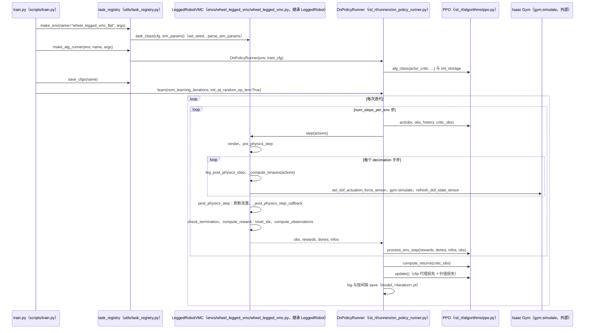

# Wheel-Legged-Gym

**Wheel-Legged-Gym**（[GitHub](https://github.com/clearlab-sustech/Wheel-Legged-Gym)）来自 [古月居转载的四足机器人开源项目综述](https://mp.weixin.qq.com/s/pRGoPm41qYCNyHPWR6Dl6A)，属「轮足机器人」组。

## 一句话定义

**Wheel-Legged-Gym（南方科技大学 CLEAR Lab）是基于 legged_gym 与 rsl_rl 的轮足机器人强化学习环境。**

## 英文缩写速查

| 缩写 | 英文全称 | 简要说明 |
|------|----------|----------|
| RL | Reinforcement Learning | 强化学习 |

## 为什么重要

- 综述把它放在「轮足机器人」这条技术路线下，作为可读源码的参照项目；横向对比见 [四足机器人开源项目技术地图：从极简运动学到研究级硬件（36 个 GitHub 项目）](../overview/quadruped-open-source-projects-technology-map.md)。
- 文中星标：（文中未给）（文章表述，入库日未复核）。

## 核心信息

| 项 | 内容 |
|----|------|
| **仓库** | [clearlab-sustech/Wheel-Legged-Gym](https://github.com/clearlab-sustech/Wheel-Legged-Gym) |
| **最近提交** | 2024-06-19 |
| **可达性** | `git ls-remote` 可达（2026-11-01） |
| **文章归类** | 轮足机器人 |

## 文章说法核对

- **文章：** 文章称其简单易上手，有清晰代码结构与文档，含完整训练流程并提供预训练模型。
- **README / 核查：** README 致谢 legged_gym 与 rsl_rl，列出相关论文（Learning to Walk in Minutes…、Concurrent Training of a Control Policy and a State Estimator…），安装依赖 Python 3.8 与 Isaac Gym Preview 4。
- **差异与保留：** 「预训练模型」「文档详细」来自文章，未核实。

## 源码运行时序图

入口：`python wheel_legged_gym/scripts/train.py --task=wheel_legged_vmc_flat`（训练，README 推荐入口；`play.py` 用于回放已训练策略）。运行前需已安装 Isaac Gym 与 `pip install -e .`。

图依据：clearlab-sustech/Wheel-Legged-Gym@c354431，实际读过 `README.md`（安装、训练与回放命令）、`wheel_legged_gym/scripts/train.py`（`train`）、`wheel_legged_gym/utils/task_registry.py`（`make_env` 与 `make_alg_runner` 的调用段落）、`wheel_legged_gym/envs/__init__.py`（任务注册）、`wheel_legged_gym/envs/base/legged_robot.py`（`step` 与 `post_physics_step` 的调用顺序）、`wheel_legged_gym/envs/wheel_legged_vmc/wheel_legged_vmc.py`（`LeggedRobotVMC.step`、`post_physics_step` 与 `_compute_torques` 的签名）、`wheel_legged_gym/rsl_rl/runners/on_policy_runner.py`（`__init__` 中 PPO 构造与 `learn` 循环）、`wheel_legged_gym/rsl_rl/algorithms/ppo.py`（`act`、`process_env_step`、`update` 的签名与代理损失段）。`ActorCritic` 的网络结构、`compute_observations` 的观测细节、奖励项名称未逐行追踪；未运行训练。

## 关联页面

- [legged-gym](../entities/legged-gym.md)
- [rsl-rl](../entities/rsl-rl.md)
- [reinforcement-learning](../methods/reinforcement-learning.md)
- [locomotion](../tasks/locomotion.md)
- [quadruped-open-source-projects-technology-map](../overview/quadruped-open-source-projects-technology-map.md)

## 参考来源

- [wheel_legged_gym.md](../../sources/repos/wheel_legged_gym.md)
- [wechat_guyueju_quadruped_opensource_deep_dive_2026-11-01.md](../../sources/blogs/wechat_guyueju_quadruped_opensource_deep_dive_2026-11-01.md)
- [原文（微信公众号）](https://mp.weixin.qq.com/s/pRGoPm41qYCNyHPWR6Dl6A)
- 源码核对（2026-11-02）：clearlab-sustech/Wheel-Legged-Gym@c354431，读过 README.md、wheel_legged_gym/scripts/train.py、utils/task_registry.py、envs/__init__.py、envs/base/legged_robot.py、envs/wheel_legged_vmc/wheel_legged_vmc.py、rsl_rl/runners/on_policy_runner.py、rsl_rl/algorithms/ppo.py；时序图依据以上文件，未运行代码。
