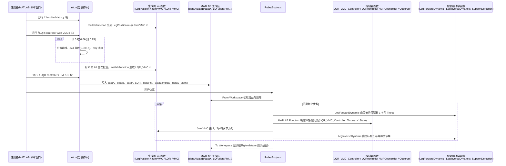

# WheelLeggedRobotSimulation

**WheelLeggedRobotSimulation**（[GitHub](https://github.com/Rengar-Yang/WheelLeggedRobotSimulation)）来自 [古月居转载的四足机器人开源项目综述](https://mp.weixin.qq.com/s/pRGoPm41qYCNyHPWR6Dl6A)，属「轮足机器人」组。

## 一句话定义

**WheelLeggedRobotSimulation 是面向新手的五连杆轮腿机器人 MATLAB 仿真平台：含 PID、LQR、MPC 三种控制方式，运动学与动力学两种控制模型，LQR 结合 MRAC 做简单自适应控制。**

## 英文缩写速查

| 缩写 | 英文全称 | 简要说明 |
|------|----------|----------|
| LQR | Linear Quadratic Regulator | 线性二次调节器 |
| MRAC | Model Reference Adaptive Control | 模型参考自适应控制 |

## 为什么重要

- 综述把它放在「轮足机器人」这条技术路线下，作为可读源码的参照项目；横向对比见 [四足机器人开源项目技术地图：从极简运动学到研究级硬件（36 个 GitHub 项目）](../overview/quadruped-open-source-projects-technology-map.md)。
- 文中星标：73（文章表述，入库日未复核）。

## 核心信息

| 项 | 内容 |
|----|------|
| **仓库** | [Rengar-Yang/WheelLeggedRobotSimulation](https://github.com/Rengar-Yang/WheelLeggedRobotSimulation) |
| **最近提交** | 2026-01-13 |
| **可达性** | `git ls-remote` 可达（2026-11-01） |
| **文章归类** | 轮足机器人 |

## 文章说法核对

- **文章：** 文章称是轮腿机器人仿真文件集合，支持多种仿真器。
- **README / 核查：** README 称整体结构简单、适合入门，手动运行代码在 Init.m；作者自述代码可能有问题并欢迎指正。
- **差异与保留：** **文章称「支持多种仿真器」，README 只提 MATLAB**；本节点以 README 为准。

## 源码运行时序图

入口：在 MATLAB 中手动逐块运行 `Init.m`（README：需手动运行的代码均在 Init.m），再打开并运行 Simulink 模型 `RobotBody.slx`。仓库无命令行入口，下图为 MATLAB 内的离线准备与仿真阶段。Simulink 模型内部连线未逐线核对，图中只画能从 `Init.m`、`.m` 函数与 `.slx` 内的函数引用确认的关系。

图依据：Rengar-Yang/WheelLeggedRobotSimulation@f1a90a7，读过 README.md、Init.m、LQR_VMC_Controller.m、LQRcontroller.m、MPCcontroller.m（开头部分）、Observer.m、LegForwardDynamic.m、LegInverseDynamic.m，以及 RobotBody.slx 内 system_root.xml 的块名与 stateflow 图中对这些函数的引用；各函数在模型中的具体连线与调用先后、plotdata.m 内容未读。

## 关联页面

- [locomotion](../tasks/locomotion.md)
- [lqr-ilqr](../methods/lqr-ilqr.md)
- [model-predictive-control](../methods/model-predictive-control.md)
- [quadruped-open-source-projects-technology-map](../overview/quadruped-open-source-projects-technology-map.md)

## 参考来源

- [wheel_legged_robot_simulation.md](../../sources/repos/wheel_legged_robot_simulation.md)
- [wechat_guyueju_quadruped_opensource_deep_dive_2026-11-01.md](../../sources/blogs/wechat_guyueju_quadruped_opensource_deep_dive_2026-11-01.md)
- [原文（微信公众号）](https://mp.weixin.qq.com/s/pRGoPm41qYCNyHPWR6Dl6A)
- 源码核对（2026-11-02）：Rengar-Yang/WheelLeggedRobotSimulation@f1a90a7，读过 README.md、Init.m、LQR_VMC_Controller.m、LQRcontroller.m、MPCcontroller.m（部分）、Observer.m、LegForwardDynamic.m、LegInverseDynamic.m、RobotBody.slx 的块名与函数引用；时序图依据以上文件，未运行代码。
