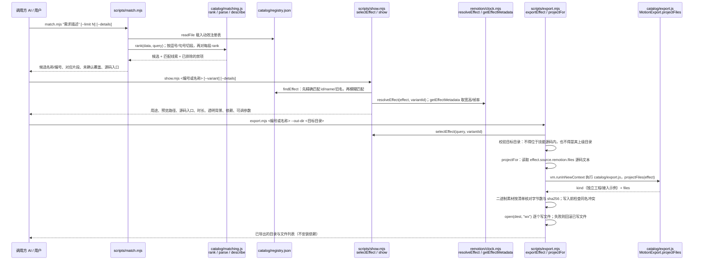

# Wise Motion

## 一句话定义

**Wise Motion** 是一个按动作需求检索现有动效、查看实现并导出源码的 Agent Skill，可用于产品演示和讲解视频素材制作。

## 英文缩写速查

| 缩写 | 英文全称 | 简要说明 |
|------|----------|----------|
| AI | Artificial Intelligence | 由调用方设计字幕、分镜与整体组合 |
| CLI | Command-Line Interface | 用 Node.js 命令检索、查看与导出 |
| UI | User Interface | 动效可用于界面及产品演示 |

## 核心流程

1. 将需求拆成主体、起止状态、动作关系与禁项，用 `match.mjs` 找候选。
2. 用 `show.mjs` 查看预览、源码入口、参数与依赖，并说明未覆盖的需求。
3. 用 `export.mjs` 导出独立工程或组件接入示例；导出不安装依赖，同名文件冲突时停止。

目录可直接打开 `catalog/index.html`。官方 README 在入库时统计 315 个单动作、99 个插画单图和 48 个组合片段；数量随版本变化。

## 工程实践与边界

- 根目录 `SKILL.md` 标注仅在用户明确调用时使用；检索和导出需要 Node.js，单个视频渲染需准备依赖与 Remotion 环境。
- 项目负责参考匹配和源码交付；字幕、分镜、配色及整片组合由调用方设计。它适合制作机器人项目展示素材，但不提供机器人控制或仿真能力。
- **开源状态：** 自有技能与源码为 Apache-2.0；第三方代码、字体及素材有各自许可。部分原始媒体和 Blender 场景需依照工程说明另行准备。

## 源码运行时序图

入口：`node scripts/match.mjs "<需求>"` → `node scripts/show.mjs <编号或名称> [--details]` → `node scripts/export.mjs <编号或名称> --out-dir <目标目录>`（SKILL.md 给出的三条命令；检索与导出只需 Node.js）。本图只画这三条 CLI；导出后在目标工程中的 Remotion 渲染（`scripts/render-remotion.mjs`、`npm run render`）未读，不画。

图依据：WiseWong6/wise-motion@5385cd0，读过 README.md、SKILL.md、package.json、scripts/match.mjs、scripts/show.mjs、scripts/export.mjs（catalog/matching.js、catalog/export.js、remotion/clock.mjs 仅据其被调用处，未读内部实现）。

## 关联页面

- [Remotion](./remotion.md) — 可编程视频与渲染框架。
- [video-shotcraft](./video-shotcraft.md) — 面向产品宣传片的镜头配方与制作流程。

## 参考来源

- [Wise Motion 仓库归档](../../sources/repos/wise-motion.md)
- 源码核对（2026-11-02）：WiseWong6/wise-motion@5385cd0，读过 README.md、SKILL.md、package.json、scripts/match.mjs、scripts/show.mjs、scripts/export.mjs；时序图依据以上文件，未运行代码。

## 推荐继续阅读

- [官方仓库与使用说明](https://github.com/WiseWong6/wise-motion)
