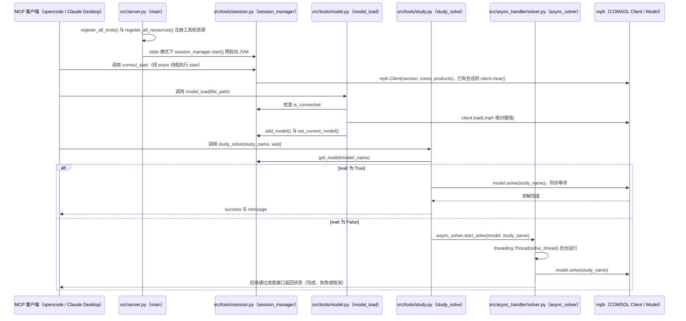

# COMSOL Multiphysics MCP（wjc9011/COMSOL_Multiphysics_MCP）

## 一句话定义

COMSOL Multiphysics MCP（wjc9011/COMSOL_Multiphysics_MCP）是面向 COMSOL 多物理场软件的 MCP 接口。

## 英文缩写速查

| 缩写 | 英文全称 | 简要说明 |
|------|----------|----------|
| MCP | Model Context Protocol | 代理与工程软件工具的交互协议 |
| CAE | Computer-Aided Engineering | 计算机辅助工程软件与分析 |
| API | Application Programming Interface | 软件可供自动化调用的接口 |

## 为什么重要

对 CAE 自动化而言，代理能否稳定完成任务，取决于工程步骤是否清楚、工具边界是否明确、结果是否保留可审查证据。面向 COMSOL 多物理场软件的 MCP 接口；文章指出该项目有 Neurocomputing 论文背书，重点是将 COMSOL 工程操作暴露给代理调用。

## 核心原理

**项目自身范围：** Open-source MCP interface for AI-assisted COMSOL multiphysics simulation.

**工作流：** MCP 客户端发起工具调用，由本地接口连接 COMSOL 完成工程操作；可与流程 Skill 配合组织建模与检查。

## 工程实践

1. 从目标问题识别所需的 Skill、MCP、CLI 或软件接口，不把指导文件当成求解器。
2. 依照仓库 README 检查安装前提、软件/许可证、输入文件和输出证据。
3. 小规模运行并逐项核对几何、网格、边界、求解状态和物理量，再决定是否扩大任务。

文章所述的项目特征：面向 COMSOL 多物理场软件的 MCP 接口；文章指出该项目有 Neurocomputing 论文背书，重点是将 COMSOL 工程操作暴露给代理调用。

## 局限与风险

必须本机安装 COMSOL 并具备有效授权；论文背书、接口开放和可复现实验是不同层面的证据。

源码状态核验：该 GitHub 仓库于 2026-10-07 可公开访问。仓库 API 报告许可证为 MIT。 涉及商业软件时，安装包和有效许可证需由使用者自行提供。

## 源码运行时序图

入口：`python -m src.server`（`src/server.py` 的 `main()`，默认 stdio 传输；HTTP 传输时 COMSOL 在首次工具调用时惰性启动）

图依据：wjc9011/COMSOL_Multiphysics_MCP@53c9ca4，README.md、src/server.py、src/tools/session.py、src/tools/model.py、src/tools/study.py、src/async_handler/solver.py

## 关联页面

- [CAE / CFD 代理工具项目总览](../overview/cae-cfd-agent-skills-landscape.md)
- [COMSOL MCP](./777gegewu-comsol-mcp.md)

## 参考来源

- [公众号文章原始资料归档](../../sources/blogs/wechat_cae_cfd_agent_skills_2026-10-07.md)
- [GitHub 仓库资料归档](../../sources/repos/wjc9011-comsol-multiphysics-mcp.md)
- [wjc9011/COMSOL_Multiphysics_MCP 官方仓库](<https://github.com/wjc9011/COMSOL_Multiphysics_MCP>)
- 源码核对（2026-11-02）：wjc9011/COMSOL_Multiphysics_MCP@53c9ca4，读过 README.md、src/server.py、src/tools/session.py、src/tools/model.py、src/tools/study.py、src/async_handler/solver.py；时序图依据以上文件，未运行代码。

## 推荐继续阅读

- [项目 README](<https://github.com/wjc9011/COMSOL_Multiphysics_MCP/blob/main/README.md>)