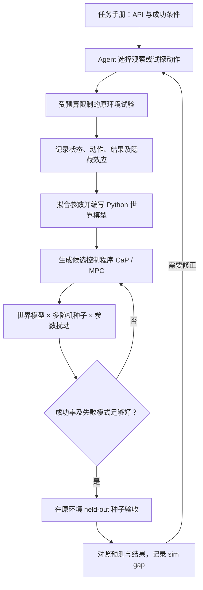
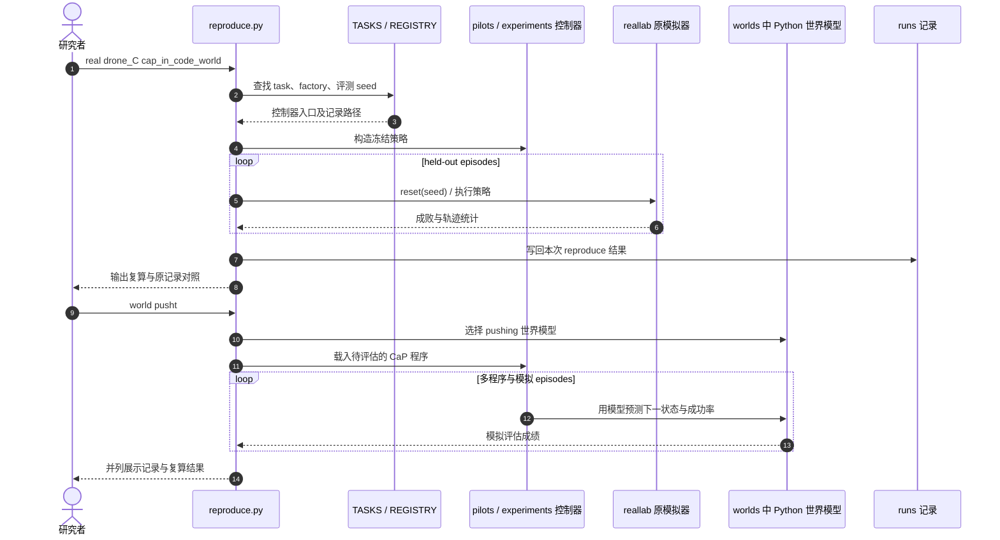

# World Models as Unit Tests / 把世界模型当作单元测试

> **研究身份：** Denzel Zheng（Princeton University MAE），2026-11，**early research note（非同行评审论文）**。一手原文：[作者项目页](https://dongzhezheng.github.io/world-models-as-unit-tests/) · [公开代码](https://github.com/DongzheZheng/world-models-as-unit-tests)。

## 一句话定义

**World Models as Unit Tests** 让编程智能体先用少量有限预算的环境交互辨识隐藏动力学，再写一个可执行的 Python 世界模型作为近似测试环境，在部署下一版控制程序前对大量随机初始条件与物理扰动做仿真筛选；它解决的是 **Agent 会改控制代码、却负担不起反复真实测试** 的验证瓶颈。

## 英文缩写速查

| 缩写 | 英文全称 | 简要说明 |
|---|---|---|
| WM | World Model | 由 Agent 以代码显式实现的系统动力学与事件规则 |
| CaP | Code as Policies | LLM 生成并迭代可执行控制程序的方式 |
| LLM | Large Language Model | 编写模型和控制程序的智能体基础模型 |
| MPC | Model Predictive Control | Rope 中基于短预测窗口反复筛选动作的在线控制 |
| PPO | Proximal Policy Optimization | 无人机、Doom 的强化学习对照基线 |
| MAE | Mean Absolute Error | 预测与原模拟器成功率差的平均绝对误差 |

## 为什么重要

- **真实试错稀缺：** 每改一版程序都在原环境跑数次，很容易选错版本；Push-T 的 CaP 程序从第 3 次试验后的 96% 降至第 4 次后的 16%，但 agent 没察觉退化（作者原文 §1–§2）。
- **可执行测试替代高频验证：** 模型文件仅 14–26 KB、249–412 行，使用观测日志拟合转子推力缺失、风、质心偏移、摩擦及绳索弯曲等参数（§2、§7）。
- **转化为可复核的程序验证：** 通过独立随机种子、扰动模型与统计汇总筛选候选程序。研究重点是 **相对排序**，不是模型能证明物理绝对安全（§3、§9）。

## 核心原理

### 流程总览（依据作者网页 §2–§4）

**角色隔离：** 负责搭原模拟器的 agent 可见其实现，研究中的控制 agent 只能拿任务手册与自己的试验日志；作者做了 import guard 与命令日志核查（§1、§9）。

### 两类用法

| 用法 | 被评估的对象 | 实际机制 |
|---|---|---|
| **Program-level testing** | LLM 编写的每个控制代码版本 | 在世界模型里重跑大量随机 episode，为版本排序，减少有限原环境试验带来的误判 |
| **Action-level planning** | 下一小段候选动作 | Rope 任务用采样 MPC，每 8 个 50 Hz 步（0.16 秒）从新观察重新规划，在多个扰动模型上筛动作 |

模型并非神经网络权重预测器；在本项目中主要是刚体、接触、碰撞、控制输入及随机行为等规则的显式 Python 近似（§7）。

## 实验与评测

**注意：作者的“real trial / real success”是不可见源代码的原模拟器试验，**不是实体机器人。共 8 个任务，四类模拟器（VizDoom、PyBullet/PyFlyt、pymunk、MuJoCo），初始每任务 5 次试验预算；部分扩展实验使用更多次（§1、§9）。

| 作者报告的证据 | 结果 | 如何解读 |
|---|---|---|
| 34 个 CaP 程序、五任务的相对评估（§3） | Pearson r = 0.974；MAE = 5.2 百分点 | 只说明该组候选代码的模型评分与原环境评分较相关，不是通用可靠性证书 |
| Drone-C，CaP 20 次试验版本后添加 WM 测试（§4） | 原 76% → 95%（100 held-out）；无需再增加原环境试验 | 前期 WM 建模另消耗试验预算，不能把总成本写成 0 |
| Push-L，从 CaP 8 次试验版本转为模型内筛选（§4） | 46% → 84% held-out；独立种子重测 80% | 比该任务 oracle planner 80% held-out 更高，但任务规模与采样策略有限 |
| Rope，短窗口 MPC（§6） | 扩展 20 次试验：78%；oracle planner 84% | 早期 WM 自评 100%、原环境仅 32%，最终计算开销远大于实时步长 |
| Cable，有实时载荷读数（§5） | CaP 50/50；WM 不增加任务成功率 | 能在线纠偏时，模型主要用于找罕见几何程序 bug（对 3 个版本 150/150 预测匹配） |

**偏差：** 该模型在 Push-T/Push-L 分别高估约 17/28 个百分点；Rope 首版自评 100% 对原环境 32%。因此优先把它当**相对版本排序器**，不能把绝对预测率直接用于安全放行。

## 工程实践

1. **先明确定义接口：** 任务手册只写传感器字段、动作格式、成功条件和试验预算；要识别的隐藏参数不应偷放在工具上下文。
2. **刻意做系统辨识：** 设计观察性试验记录被动轨迹、受控扰动、关键失败；例如 Drone-C 的观测飞行帮助建立其他无人机的随机行为类别。
3. **冻结验证集：** 对每个程序版本记成功率、失败种子与扰动设置；用同一组未见种子评价，分开汇报 WM 预测与原环境实测。
4. **复现入口：** 官方给出 Python 3.12 Linux 环境，`python reproduce.py list`、`python reproduce.py real drone_C cap_in_code_world`、`python reproduce.py world pusht`；详见[源码归档](../../sources/repos/world-models-as-unit-tests.md)。这些命令在本次 ingest **未执行**。

## 源码运行时序图

依据官方 `reproduce.py` 的 TASKS/REGISTRY、real/world 命令及 `harness/README.md` 的验证契约；区分复现冻结策略与尚未由作者完整模型实测的新 harness。

**独立 harness：** `python -m harness run --config harness/examples/toy/run.toml` 从 `harness/cli.py` 调用环境服务与 `harness/verify.py`，比较 `world.py` 和 held-out 原环境的预测；作者仅验证 replay toy 等无需真实 LLM 的路径，未证明对新真机系统可直接复现。

## 局限与风险

- **无真实机器人证据：** §9 明确声明所有任务均在模拟器中完成，没有测试从仿真迁移至物理机器。
- **小规模且统计不充分：** 结构化状态观测、8 个任务，每个 agent/task 一次运行；PPO 学习曲线单一 seed，不能直接外推到复杂视觉输入或可靠部署。
- **近似验收器：** 世界模型仍会漏掉摩擦、接触与随机行为；Push-L 排序误差更大，Rope 的程序级判别因绝大多数版本失败而证据较弱。
- **Rope 不满足实时：** 最终控制器约 2 s 计算对应 0.02 s 模拟物理步（§9），不适合直接作为在线真机控制循环。
- **开源边界：** MIT 仓库包含程序、模型和评测记录，可通过 `reproduce.py` 复跑冻结结果；并不提供已验证能让 Claude/Codex 在任意新环境自动学会建模的通用框架。

## 与其他工作对比

- [Coding Agent 验证闭环](../methods/coding-agent-verification-loops.md)：软件测试的 E2E、属性/差分测试；本项目给机器人控制**额外增加可执行物理近似验证**，但不能取代原环境或真机最终测试。
- [仿真评测基础设施](../concepts/simulation-evaluation-infrastructure.md)：同样强调“先可验证，再快速迭代”；本项目把模拟环境缩成由 agent 按试验日志现场编写的轻量 Python 文件。
- [系统辨识](../concepts/system-identification.md)：这里重点是少量主动观察、可读参数与随机扰动覆盖，不等同于传统已知结构的最小二乘辨识。

## 关联页面

- [仿真评测基础设施](../concepts/simulation-evaluation-infrastructure.md)
- [系统辨识](../concepts/system-identification.md)
- [仿真与真机评测 gap](../concepts/sim-vs-real-eval-gap.md)
- [MPC 方法](../methods/model-predictive-control.md)
- [Coding Agent 验证闭环](../methods/coding-agent-verification-loops.md)
- [具身模型测评纵深路线](../../roadmap/depth-embodied-eval.md)
- [具身大模型评测基准选型闭环](../queries/embodied-eval-benchmark-selection-loop.md) — 把轻量可执行 Python 世界模型作为候选版本排序与仿真筛选环节，对照闭环评测选型与真机验收边界

## 参考来源

- [作者研究笔记全文（原文通读归档）](../../sources/sites/world-models-as-unit-tests.md)
- [官方仓库与运行入口归档](../../sources/repos/world-models-as-unit-tests.md)

## 推荐继续阅读

- [World Models as Unit Tests — 官方研究笔记](https://dongzhezheng.github.io/world-models-as-unit-tests/)
- [GitHub：DongzheZheng/world-models-as-unit-tests](https://github.com/DongzheZheng/world-models-as-unit-tests)
- [Hugging Face：数据集](https://huggingface.co/datasets/DenzelZheng/world-models-as-unit-tests)
