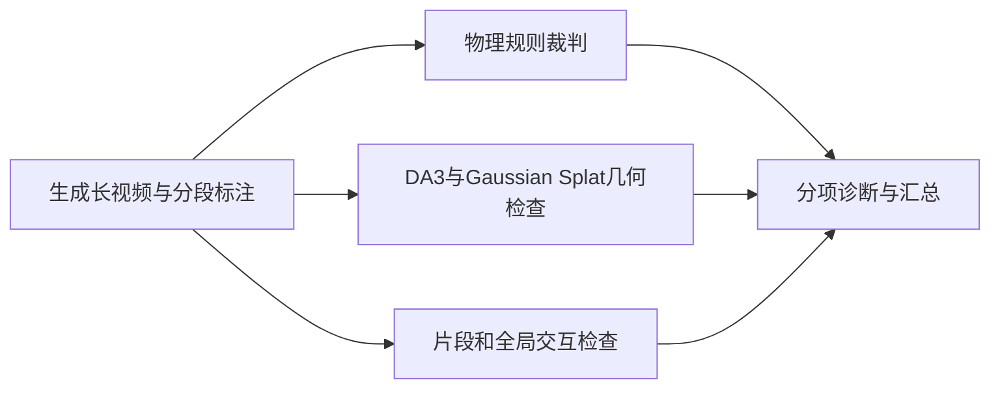

# WorldOlympiad（视频世界模型三项赛）

## 一句话定义

WorldOlympiad 是面向长视频生成式世界模型的诊断基准：除视频观感外，分别检查生成内容是否遵循物理规律、维持连贯的 3D 世界结构，以及在长时序中执行并延续交互指令。

## 英文缩写速查

| 缩写 | 英文全称 | 简要说明 |
|------|----------|----------|
| MLLM | Multimodal Large Language Model | 用于结合视频与文本证据进行多模态裁判 |
| GS | Gaussian Splatting | 从视频重建 3D 场景并渲染新视角的方法 |
| CLIP | Contrastive Language-Image Pre-training | 计算视觉与文本语义相似度的模型系列 |
| DA3 | Depth Anything 3 | 项目几何赛道使用的单目深度/3D重建模型 |

## 为什么重要

- **拆开“看着像”和“世界是否稳定”。** 视频可有良好画质，却违反重力/材料规律、在相机运动中丢失场景结构，或无法维持跨片段交互状态。三个赛道分别暴露这些问题。
- **长视频和跨域评测。** 数据包含机器人双臂操作、游戏与真实世界长视频，评测覆盖单一机器人操作视频以外的动态场景。
- **结果带有诊断性。** 项目页报告自动排名与人工偏好排名相关性较高，但同时展示物理、几何与交互分项；读者可定位强弱项，而不必把 Overall 分数理解成通用能力。

## 核心原理

### 三条评测赛道

| 赛道 | 主要问题 | 公开实现/信号 |
|------|----------|----------------|
| **Physical** | 生成动作是否遵守力学、热力学与材料属性规律？ | 对象级分割证据 + MLLM 裁判；检查重力、碰撞、熔化、硬度、溶解度等规则 |
| **Geometry / 3D** | 视频是否维持连贯的空间结构和相机运动？ | DA3 / Gaussian-splat 重建、新视角质量与相机轨迹对齐 |
| **Interaction** | 长视频是否按指令继续行动，片段间状态是否衔接？ | 片段级动作/字幕遵循、边界平滑、全视频一致性与 CLIP 语义信号 |

基准包含 **1,000** 段视频：**400** 段机器人操作、**400** 段游戏和 **200** 段真实世界视频。项目页说明机器人数据来自 RoboCOIN 双臂操作，游戏数据来自 OGameData_50K，真实视频来自 LVD-2M 长视频子集。

### 与相邻基准的区别

| 基准 | 主要焦点 | 适合回答的问题 |
|------|----------|----------------|
| [EWMBench](./ewmbench.md) | 机器人操作视频的场景、末端运动与语义质量 | 操纵视频是否保持场景布局、动作轨迹和步骤语义？ |
| [WorldArena](./worldarena.md) | 视频感知质量 + 数据引擎、策略评估等功能效用 | 视觉质量是否转化为策略/规划价值？ |
| **WorldOlympiad** | 通用长视频世界建模中的物理、3D与交互诊断 | 长 rollout 是否维持规律、几何和跨片段状态？ |

这些基准的数据域、生成协议和分数归一化不同，不能把它们的总分直接并列排名。

## 工程实践

1. **按样例目录准备视频和标注。** 官方 README 的批量评测输入包含参考视频、生成视频、`prompt.json`，以及推荐的 chunk 时间戳文件。
2. **先配置模型服务。** 官方代码使用 SAM3、QwenVL 与 Depth Anything 3 等依赖；克隆 DA3 源码并准备权重后，再启动对应服务与批量 runner。
3. **保留三个赛道的逐例 JSON。** 逐案例输出可供中断续跑，并可定位哪些域、模型和交互片段导致总分变化。
4. **谨慎解释公开排行榜。** 项目页目前列出 8 条生成管线；跨域结果只代表其提供的数据、标注和裁判协议。

## 局限与风险

- **不是策略闭环或真机成功率基准。** 生成视频的规律性与动作跟随，不证明视频世界模型能训练出更好的策略或可直接控制机器人。
- **几何指标依赖重建质量。** DA3 深度与 Gaussian-splat 重建本身会引入估计误差；需结合样例和其他维度判断。
- **域分布有限。** 机器人子集偏双臂操作；三类数据的组合也不能覆盖所有本体、视角、接触和长程任务。
- **数据许可证需单独核实。** 官方项目页说明网站与代码采用 MIT；Hugging Face 数据集页面未提供数据卡，使用/再分发前应核查数据文件许可与上游数据条款。

## 关联页面

- [WorldArena](./worldarena.md) — 视频质量之外还评估模型的功能效用。
- [EWMBench](./ewmbench.md) — 机器人操作视频生成的专用评测维度。
- [生成式世界模型](../methods/generative-world-models.md) — 视频生成式世界模型的建模语境。
- [视频即仿真](../concepts/video-as-simulation.md) — 视频 rollout 作为具身推演接口时的限制。
- [具身大模型评测基准选型闭环](../queries/embodied-eval-benchmark-selection-loop.md) — 评测目标与基准选型。

## 参考来源

- [WorldOlympiad 论文摘录](../../sources/papers/worldolympiad_arxiv_2606_11129.md)
- [官方代码仓库归档](../../sources/repos/worldolympiad.md)
- [官方项目页归档](../../sources/sites/worldolympiad.md)
- Zhao et al., [WorldOlympiad: Can Your World Model Survive a Triathlon?](https://arxiv.org/abs/2606.11129)

## 推荐继续阅读

- [官方项目页：指标、数据与榜单](https://alibaba-damo-academy.github.io/WorldOlympiad/)
- [WorldOlympiad 官方代码](https://github.com/alibaba-damo-academy/WorldOlympiad)
- [Hugging Face 数据集](https://huggingface.co/datasets/ziplab/WorldOlympiad)
