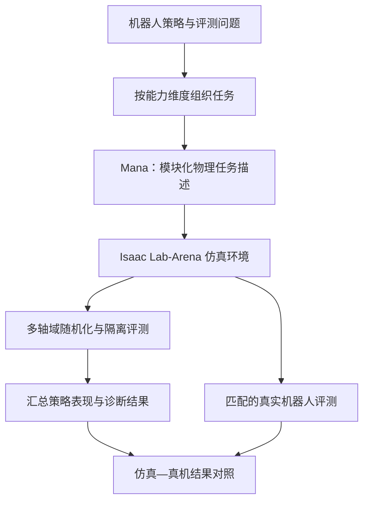
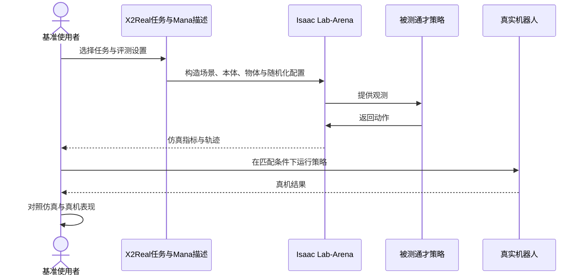

# X2Real 项目：通才机器人操作策略仿真基准

**X2Real** 是 X Square Robot（自变量机器人）提出的通才机器人操作策略评测项目。它希望让仿真中的策略比较更接近真实机器人表现，并通过可扩展任务和清晰的数据划分降低评测偏差。项目关联论文见 [X2Real 论文详情](./paper-x2real.md)。

## 英文缩写速查

| 缩写 | 英文全称 | 本文含义 |
|---|---|---|
| X2Real | eXtensive simulation benchmark for real-world generalist policies | 项目名；通才操作策略仿真评测基准 |
| Sim2Real | Simulation-to-Real | 仿真评测结果与真机表现的对应关系 |
| DSL | Domain-Specific Language | Mana 物理任务描述语言的类别 |
| HF | Hugging Face | x2real-assets 静态资产的托管平台 |
| API | Application Programming Interface | 图示不代表已核实的项目接口 |

## 项目定位

X2Real 是**评测基准与仿真生态**，不是一个可直接部署到机器人上的策略模型。论文将其建立在 NVIDIA Isaac Lab-Arena 上，围绕三项目标组织：

| 目标 | 项目关注点 | 阅读时应核对 |
|---|---|---|
| 保真度 | 校准仿真视觉与物理属性，使仿真评估更贴近真机 | 标定对象、机器人、任务范围和相关系数口径 |
| 多样性 | 10 个能力维度、44 个层级化长程操作任务 | 任务层次、能力覆盖及任务难度定义 |
| 公平性 | 多轴域随机化、严格分离训练与评测流程 | 测试任务、资产、随机种子是否与训练隔离 |

## 基准组成与流程

论文摘要称，任务覆盖基础操作以及视觉定位、语言理解、双臂控制等能力；Mana 物理领域专用语言用于模块化描述任务，并支持迭代分析。论文还报告近 300 小时的标注仿真轨迹。该轨迹集与 [公开静态资产集](../../sources/datasets/x2real-assets.md) 是不同资源。

### 一次评测的角色与信息流

> 图示是依据论文摘要整理的概念流程，不代表项目仓库中已经核实的具体 API、控制频率或部署命令。

## 论文报告的结果应如何理解（v2 全文核对）

论文（[arXiv:2609.27449v2](https://arxiv.org/html/2609.27449v2)）报告仿真与真机评测的 **0.84 线性相关**（针对全部 8 项 ManipArena 数字孪生任务的 Progress 相关系数；按 SR 口径为 **0.74**，其中 5 项一般操作任务达 **0.96 SR / 0.99 Progress**，另外 3 项精细任务如放眼镜在仿真因镜腿折叠 OOD 跌至 0%）。这是相关系数，不是“84% 成功率”。

- **桌面主榜（Table 1，ID / OOD）：** `wall-oss-preview`（SR **53.90% / 34.26%**，Score 67.25 / 56.63）> $\pi_{0.5}$（SR 26.12% / 16.13%）> `DreamZero`（4.85% / 3.45%）> `Wall-OSS-0.5`（4.08% / 3.20%）；所有模型在 OOD 下均显著掉点，精细接触与长程保持仍是共同瓶颈。
- **移动操作与局限（Table 2–3, §6）：** 3 项移动任务上 `wall-oss-preview` ID/OOD SR 为 **58.33% / 5.00%**（vs $\pi_{0.5}$ 29.17% / 0.83%）；当前仅支持刚体与铰接刚体（不含柔性体/流体），无触觉传感且评测偏静态。

## 可获取资源与复现边界

- **项目页：** [x2robot.com/en/pages/x2real](https://x2robot.com/en/pages/x2real)
- **论文：** [arXiv:2609.27449](https://arxiv.org/abs/2609.27449)（v1 2026-09-23；v2 2026-10-13）。
- **代码状态：** 官方已于 2026-10-10 发布 [X-Square-Robot/x2real](https://github.com/X-Square-Robot/x2real)（`v0.9.0`，开源 ID 评测运行时、Policy Space 跨进程接口与手动采数）。
- **仿真静态资产与数据集：** [Hugging Face：x-square-robot/x2real-assets](https://huggingface.co/datasets/x-square-robot/x2real-assets)（74,423 个文件、约 44.2 GB 静态资产）与 [Hugging Face：x-square-robot/X2Real-Dataset](https://huggingface.co/datasets/x-square-robot/X2Real-Dataset)（v2 公开轨迹数据集入口）；静态资产包本身仍不含轨迹。

## 与论文节点的分工

- [X2Real 论文详情](./paper-x2real.md)：题录、论文主张、实验相关性以及结论边界。
- **本项目详情：** 基准的工程定位、组成模块、资源入口、使用路径与复现状态。

## 关联页面

- [Isaac Lab-Arena](./isaac-lab-arena.md) — 论文摘要所述仿真基座
- [Sim2Real](../concepts/sim2real.md) — 仿真评测与真机表现的关系
- [机器人操作](../tasks/manipulation.md) — 任务领域
- [具身大模型评测基准选型闭环](../queries/embodied-eval-benchmark-selection-loop.md) — X2Real 对应其中「策略任务成功率评测」与「sim↔real 评测 gap 校准」层

- [具身智能体评测方法](../methods/embodied-agent-benchmarking.md)：对照任务设置、接口与评估指标。

## 参考来源

- [X2Real 项目页来源归档](../../sources/sites/x2real-project.md)
- [X2Real Simulation Assets 数据集归档](../../sources/datasets/x2real-assets.md)
- [X2Real 论文来源归档](../../sources/papers/x2real_arxiv_2609_27449.md)
