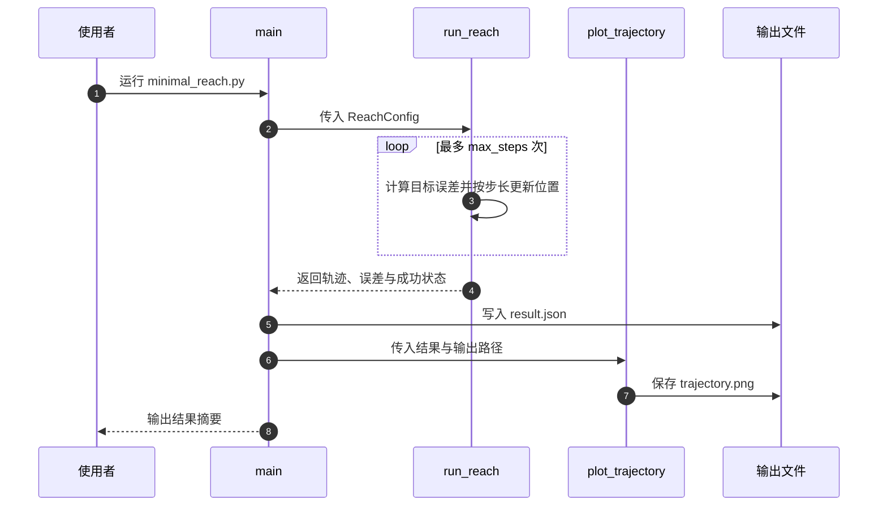

# Xbotics 具身智能教程（21 讲） / Xbotics Embodied AI Handbook

## 一句话定义

[Xbotics-Embodied-AI-Handbook](https://github.com/Xbotics-Embodied-AI-club/Xbotics-Embodied-AI-Handbook) 是 Xbotics 社区的开源实践课（MIT）：围绕"感知—状态—策略—控制—数据—部署—失败回流"整条链路，用 SO101 机械臂和 Unitree G1 为载体，配套 LeRobot 工作流，把 21 讲排成六个部分、五个阶段项目。它是姊妹仓 Xbotics-Embodied-Guide（全局路线）的动手版。

## 英文缩写速查

| 缩写 | 英文全称 | 简要说明 |
|------|----------|----------|
| VLA | Vision-Language-Action | 视觉–语言–动作策略，教程 L11–L13 的主线 |
| ACT | Action Chunking Transformer | 一次预测一段动作的模仿学习策略，L10 实战 |
| SFT / LoRA | Supervised Fine-Tuning / Low-Rank Adaptation | L12 对比全量微调与低秩微调 |
| GRPO | Group Relative Policy Optimization | 组内相对打分的后训练算法，L15 |
| VLN | Vision-and-Language Navigation | 语言驱动导航，L17–L18 |
| WAM | World Action Model | 联合建模未来与动作的世界模型，L20 用 Fast-WAM 复现 |

## 为什么重要

- **课程把"训练损失低 ≠ 任务成功"落到可检查的清单：** L8 把动作口径、归一化、裁剪限位做成出发前检查单；L12 指出真机验收若用相关系数会失效（把 `state` 原样抄成预测也能有 0.936–0.995），改用 `ratio` / `delta_corr` / `delta_std`。
- **同一条 LeRobot 工作流贯穿采集→训练→评测→部署**，且给出仿真/真机混合数据、推理与执行分家（边缘板 + GPU 机，gRPC）的实际做法，可作为 [LeRobot](./lerobot.md) 的上手课程。
- **覆盖面宽于多数 VLA 教程：** 同时含 RL（PPO / GRPO / off-policy）、VLN、Agent、世界模型，适合建立系统地图后再选方向。

## 流程总览

## 核心结构

| 部分 | 讲次 | 主要实验载体 |
|------|------|--------------|
| 系统基础 | L1–L4 | ROS2、MoveIt、坐标系与相机模型 |
| 视觉操作 | L5–L7 | MuJoCo / Menagerie 中的 SO-101，位姿估计，抓取与恢复 |
| 端到端 | L8–L13 | LIBERO + π₀ 闭环、LeRobot 采集、ACT、SmolVLA 全量 / LoRA 微调、SO-101 真机 |
| 强化学习 | L14–L16 | G1 行走（REINFORCE→PPO→SAC）、Qwen2.5-VL GRPO 数数、FastSAC |
| VLN | L17–L18 | Habitat VLN 走读 |
| 前沿综合 | L19–L21 | Agent 技能契约、Fast-WAM on LIBERO、答辩 |

**可引用的结果（均为仓内文稿 / README 自述，未独立复现）：**

- SmolVLA 全量微调（仿真+真机混合 3698 集）：三个仿真任务成功率 罐 96% / 小方块 90% / 方块 94%。
- GRPO 后训练 Qwen2.5-VL-3B：SuperCLEVR 数数准确率 0.095 → 0.44，格式合规率 0.22 → 0.79。
- L16 引用论文称 FastSAC/FastTD3 在单张 RTX 4090 上约 15 分钟训出可 sim-to-real 的 G1 行走策略（文稿同时说明这是墙钟对比而非"PPO 学不会"）。

## 21 讲导航

### 系统基础

- [第 1 讲：具身智能导论](./xbotics-handbook-lecture-01.md)
- [第 2 讲：机器人系统架构：硬件、软件与 ROS2](./xbotics-handbook-lecture-02.md)
- [第 3 讲：机器人本体与控制基础](./xbotics-handbook-lecture-03.md)
- [第 4 讲：传感器与感知基础](./xbotics-handbook-lecture-04.md)

### 视觉操作

- [第 5 讲：仿真环境与操作任务搭建](./xbotics-handbook-lecture-05.md)
- [第 6 讲：机器人感知与位姿估计](./xbotics-handbook-lecture-06.md)
- [第 7 讲：机器人操作技能](./xbotics-handbook-lecture-07.md)

### 端到端操作

- [第 8 讲：端到端策略导论 —— 从 Pipeline 到 Policy](./xbotics-handbook-lecture-08.md)
- [第 9 讲：操作数据闭环 —— 采一份能训练的数据集](./xbotics-handbook-lecture-09.md)
- [第 10 讲：模仿学习实战 —— ACT、Diffusion 与 Flow Matching](./xbotics-handbook-lecture-10.md)
- [第 11 讲：VLA 模型导览 —— 从 OpenVLA 到 π0 家族](./xbotics-handbook-lecture-11.md)
- [第 12 讲：VLA 微调实战 —— 从全量 SFT 到 LoRA 上真机](./xbotics-handbook-lecture-12.md)
- [第 13 讲：VLA 前沿 —— 跑得更快、记得更久、用上全身](./xbotics-handbook-lecture-13.md)

### 强化学习

- [第 14 讲：强化学习入门 —— 从策略梯度到 PPO](./xbotics-handbook-lecture-14.md)
- [第 15 讲：GRPO 后训练 —— 让 VLM 学会数数、让 VLA 自我提升](./xbotics-handbook-lecture-15.md)
- [第 16 讲：Off-policy 强化学习 —— 从仿真提速到真机落地](./xbotics-handbook-lecture-16.md)

### 视觉语言导航

- [第 17 讲：VLN 理论基础](./xbotics-handbook-lecture-17.md)
- [第 18 讲：VLN 实操与评测](./xbotics-handbook-lecture-18.md)

### Agent、世界模型与综合实践

- [第 19 讲：Embodied Agent](./xbotics-handbook-lecture-19.md)
- [第 20 讲：世界模型 —— 预测、规划与数据飞轮](./xbotics-handbook-lecture-20.md)
- [第 21 讲：具身智能前沿进展 —— 综合闭环与答辩](./xbotics-handbook-lecture-21.md)

## 源码运行时序图

教程是多个不同入口组成的课程，不存在统一程序。两条可直接核对的时序见[第 1 讲：二维 Reaching 示例](./xbotics-handbook-lecture-01.md)和[第 10 讲：ACT 训练与推理](./xbotics-handbook-lecture-10.md)；其他章节也分别标注入口或不适用原因。

以下仅对应第 1 讲的 [minimal_reach.py](https://github.com/Xbotics-Embodied-AI-club/Xbotics-Embodied-AI-Handbook/blob/342247fb71dd0ee15386b6eab80543c50593d3c1/code/lecture01/simulation/minimal_reach.py)，是二维数值示意，并非机械臂物理仿真或 VLA 训练流程。

默认目标为 (0.20, 0.05)，步长 0.02，距离小于 0.01 时停止；程序依赖 NumPy 和 Matplotlib，输出路径位于脚本旁的 `outputs/`。图按源码静态核对，未实际运行。

## 工程实践

- **源码开放状态（2026-10-12 核查）：** 文稿、配图、代码同仓开放（MIT），现已核对[官方教程站](https://xbotics-embodied-ai-club.github.io/Xbotics-Embodied-AI-Handbook/)。代码成熟度不均：`code/vla/`（约 117 文件）与 `code/rl/`（约 87 文件）较完整；`lecture19/20` 为 mock / 简版 demo；`lecture17/18/21` 仅 README 与 `hardware/` 占位。`meta/status.md` 进度表多数仍为 ⬜，与仓内文稿实际状态不一致（推测为未及时同步）。详见 [来源归档](../../sources/repos/xbotics-embodied-ai-handbook.md)。
- **建议用法：** 已有 LeRobot 基础的读者可直接从 L8→L12 跳读；需要先补坐标系 / ROS2 的读者按序读 Part 1–2。
- 真机练习需 SO101 等硬件；无硬件读者按文稿的 MuJoCo / ManiSkill / Isaac Lab 路径做核心实验。

## 常见误区或局限

- **误区：读完 21 讲 = 会部署真机 VLA。** 教程自己强调失败复盘，且 L17–L21 的配套代码尚薄，Part 5–6 偏概念走读。
- **局限：** 文稿引用的实验数字出自作者自跑，未见第三方复现；L20 明确"不把完整重训 Fast-WAM 作为课堂目标"，仅复现 release checkpoint 评测。
- 与 [qqfly 机器人学指南](./learn-robotics-qqfly-guide.md)互补：后者偏固定基规控理论，本教程偏学习型策略工程。

## 参考来源

- [官方教程网站归档](../../sources/sites/xbotics-embodied-ai-handbook-site.md) 与 [课程主页](https://xbotics-embodied-ai-club.github.io/Xbotics-Embodied-AI-Handbook/)

- [Xbotics-Embodied-AI-Handbook 来源归档](../../sources/repos/xbotics-embodied-ai-handbook.md)
- [Xbotics-Embodied-Guide 来源归档](../../sources/repos/xbotics-embodied-guide.md)
- [Xbotics-Embodied-AI-Handbook（GitHub）](https://github.com/Xbotics-Embodied-AI-club/Xbotics-Embodied-AI-Handbook)

## 关联页面

- [动作分块](../methods/action-chunking.md) 与 [Diffusion Policy](../methods/diffusion-policy.md) — 第10讲的方法入口
- [模仿学习纵深](../../roadmap/depth-imitation-learning.md) · [扩散与流匹配纵深](../../roadmap/depth-robotics-diffusion-dit-flow.md) — 课程第10讲对应的实践路径

- [LeRobot](./lerobot.md) — 教程 Part 3 全程使用的采集 / 训练 / 部署框架
- [VLA 方法](../methods/vla.md) — L11–L13 对应的方法总览
- [模仿学习](../methods/imitation-learning.md) — L10 的 ACT / Diffusion / Flow Matching 背景
- [强化学习](../methods/reinforcement-learning.md) — Part 4 背景
- [GRPO](../methods/grpo.md) — L15 后训练算法页
- [Fast-WAM](./paper-fast-wam.md) — L20 复现对象
- [LIBERO Benchmark](./libero-benchmark.md) — L8 / L20 评测环境
- [数据飞轮](../concepts/data-flywheel.md) — L9 / L20 数据闭环主题

## 推荐继续阅读

- [Xbotics-Embodied-Guide](https://github.com/Xbotics-Embodied-AI-club/Xbotics-Embodied-Guide) — 姊妹仓：路线图与公司图谱
- [LeRobot 文档](https://huggingface.co/docs/lerobot) — 教程所用工作流的官方说明
