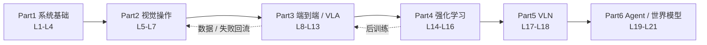
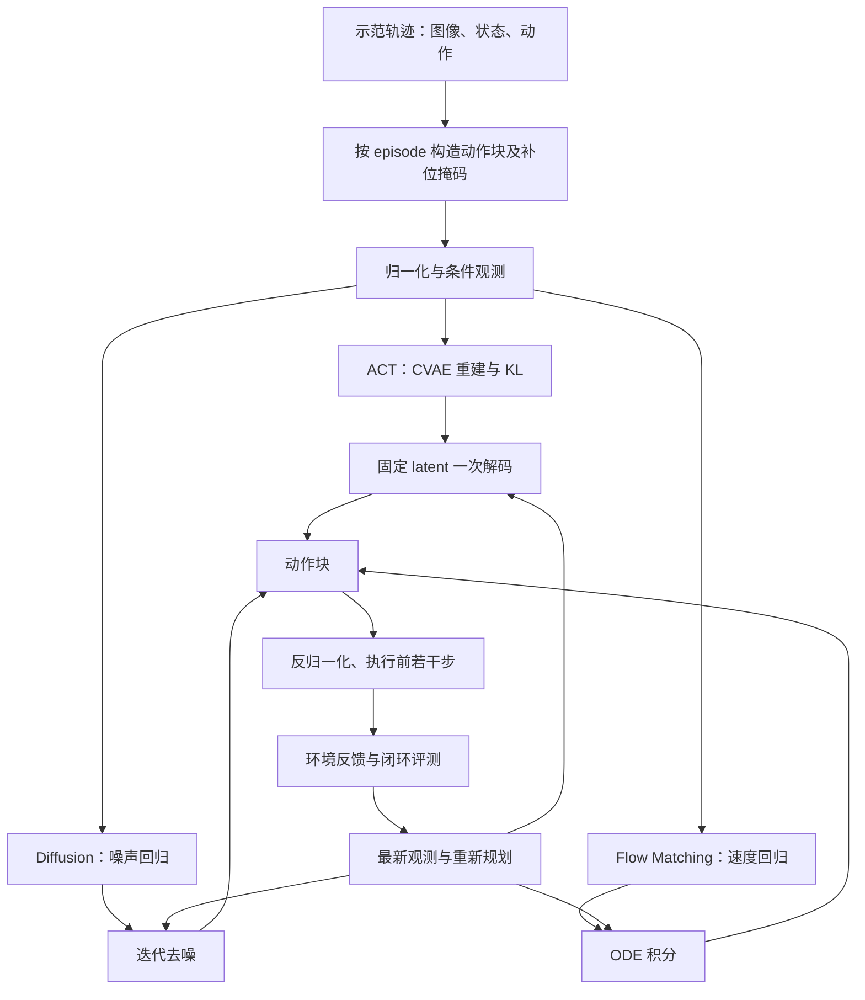
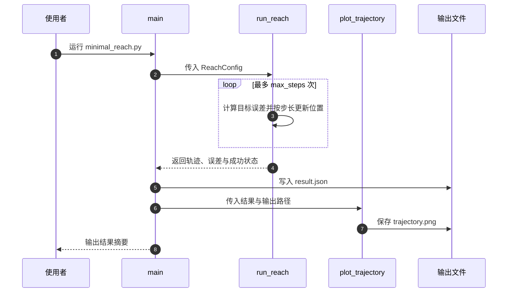
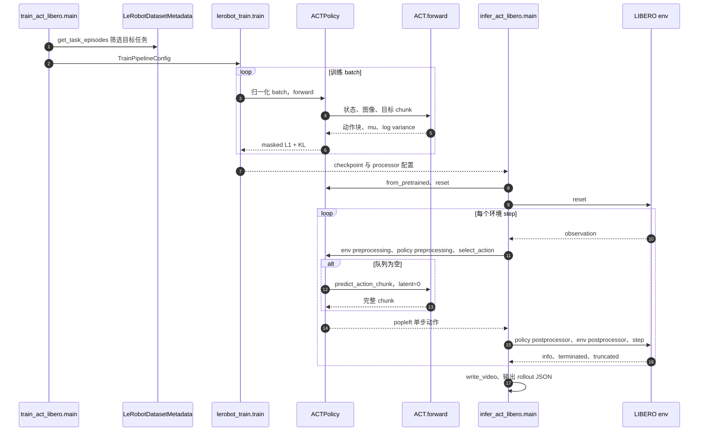

# Xbotics 具身智能教程（21 讲） / Xbotics Embodied AI Handbook

## 一句话定义

[Xbotics-Embodied-AI-Handbook](https://github.com/Xbotics-Embodied-AI-club/Xbotics-Embodied-AI-Handbook) 是 Xbotics 社区的开源实践课（MIT）：围绕"感知—状态—策略—控制—数据—部署—失败回流"整条链路，用 SO101 机械臂和 Unitree G1 为载体，配套 LeRobot 工作流，把 21 讲排成六个部分、五个阶段项目。它是姊妹仓 Xbotics-Embodied-Guide（全局路线）的动手版。

## 英文缩写速查

| 缩写 | 英文全称 | 简要说明 |
|------|----------|----------|
| VLA | Vision-Language-Action | 视觉–语言–动作策略，教程 L11–L13 的主线 |
| ACT | Action Chunking Transformer | 一次预测一段动作的模仿学习策略，L10 实战 |
| SFT / LoRA | Supervised Fine-Tuning / Low-Rank Adaptation | L12 对比全量微调与低秩微调 |
| GRPO | Group Relative Policy Optimization | 组内相对打分的后训练算法，L15 |
| VLN | Vision-and-Language Navigation | 语言驱动导航，L17–L18 |
| WAM | World Action Model | 联合建模未来与动作的世界模型，L20 用 Fast-WAM 复现 |

## 为什么重要

- **课程把"训练损失低 ≠ 任务成功"落到可检查的清单：** L8 把动作口径、归一化、裁剪限位做成出发前检查单；L12 指出真机验收若用相关系数会失效（把 `state` 原样抄成预测也能有 0.936–0.995），改用 `ratio` / `delta_corr` / `delta_std`。
- **同一条 LeRobot 工作流贯穿采集→训练→评测→部署**，且给出仿真/真机混合数据、推理与执行分家（边缘板 + GPU 机，gRPC）的实际做法，可作为 [LeRobot](./lerobot.md) 的上手课程。
- **覆盖面宽于多数 VLA 教程：** 同时含 RL（PPO / GRPO / off-policy）、VLN、Agent、世界模型，适合建立系统地图后再选方向。

## 流程总览

## 核心结构

| 部分 | 讲次 | 主要实验载体 |
|------|------|--------------|
| 系统基础 | L1–L4 | ROS2、MoveIt、坐标系与相机模型 |
| 视觉操作 | L5–L7 | MuJoCo / Menagerie 中的 SO-101，位姿估计，抓取与恢复 |
| 端到端 | L8–L13 | LIBERO + π₀ 闭环、LeRobot 采集、ACT、SmolVLA 全量 / LoRA 微调、SO-101 真机 |
| 强化学习 | L14–L16 | G1 行走（REINFORCE→PPO→SAC）、Qwen2.5-VL GRPO 数数、FastSAC |
| VLN | L17–L18 | Habitat VLN 走读 |
| 前沿综合 | L19–L21 | Agent 技能契约、Fast-WAM on LIBERO、答辩 |

**可引用的结果（均为仓内文稿 / README 自述，未独立复现）：**

- SmolVLA 全量微调（仿真+真机混合 3698 集）：三个仿真任务成功率 罐 96% / 小方块 90% / 方块 94%。
- GRPO 后训练 Qwen2.5-VL-3B：SuperCLEVR 数数准确率 0.095 → 0.44，格式合规率 0.22 → 0.79。
- L16 引用论文称 FastSAC/FastTD3 在单张 RTX 4090 上约 15 分钟训出可 sim-to-real 的 G1 行走策略（文稿同时说明这是墙钟对比而非"PPO 学不会"）。

### 第10讲：模仿学习实战 / Imitation Learning in Practice

本次以 [第10讲官方文稿](https://github.com/Xbotics-Embodied-AI-club/Xbotics-Embodied-AI-Handbook/blob/342247fb71dd0ee15386b6eab80543c50593d3c1/docs/part3-end-to-end/10-%E6%A8%A1%E4%BB%BF%E5%AD%A6%E4%B9%A0%E5%AE%9E%E6%88%98.md) 为原文；历史课程概览保留此前核查范围，不将本讲通读外推到其余讲次。

单步 BC 在专家状态分布外容易累积误差，MSE 点估计还可能平均掉多个合理动作模式。动作分块（预测时域、执行时域）与条件分布建模（CVAE、扩散、连续流）是两条可独立组合的设计轴。三种方案都可理解为从观测生成未来动作块，而不是三代相互替代的算法。

| 机制 | ACT（LeRobot v0.5.1） | Diffusion Policy | 线性条件 Flow Matching |
|---|---|---|---|
| 训练 | masked L1 + KL 权重 | 条件噪声预测 MSE | 条件速度预测 MSE |
| 推理 | z=0，单次模型前向 | 随机噪声起点，多次去噪 | 随机噪声起点，ODE 积分 |
| 动作执行 | 队列或 temporal ensembling | 滚动执行部分 chunk | 滚动执行部分 chunk |
| 主要权衡 | KL 与重建、重规划频率 | 采样器与噪声调度 | 路径、耦合、求解器与 NFE |

- **ACT 训练**：数据层通过 action_delta_indices 构造未来动作；episode 尾部 clamp 并生成 action_is_pad。VAE encoder 用 CLS、状态、目标动作块估计后验均值与 log variance；重参数化采样后，与 ResNet18 图像特征和状态进入主 Transformer，query 解码动作块。v0.5.1 的 L1 在 mask 乘法后对整个张量取均值，补位为零贡献，分母仍含补位。推理使用零 latent，不能据此声称 CVAE 在一般情形没有多模态能力。
- **ACT 默认超参**：chunk_size=100，n_action_steps=100，n_obs_steps=1，latent_dim=32，dim_model=512，8 heads，FFN=3200，主 encoder/decoder=4/1，VAE encoder=4，kl_weight=10。打开 temporal_ensemble_coeff 时应将 n_action_steps 设为 1；正系数对更早的预测赋更大权重（原 ACT 取 0.01）。默认 ResNet18 使用 ImageNet 权重，因此课程所说的从零训练是指无预训练机器人策略基座，不是所有参数随机初始化。
- **Diffusion**：给专家动作块按噪声调度直接构造带噪样本，预测加入的噪声；推理反向采样。DDIM 可跳步，扩散也可使用概率流 ODE，不以随机/确定性一刀切区分模型族。
- **Flow Matching**：在噪声端点 x0、动作端点 x1 间取 xτ=(1−τ)x0+τx1，监督速度 x1−x0；网络条件化到观测，推理积分速度场。独立端点插值不等同 OT 耦合，边际流可弯曲。Euler 一步一次前向，Midpoint 一步两次；实际加速需同硬件比较 NFE、时延、任务成功率。

### 第10讲实验与工程验收

| 实验 | 训练设置 | 作者报告的评估 |
|---|---|---|
| LIBERO bowl-to-plate | libero_goal task 8，100000 步，batch 256，256×256 | 定期 10 局闭环评估；文稿报告平台中位约 83%，非独立复现 |
| SO-101 cube40 | 498 仿真 + 300 真机 = 798 集，273889 帧；50000 步，batch 64 | 训练中每次 10 局：40/70/80/80/90%；最终独立 50 局仿真验收 76%（38/50） |

SO-101 合并前核对绝对关节目标、臂关节单位度、夹爪百分比、top/wrist 键名、640×480、30 Hz、H.264、so_follower 与指令文本。官方合并检查元数据不能保证动作语义一致，须人工检查量纲及限位。76% 是同一仿真场景混训模型的成功率；没有仅真机/仅仿真对照，不能把结果归因于混训收益，更不能宣称实机达成同样成功率。默认 100 步在 30 Hz 下覆盖约 3.33 秒，应独立调节执行时域和预测时域。

延迟评测需将重新生成 chunk 的模型调用与队列弹出分别统计，不能用大量队列命中稀释均值；若仅每 100 步重规划一次，逐步延迟的 p95 也不一定捕获重规划峰值。实际任务还需报告动作可用时延与端到端闭环表现。

## 源码运行时序图

以下仅对应第 1 讲的 [minimal_reach.py](https://github.com/Xbotics-Embodied-AI-club/Xbotics-Embodied-AI-Handbook/blob/342247fb71dd0ee15386b6eab80543c50593d3c1/code/lecture01/simulation/minimal_reach.py)，是二维数值示意，并非机械臂物理仿真或 VLA 训练流程。

默认目标为 (0.20, 0.05)，步长 0.02，距离小于 0.01 时停止；程序依赖 NumPy 和 Matplotlib，输出路径位于脚本旁的 `outputs/`。图按源码静态核对，未实际运行。

### 第10讲 ACT 源码运行时序图

依据 [LIBERO 训练](https://github.com/Xbotics-Embodied-AI-club/Xbotics-Embodied-AI-Handbook/blob/342247fb71dd0ee15386b6eab80543c50593d3c1/code/vla/3_imitation_learning/3_1_act/train_act_libero.py)、[推理](https://github.com/Xbotics-Embodied-AI-club/Xbotics-Embodied-AI-Handbook/blob/342247fb71dd0ee15386b6eab80543c50593d3c1/code/vla/3_imitation_learning/3_1_act/infer_act_libero.py) 和 [LeRobot v0.5.1 ACT](https://github.com/huggingface/lerobot/tree/v0.5.1/src/lerobot/policies/act) 静态阅读；图示为真实调用链，未执行训练。

SO-101 的 [训练入口](https://github.com/Xbotics-Embodied-AI-club/Xbotics-Embodied-AI-Handbook/blob/342247fb71dd0ee15386b6eab80543c50593d3c1/code/vla/3_imitation_learning/3_1_act/train_act_so101_sim.sh) 先在缺少合并结果时调用 merge_dataset.py，再断言 total_tasks=1，调用 lerobot-train；[评估入口](https://github.com/Xbotics-Embodied-AI-club/Xbotics-Embodied-AI-Handbook/blob/342247fb71dd0ee15386b6eab80543c50593d3c1/code/vla/3_imitation_learning/3_1_act/eval_act_so101_sim.sh) 调用 lerobot-eval，最后从 eval_info.json 的 overall 读取成功率和局数。两个入口均指定 pd_joint_pos、640×480、30 Hz 与 SO101PickPlaceCube40-v1。

## 工程实践

- **源码开放状态（2026-10-12 核查）：** 文稿、配图、代码同仓开放（MIT），未发现独立项目页。代码成熟度不均：`code/vla/`（约 117 文件）与 `code/rl/`（约 87 文件）较完整；`lecture19/20` 为 mock / 简版 demo；`lecture17/18/21` 仅 README 与 `hardware/` 占位。`meta/status.md` 进度表多数仍为 ⬜，与仓内文稿实际状态不一致（推测为未及时同步）。详见 [来源归档](../../sources/repos/xbotics-embodied-ai-handbook.md)。
- **建议用法（推测）：** 已有 LeRobot 基础的读者可直接从 L8→L12 跳读；需要先补坐标系 / ROS2 的读者按序读 Part 1–2。
- 真机练习需 SO101 等硬件；无硬件读者按文稿的 MuJoCo / ManiSkill / Isaac Lab 路径做核心实验。

## 常见误区或局限

- **误区：读完 21 讲 = 会部署真机 VLA。** 教程自己强调失败复盘，且 L17–L21 的配套代码尚薄，Part 5–6 偏概念走读。
- **局限：** 文稿引用的实验数字出自作者自跑，未见第三方复现；L20 明确"不把完整重训 Fast-WAM 作为课堂目标"，仅复现 release checkpoint 评测。
- 与 [qqfly 机器人学指南](./learn-robotics-qqfly-guide.md)互补：后者偏固定基规控理论，本教程偏学习型策略工程。

## 参考来源

- [第10讲课程原文归档](../../sources/courses/xbotics-handbook-lecture-10.md)

- [Xbotics-Embodied-AI-Handbook 来源归档](../../sources/repos/xbotics-embodied-ai-handbook.md)
- [Xbotics-Embodied-Guide 来源归档](../../sources/repos/xbotics-embodied-guide.md)
- [Xbotics-Embodied-AI-Handbook（GitHub）](https://github.com/Xbotics-Embodied-AI-club/Xbotics-Embodied-AI-Handbook)

## 关联页面

- [动作分块](../methods/action-chunking.md) 与 [Diffusion Policy](../methods/diffusion-policy.md) — 第10讲的方法入口
- [模仿学习纵深](../../roadmap/depth-imitation-learning.md) · [扩散与流匹配纵深](../../roadmap/depth-robotics-diffusion-dit-flow.md) — 课程第10讲对应的实践路径

- [LeRobot](./lerobot.md) — 教程 Part 3 全程使用的采集 / 训练 / 部署框架
- [VLA 方法](../methods/vla.md) — L11–L13 对应的方法总览
- [模仿学习](../methods/imitation-learning.md) — L10 的 ACT / Diffusion / Flow Matching 背景
- [强化学习](../methods/reinforcement-learning.md) — Part 4 背景
- [GRPO](../methods/grpo.md) — L15 后训练算法页
- [Fast-WAM](./paper-fast-wam.md) — L20 复现对象
- [LIBERO Benchmark](./libero-benchmark.md) — L8 / L20 评测环境
- [数据飞轮](../concepts/data-flywheel.md) — L9 / L20 数据闭环主题

## 推荐继续阅读

- [Xbotics-Embodied-Guide](https://github.com/Xbotics-Embodied-AI-club/Xbotics-Embodied-Guide) — 姊妹仓：路线图与公司图谱
- [LeRobot 文档](https://huggingface.co/docs/lerobot) — 教程所用工作流的官方说明
