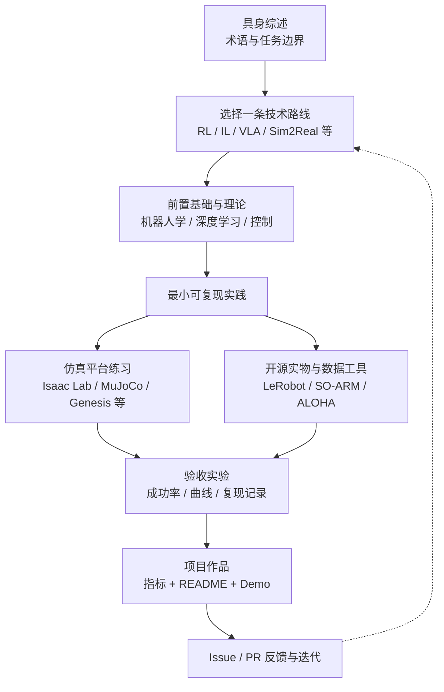

# Xbotics 具身智能学习指南（Xbotics-Embodied-Guide / Roadmap to Embodied AI）

## 一句话定义

**一句话：** [Xbotics-Embodied-Guide](https://github.com/Xbotics-Embodied-AI-club/Xbotics-Embodied-Guide) 是面向机器人学习入门者和工程实践者的**文档式路线图**：从具身综述选方向，再沿十条技术路线走向仿真、开源硬件练习与可复现的项目作品；它是导航资料，不是可直接启动训练的策略框架。

## 英文缩写速查

| 缩写 | 英文全称 | 简要说明 |
| --- | --- | --- |
| RL | Reinforcement Learning | 强化学习路线：从 MDP/策略基础到仿真任务 |
| IL | Imitation Learning | 模仿学习路线：从 BC、DAgger 到机器人演示策略 |
| VLA | Vision-Language-Action | 视觉、语言、动作联合建模及微调路线 |
| Sim2Real | Simulation to Reality | 从仿真训练迁移到实体机器人 |
| SOP | Standard Operating Procedure | 实验和部署的标准作业步骤；本 Guide 提供相关学习方向，不等于完整可运行 SOP |
| SFT | Supervised Fine-Tuning | 前沿章节提及的大模型监督微调 |

## 为什么重要

- **学习方向可选：** 官网 [十条路线](https://github.com/Xbotics-Embodied-AI-club/Xbotics-Embodied-Guide/blob/19b9e947b4d4e355655a94691ab51c6ce1cbe6f7/docs/2-roadmaps/README.md) 把 RL、IL、3D 视觉、规划控制、导航、触觉力控、VLA、Sim2Real、世界模型、数据飞轮与遥操作按前置知识、起步实验、进阶任务组织。
- **从阅读走向交付：** 主 README 的求职路线要求最小 Demo → 基线复现/改造 → 可量化结果 → README 与演示素材，比只汇总论文链接更接近工程实践。
- **与本库分工：** 本页适合挑选起步路径；机制与可复现代码细节仍需进入 [RL](../methods/reinforcement-learning.md)、[模仿学习](../methods/imitation-learning.md)、[VLA](../methods/vla.md) 等知识节点；[Xbotics 21 讲教程](./xbotics-embodied-ai-handbook.md) 承接实际课程。

## 核心原理：路线图的组织与学习闭环

| 上游部分 | 原始内容 | 在本知识库中的作用 |
| --- | --- | --- |
| 1–2 具身综述与 Roadmaps | 感知/控制/导航/世界模型总览 + 十方向路线 | 建立术语，并定位技术入口 |
| 3–5 基础、经典与前沿 | 机器人学、Transformer、BC/DAgger/GAIL、VLA、Diffusion、Sim2Real | 选理论与复现材料 |
| 6 仿真学习 | Isaac Lab、MuJoCo、PyBullet、Genesis、Gazebo | 选择仿真底座，配置最小任务 |
| 7 开源实物 | LeRobot、SO-ARM、ALOHA、数据集、训练/评估示例 | 将算法练习映射到真实操作平台 |
| 8–10 社区与行业 | 人物、公司、Issue/贡献方式 | 查询生态线索、反馈问题、完善作品集 |

### 流程总览（依据官方 README 与 Roadmaps）

这里表示**学习决策与产物流程**，不是某个机器人模型的训练数据流；平台和硬件是按方向选择，不要求每个学习者同时使用。

## 工程实践

| 目标 | 建议使用路径 | 预期交付 |
| --- | --- | --- |
| 学习机器人 RL | 按 Roadmaps 2.1 补 MDP / PPO，再用公开工具完成 CartPole / 仿真试验 | 训练曲线、控制效果与超参记录 |
| 学习模仿学习 / VLA | Roadmaps 2.2 / 2.7 → [LeRobot](./lerobot.md) 与公开数据集 | 数据处理、策略评测、推理时延与成功率 |
| 进入 Sim2Real | Roadmaps 2.8 → [Sim2Real 纵深路线](../../roadmap/depth-sim2real.md) → 真机 checklist | sim2sim 回归、部署安全检查和失败复盘 |
| 准备作品集 / 面试 | README 求职路线：方向→最小 Demo→复现与指标→项目说明 | 代码入口、复现命令、实验指标、演示视频 |

**核对版本：** 上游 `main@19b9e947b4d4`（2026-11-22）。上述学习目标来自原文整理；表中“预期交付”是工程实践建议，不是已复现的实验结果。

## 源码运行时序图

**不适用。** 上游 README 明确是“以文档与路线为主，无需运行脚本即可开始学习”。其 `docs/7-real-robots/README.md` 中的安装、训练和评估命令调用的是**外部 LeRobot**，不能充作本项目自有代码的运行时序。此处以已核对的学习流程图代替，不虚构 `train.py`、策略模块或机器人执行链路。

## 局限与风险

- **路线完整度不均：** 十条方向都有学习材料，但“4–8 周分周计划 / 量化验收”属于通用模板要求；部分方向仍以理论、工具与最小/进阶目标清单为主，不是全部已有成套课表。
- **资源时效与复现性：** 例如 LeRobot 示例命令、模型接口或硬件支持列表可能随上游变化，使用前以各工具官方当前文档核对；本 Guide 不提供统一可运行的环境锁定与全路线 benchmark。
- **许可证文本不一致：** 上游 [README](https://github.com/Xbotics-Embodied-AI-club/Xbotics-Embodied-Guide/blob/19b9e947b4d4e355655a94691ab51c6ce1cbe6f7/README.md) 标 CC BY 4.0，[贡献页](https://github.com/Xbotics-Embodied-AI-club/Xbotics-Embodied-Guide/blob/19b9e947b4d4e355655a94691ab51c6ce1cbe6f7/docs/10-contributing/README.md) 又称“代码 MIT / 文档 CC BY 4.0”，但根目录 [LICENSE](https://github.com/Xbotics-Embodied-AI-club/Xbotics-Embodied-Guide/blob/19b9e947b4d4e355655a94691ab51c6ce1cbe6f7/LICENSE) 文本为 CC BY-NC-SA 4.0；复用素材前应向维护者确认。
- **人物与公司名录** 是探索入口；个人职位、组织关系与招聘情况应回到第一手资料独立核对。

## 关联页面

- [Xbotics-Embodied-AI-Handbook（21 讲教程）](./xbotics-embodied-ai-handbook.md) — 同社区、偏动手实作的姊妹仓
- [LeRobot](./lerobot.md) — 真机采集、数据与机器人策略工具
- [Genesis](./genesis-sim.md) — 源指南提及的仿真工具
- [强化学习](../methods/reinforcement-learning.md) · [模仿学习](../methods/imitation-learning.md) · [VLA](../methods/vla.md)
- [数据飞轮](../concepts/data-flywheel.md) · [Sim2Real](../concepts/sim2real.md)
- [Sim2Real 纵深路线](../../roadmap/depth-sim2real.md) — 迁移步骤的深入工程核查

## 参考来源

- [Xbotics-Embodied-Guide 一手资料归档](../../sources/repos/xbotics-embodied-guide.md) — 核对的文档范围与许可证不一致情况
- [上游 README](https://github.com/Xbotics-Embodied-AI-club/Xbotics-Embodied-Guide/blob/19b9e947b4d4e355655a94691ab51c6ce1cbe6f7/README.md)
- [十方向 Roadmaps](https://github.com/Xbotics-Embodied-AI-club/Xbotics-Embodied-Guide/blob/19b9e947b4d4e355655a94691ab51c6ce1cbe6f7/docs/2-roadmaps/README.md)
- [仿真学习](https://github.com/Xbotics-Embodied-AI-club/Xbotics-Embodied-Guide/blob/19b9e947b4d4e355655a94691ab51c6ce1cbe6f7/docs/6-simulation/README.md)
- [开源实物与 LeRobot](https://github.com/Xbotics-Embodied-AI-club/Xbotics-Embodied-Guide/blob/19b9e947b4d4e355655a94691ab51c6ce1cbe6f7/docs/7-real-robots/README.md)

## 推荐继续阅读

- [Xbotics-Embodied-AI-Handbook：21 讲实作教程](https://github.com/Xbotics-Embodied-AI-club/Xbotics-Embodied-AI-Handbook)
- [Hugging Face LeRobot 官方文档](https://huggingface.co/docs/lerobot)
