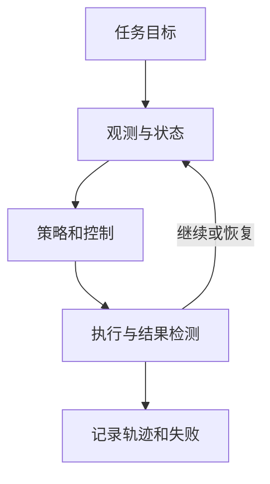
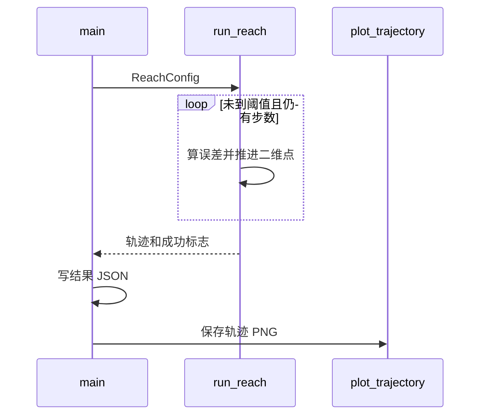

# Xbotics 第1讲：具身智能导论 / Xbotics Lecture 1: Introduction to Embodied AI: From Language Models to Physical Agents

## 一句话定义

把机器人视为由身体、感知、状态、任务、策略、控制和数据组成的系统。以抓杯和二维到达说明：能解释一个任务不等于能可靠完成它。

## 英文缩写速查

| 缩写 | 英文全称 | 简要说明 |
|---|---|---|
| VLA | Vision-Language-Action | 视觉语言到动作 |
| RL | Reinforcement Learning | 通过交互优化策略 |
| WAM | World Action Model | 联合处理未来状态与动作的模型 |

## 为什么重要

身体限制工作空间和接触能力；视觉输出只有能帮助选动作时才成为有效感知。传统流水线、模仿学习、强化学习、VLA 与世界模型可以组合，不需互相替代。

## 核心原理

目标先变成可执行条件，观测再估计对象与自身状态；策略决定下一步，控制执行后用反馈确认进度、重试或退出。成功与失败轨迹都进入下一轮迭代。

## 工程实践

在二维到达脚本中分别改变目标、步长和停止阈值，对照轨迹、步数、最终误差与成功标志；真机另需校验安全边界。

## 源码运行时序图

依据[可运行源码入口](https://github.com/Xbotics-Embodied-AI-club/Xbotics-Embodied-AI-Handbook/blob/342247fb71dd0ee15386b6eab80543c50593d3c1/code/lecture01/simulation/minimal_reach.py)静态核对；本次未独立运行该实验。

## 局限与风险

无硬件练习只更新二维点坐标，无动力学、传感器噪声与碰撞；不证明机械臂能抓物。

## 关联页面

课程：系统基础。

- [课程主节点](xbotics-embodied-ai-handbook.md)
- [第2讲：机器人系统架构：硬件、软件与 ROS2](xbotics-handbook-lecture-02.md)
- [VLA](../methods/vla.md)
- [机器人操作](../tasks/manipulation.md)
- [强化学习](../methods/reinforcement-learning.md)

## 参考来源

- [章节来源归档](../../sources/courses/xbotics-handbook-lecture-01.md)
- [官方网页全文](https://xbotics-embodied-ai-club.github.io/Xbotics-Embodied-AI-Handbook/part1-system-basics/01-introduction.html)
- [固定版本书稿](https://github.com/Xbotics-Embodied-AI-club/Xbotics-Embodied-AI-Handbook/blob/342247fb71dd0ee15386b6eab80543c50593d3c1/docs/part1-system-basics/01-introduction.md)

## 推荐继续阅读

- [官方第 1 讲](https://xbotics-embodied-ai-club.github.io/Xbotics-Embodied-AI-Handbook/part1-system-basics/01-introduction.html)：查阅正文、配图和课程给出的参考资料。
