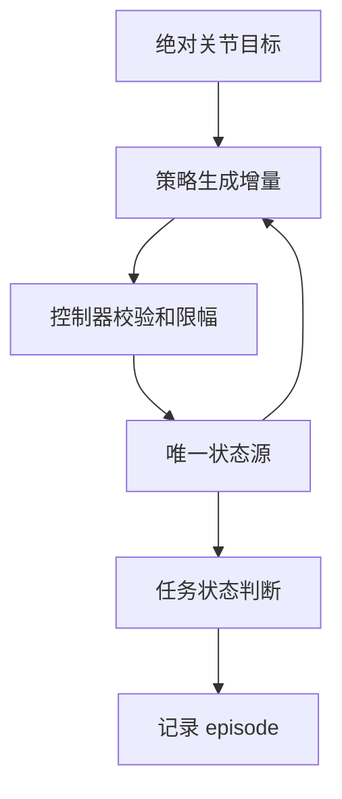
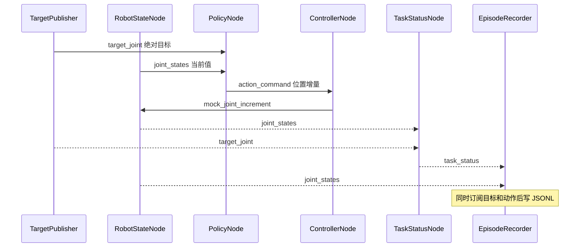

# Xbotics 第2讲：机器人系统架构：硬件、软件与 ROS2 / Xbotics Lecture 2: Robot System Architecture: Hardware, Software and ROS 2

## 一句话定义

以六关节 mock 机械臂把任务、策略、控制、机器人状态和日志拆成 ROS 2 节点；对比 Topic、Service、Action 与 Launch 的适用场景。

## 英文缩写速查

| 缩写 | 英文全称 | 简要说明 |
|---|---|---|
| ROS 2 | Robot Operating System 2 | 机器人软件通信和构建框架 |
| QoS | Quality of Service | 消息可靠性与队列策略 |
| JSONL | JSON Lines | 逐行保存记录 |

## 为什么重要

同样是六个弧度值，绝对目标与当前控制周期的位置增量是两种接口；维度、顺序、频率与数据新鲜度要写进契约。

## 核心原理

关节状态由一个节点发布；策略根据当前状态与绝对目标计算限幅增量，控制器二次校验，任务节点据状态判断到达、超时或过期，记录器汇总结果。

## 工程实践

用 launch 启动 mock，检查 Topic 与消息类型，发布目标，看状态是否收敛，再比对任务状态与 episode JSONL；改变单个参数复盘影响。

## 源码运行时序图

依据[可运行源码入口](https://github.com/Xbotics-Embodied-AI-club/Xbotics-Embodied-AI-Handbook/blob/342247fb71dd0ee15386b6eab80543c50593d3c1/code/lecture02/simulation/robot_ws/src/robot_demo/launch/minimal_loop.launch.py)静态核对；本次未独立运行该实验。

## 局限与风险

mock 路径不等于硬件驱动；实际接入 SO101 时需核验厂商接口、单位、限位和异常停机。 讲义 §2.7 仍写完整包未发布，但同一提交中的配套目录已包含可指认的 launch 与六节点源码。

## 关联页面

课程：系统基础。

- [课程主节点](xbotics-embodied-ai-handbook.md)
- [第1讲：具身智能导论](xbotics-handbook-lecture-01.md)
- [第3讲：机器人本体与控制基础](xbotics-handbook-lecture-03.md)
- [PID 控制](../methods/pid-control.md)
- [Unitree ROS](unitree-ros.md)
- [机器人操作任务](../tasks/manipulation.md)

## 参考来源

- [章节来源归档](../../sources/courses/xbotics-handbook-lecture-02.md)
- [官方网页全文](https://xbotics-embodied-ai-club.github.io/Xbotics-Embodied-AI-Handbook/part1-system-basics/02-ros2-architecture.html)
- [固定版本书稿](https://github.com/Xbotics-Embodied-AI-club/Xbotics-Embodied-AI-Handbook/blob/342247fb71dd0ee15386b6eab80543c50593d3c1/docs/part1-system-basics/02-ros2-architecture.md)

## 推荐继续阅读

- [官方第 2 讲](https://xbotics-embodied-ai-club.github.io/Xbotics-Embodied-AI-Handbook/part1-system-basics/02-ros2-architecture.html)：查阅正文、配图和课程给出的参考资料。
