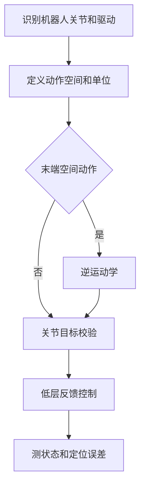

# Xbotics 第3讲：机器人本体与控制基础 / Xbotics Lecture 3: Robot Embodiment and Control: From Hardware to Action Spaces

## 一句话定义

从关节、连杆和执行器讲到反馈控制、FK/IK、动作空间和多速率控制；用固定基座机械臂对比浮动基座人形机器人。

## 英文缩写速查

| 缩写 | 英文全称 | 简要说明 |
|---|---|---|
| DOF | Degree of Freedom | 独立运动变量数 |
| FK | Forward Kinematics | 从关节状态求末端位姿 |
| IK | Inverse Kinematics | 从末端目标求关节解 |
| PID | Proportional Integral Derivative | 按误差及其积分微分做反馈 |

## 为什么重要

模型动作不是电机指令。坐标系、单位、绝对或增量、尺度以及执行频率必须两端一致，才能把策略输出转换成可执行目标。

## 核心原理

位置、速度和力矩闭环的目标不同；末端增量通常需经 IK 转换成关节目标，低层控制仍在更快的频率处理跟踪与约束。人形机器人还要兼顾平衡、支撑与全身协调。

## 工程实践

先做单关节小幅跟踪，再核对末端可达性、关节限位和动作缩放；时间上分别记推理周期、驱动周期和动作保持时长。

## 源码运行时序图

不适用：本讲未确认可据以还原运行调用链的教程实现；概念流程图不代表源码执行。

## 局限与风险

反解可能无解、多解或靠近奇异点；官方本讲代码骨架没有可核验独立运行入口，图仅表达概念。

## 关联页面

课程：系统基础。

- [课程主节点](xbotics-embodied-ai-handbook.md)
- [第2讲：机器人系统架构：硬件、软件与 ROS2](xbotics-handbook-lecture-02.md)
- [第4讲：传感器与感知基础](xbotics-handbook-lecture-04.md)
- [PID 控制](../methods/pid-control.md)
- [Pink IK](pink-ik.md)
- [逆动力学控制](../methods/inverse-dynamics-control.md)

## 参考来源

- [章节来源归档](../../sources/courses/xbotics-handbook-lecture-03.md)
- [官方网页全文](https://xbotics-embodied-ai-club.github.io/Xbotics-Embodied-AI-Handbook/part1-system-basics/03-robot-body-control.html)
- [固定版本书稿](https://github.com/Xbotics-Embodied-AI-club/Xbotics-Embodied-AI-Handbook/blob/342247fb71dd0ee15386b6eab80543c50593d3c1/docs/part1-system-basics/03-robot-body-control.md)

## 推荐继续阅读

- [官方第 3 讲](https://xbotics-embodied-ai-club.github.io/Xbotics-Embodied-AI-Handbook/part1-system-basics/03-robot-body-control.html)：查阅正文、配图和课程给出的参考资料。
