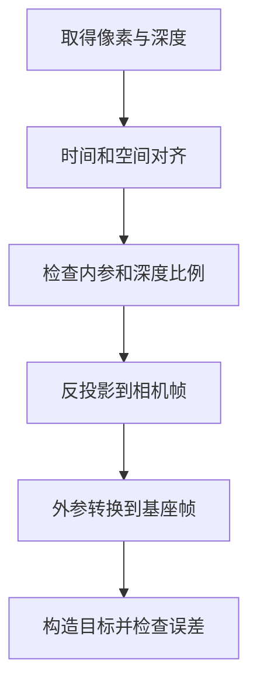
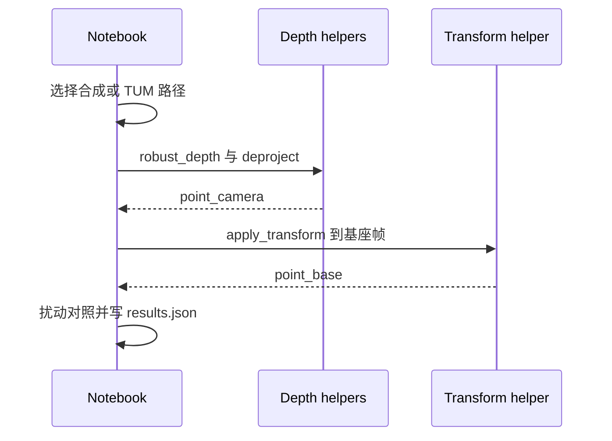

# Xbotics 第4讲：传感器与感知基础 / Xbotics Lecture 4: Sensors and Perception Fundamentals

## 一句话定义

沿 RGB-D 的一条完整链路讲内外参、时间戳、TF 树和传感器标定，目标是把像素转换成机器人可用的空间目标。

## 英文缩写速查

| 缩写 | 英文全称 | 简要说明 |
|---|---|---|
| RGB-D | RGB and Depth | 同场景颜色与深度观测 |
| TF | Transform Framework | ROS 中查询坐标帧变换 |
| IMU | Inertial Measurement Unit | 测量角速度与加速度 |

## 为什么重要

RGB 识别出目标不等于能执行；深度单位、深度相机内参与基座变换方向任一错误都会放大为实际动作错位。

## 核心原理

先将像素邻域中的有效深度做鲁棒取值，换算成米，用深度相机内参反投影，再用正确方向的齐次变换转到 base；相机与其他传感器还要按时间与语义对齐。

## 工程实践

先用合成真值核对反投影与坐标变换，再换 TUM 样例；独立扰动深度比例、外参旋转和矩阵方向，记录输出误差。

## 源码运行时序图

依据[可运行源码入口](https://github.com/Xbotics-Embodied-AI-club/Xbotics-Embodied-AI-Handbook/blob/342247fb71dd0ee15386b6eab80543c50593d3c1/code/lecture04/simulation/sensors_coordinates_demo.ipynb)静态核对；本次未独立运行该实验。

## 局限与风险

TUM 数据没有本练习的逐点真值，且 notebook 是离线几何练习，不验证实时 ROS TF 或真实手眼标定。

## 关联页面

课程：系统基础。

- [课程主节点](xbotics-embodied-ai-handbook.md)
- [第3讲：机器人本体与控制基础](xbotics-handbook-lecture-03.md)
- [第5讲：仿真环境与操作任务搭建](xbotics-handbook-lecture-05.md)
- [HumanCalib](humancalib.md)
- [机器人操作](../tasks/manipulation.md)
- [抓取位姿估计](../methods/grasp-pose-estimation.md)

## 参考来源

- [章节来源归档](../../sources/courses/xbotics-handbook-lecture-04.md)
- [官方网页全文](https://xbotics-embodied-ai-club.github.io/Xbotics-Embodied-AI-Handbook/part1-system-basics/04-sensors-coordinates.html)
- [固定版本书稿](https://github.com/Xbotics-Embodied-AI-club/Xbotics-Embodied-AI-Handbook/blob/342247fb71dd0ee15386b6eab80543c50593d3c1/docs/part1-system-basics/04-sensors-coordinates.md)

## 推荐继续阅读

- [官方第 4 讲](https://xbotics-embodied-ai-club.github.io/Xbotics-Embodied-AI-Handbook/part1-system-basics/04-sensors-coordinates.html)：查阅正文、配图和课程给出的参考资料。
