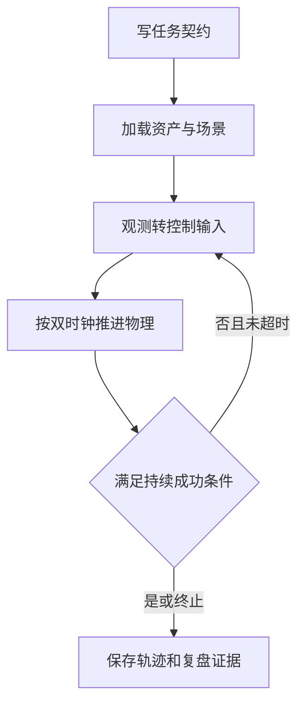
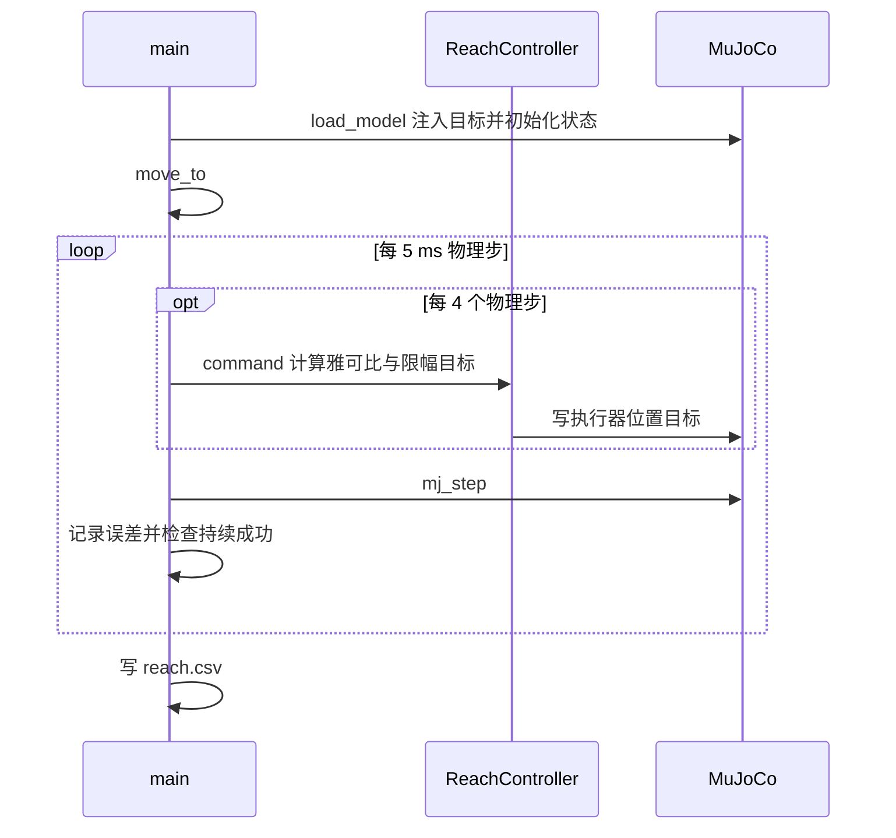

# Xbotics 第5讲：仿真环境与操作任务搭建 / Xbotics Lecture 5: Simulation Environments and Task Setup: From Real Tasks to Reproducible Loops

## 一句话定义

先为操作任务写契约，再用 MuJoCo SO-101 到达与抓放兑现它，扩展到 Isaac Lab Franka Reach、G1 速度跟踪和 Sim2Real 扰动。

## 英文缩写速查

| 缩写 | 英文全称 | 简要说明 |
|---|---|---|
| MJCF | MuJoCo XML Format | 声明场景、关节、碰撞和执行器 |
| IK | Inverse Kinematics | 反求关节位置目标 |
| DLS | Damped Least Squares | 用阻尼缓解差分 IK 病态 |
| Sim2Real | Simulation to Reality | 把仿真能力迁移到真机 |

## 为什么重要

动作含义、观测可用性、判定条件和两个时钟比选仿真器更基础；动作规范化数值不等于执行器单位，高层速度命令也不是关节 action。

## 核心原理

SO-101 用末端误差与雅可比做阻尼最小二乘，生成关节位置目标；20 ms 外层控制与 5 ms 物理步分离，误差连续 8 个控制周期低于 5 mm 才判成功。抓放额外检查双侧接触、抬升、滑移与最终放置。

## 工程实践

保留逐步 CSV，再每次只改变目标、质量、摩擦、控制周期之一；分清触及奇异、限幅、超时以及接触阶段失败。

## 源码运行时序图

依据[可运行源码入口](https://github.com/Xbotics-Embodied-AI-club/Xbotics-Embodied-AI-Handbook/blob/342247fb71dd0ee15386b6eab80543c50593d3c1/code/lecture05/simulation/reach.py)静态核对；本次未独立运行该实验。

## 局限与风险

本地仿真真值不代表真机可观测；接触、执行器、延迟和视觉可能各自引起域差，单一成功样例不足以证明迁移。

## 关联页面

课程：视觉操作。

- [课程主节点](xbotics-embodied-ai-handbook.md)
- [第4讲：传感器与感知基础](xbotics-handbook-lecture-04.md)
- [第6讲：机器人感知与位姿估计](xbotics-handbook-lecture-06.md)
- [MuJoCo](mujoco.md)
- [Isaac Lab](isaac-lab.md)
- [Sim2Real 检查表](../queries/sim2real-checklist.md)
- [机器人操作任务](../tasks/manipulation.md)
- [抓取位姿估计](../methods/grasp-pose-estimation.md)

## 参考来源

- [章节来源归档](../../sources/courses/xbotics-handbook-lecture-05.md)
- [官方网页全文](https://xbotics-embodied-ai-club.github.io/Xbotics-Embodied-AI-Handbook/part2-vision-manipulation/05-simulation.html)
- [固定版本书稿](https://github.com/Xbotics-Embodied-AI-club/Xbotics-Embodied-AI-Handbook/blob/342247fb71dd0ee15386b6eab80543c50593d3c1/docs/part2-vision-manipulation/05-simulation.md)

## 推荐继续阅读

- [官方第 5 讲](https://xbotics-embodied-ai-club.github.io/Xbotics-Embodied-AI-Handbook/part2-vision-manipulation/05-simulation.html)：查阅正文、配图和课程给出的参考资料。
