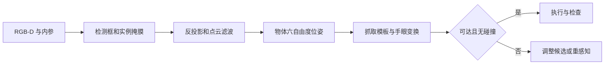
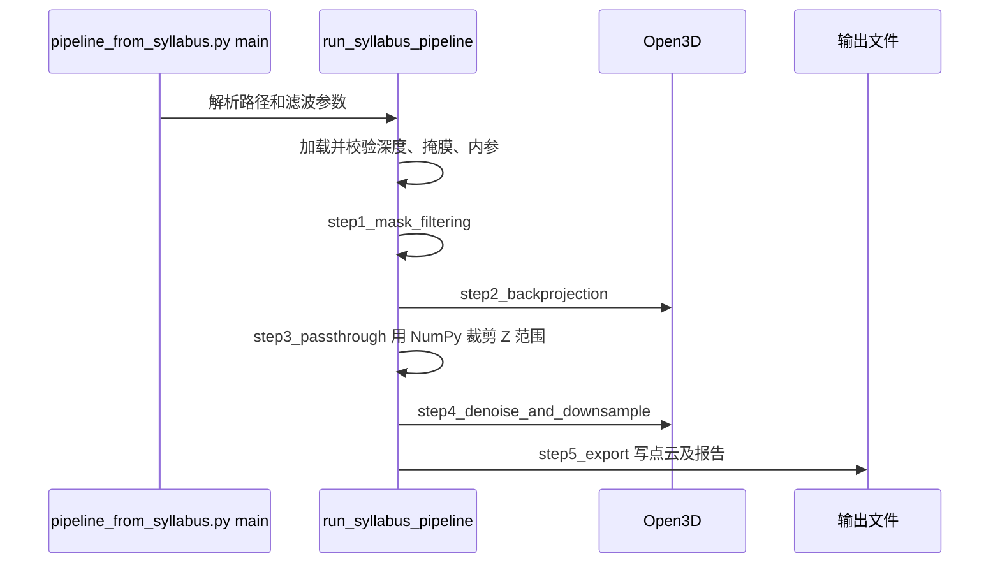

# Xbotics 第6讲：机器人感知与位姿估计 / Xbotics Lecture 6: Robot Perception and Pose Estimation: From Pixels to Grasp Poses

## 一句话定义

检测框、掩膜、三维中心、物体位姿和抓取位姿各回答不同问题。课程把这些表征连成 RGB-D 观测到机械臂执行的链路，并说明哪些环节可以被直接抓取预测替代。

## 英文缩写速查

| 缩写 | 英文全称 | 简要说明 |
|---|---|---|
| RGB-D | Red Green Blue and Depth | 颜色加深度的相机数据 |
| ICP | Iterative Closest Point | 迭代求取点云对齐变换 |
| ADD-S | Average Distance for Symmetric Objects | 考虑对称性，以最近模型点计算位姿误差 |
| IK | Inverse Kinematics | 从末端目标反求关节状态 |

## 为什么重要

把感知正确性拆成目标身份、几何尺度和朝向三项，才能区分抓错物体、位置总偏一侧和夹爪斜撞等不同故障。

## 核心原理

利用分割掩膜截取深度，经内参反投影成相机系点云，滤波后用 ICP、模板或学习方案估计刚体位姿；再把物体系抓取模板通过手眼变换转成基座系目标，检查夹爪宽度、接近方向、预抓取偏置、IK 与碰撞。

## 工程实践

先在数据样例上查看每阶段点云和统计报告，再用合成手眼脚本比较眼在手上与眼在手外的输出。真机按坐标链、静态定位、固定场景抓取、遮挡压力测试的顺序验证；对称物体宜同时看 ADD-S 和任务允许的接触姿态。

## 源码运行时序图

依据[可运行源码入口](https://github.com/Xbotics-Embodied-AI-club/Xbotics-Embodied-AI-Handbook/blob/342247fb71dd0ee15386b6eab80543c50593d3c1/code/lecture06/Visual_Perception/pipeline_from_syllabus.py)静态核对；本次未独立运行该实验。

## 局限与风险

点云课堂入口假定已有掩膜，不是检测、分割、6D 定姿或执行的一体化实现。真实遮挡、反光和手眼外参偏差仍需单独评测；高置信度框不保证可抓。 教材中的阈值和成功率量级不能外推为平台安全门槛。

## 关联页面

课程：视觉操作。

- [课程主节点](xbotics-embodied-ai-handbook.md)
- [第5讲：仿真环境与操作任务搭建](xbotics-handbook-lecture-05.md)
- [第7讲：机器人操作技能](xbotics-handbook-lecture-07.md)
- [手眼标定](../concepts/hand-eye-calibration.md)
- [感知坐标后处理](../concepts/perception-coordinate-postprocessing.md)
- [抓取知识索引](../overview/hub-grasp.md)
- [抓取位姿估计](../methods/grasp-pose-estimation.md)
- [机器人操作任务](../tasks/manipulation.md)

## 参考来源

- [章节来源归档](../../sources/courses/xbotics-handbook-lecture-06.md)
- [官方网页全文](https://xbotics-embodied-ai-club.github.io/Xbotics-Embodied-AI-Handbook/part2-vision-manipulation/06-pose-estimation.html)
- [固定版本书稿](https://github.com/Xbotics-Embodied-AI-club/Xbotics-Embodied-AI-Handbook/blob/342247fb71dd0ee15386b6eab80543c50593d3c1/docs/part2-vision-manipulation/06-pose-estimation.md)

## 推荐继续阅读

- [官方第 6 讲](https://xbotics-embodied-ai-club.github.io/Xbotics-Embodied-AI-Handbook/part2-vision-manipulation/06-pose-estimation.html)：查阅正文、配图和课程给出的参考资料。
