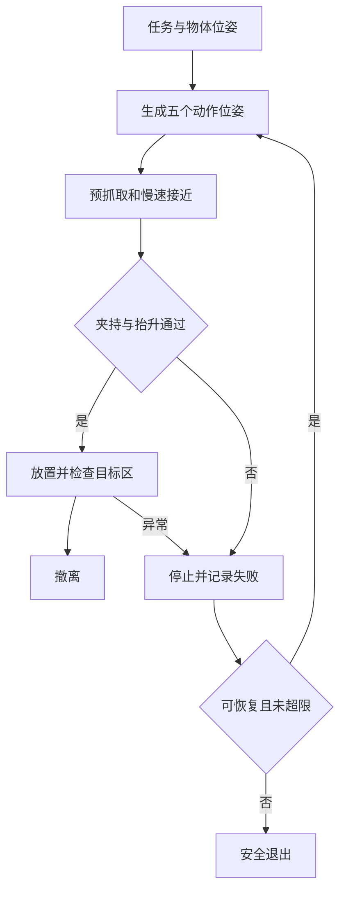
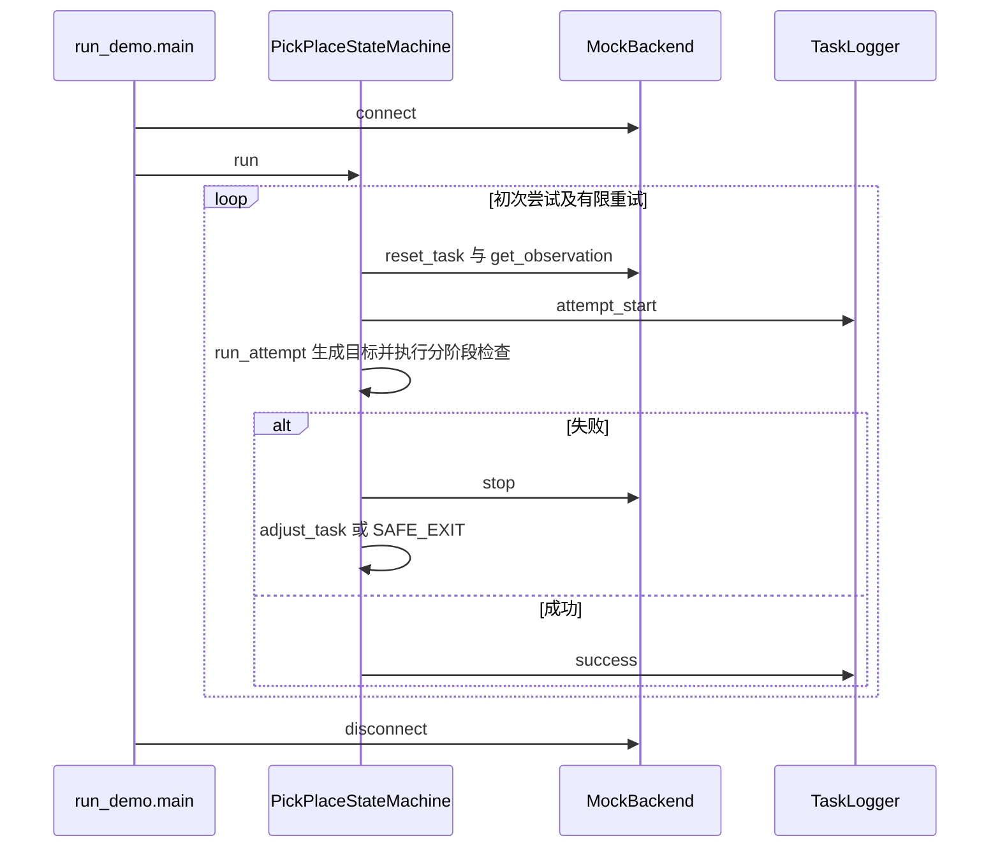

# Xbotics 第7讲：机器人操作技能 / Xbotics Lecture 7: Robot Manipulation Skills: Pick, Place, and Failure Recovery

## 一句话定义

用顶抓方块和侧抓直立瓶对照同一抓放状态机。先由任务参数生成五个位姿，再通过夹持、抬升、放置三道物理验证，而不是把运动完成当任务成功。

## 英文缩写速查

| 缩写 | 英文全称 | 简要说明 |
|---|---|---|
| FSM | Finite State Machine | 将抓放步骤和条件写成状态转移 |
| TCP | Tool Center Point | 夹爪控制与标定所用的工具参考点 |
| IK | Inverse Kinematics | 验证五个位姿可被机械臂达到 |
| JSONL | JSON Lines | 按事件逐行记录观测和失败码 |

## 为什么重要

状态机让第一次异常有明确归属。它在夹爪已经闭合但物体没随动时就停止，而不必等整段轨迹做完才发现失败。

## 核心原理

五个位姿是预抓取、抓取、抬升、放置与撤离。抓取候选涵盖方向、宽度与偏置；失败时先停，再按失败类型调整高度、宽度或速度，达到上限走安全退出。

## 工程实践

先用 Python 模块入口分别执行 cube 和 bottle，查看 JSONL 事件中的阶段、失败码和重试次数；随后把同样的任务接口接入仿真或 SO-101，逐项验证碰撞、可达性和实际接触反馈。

## 源码运行时序图

依据[可运行源码入口](https://github.com/Xbotics-Embodied-AI-club/Xbotics-Embodied-AI-Handbook/blob/342247fb71dd0ee15386b6eab80543c50593d3c1/code/lecture07/robot_pick_place/run_demo.py)静态核对；本次未独立运行该实验。

## 局限与风险

run_demo 默认只接 MockBackend，模拟结果不能替代真机成功率。教材列出的偏移量是工程教学示例，不是可直接照搬的真机标定值。

## 关联页面

课程：视觉操作。

- [课程主节点](xbotics-embodied-ai-handbook.md)
- [第6讲：机器人感知与位姿估计](xbotics-handbook-lecture-06.md)
- [第8讲：端到端策略导论 —— 从 Pipeline 到 Policy](xbotics-handbook-lecture-08.md)
- [抓取知识索引](../overview/hub-grasp.md)
- [移动操作](../tasks/loco-manipulation.md)
- [手眼标定](../concepts/hand-eye-calibration.md)
- [机器人操作任务](../tasks/manipulation.md)

## 参考来源

- [章节来源归档](../../sources/courses/xbotics-handbook-lecture-07.md)
- [官方网页全文](https://xbotics-embodied-ai-club.github.io/Xbotics-Embodied-AI-Handbook/part2-vision-manipulation/07-manipulation-skills.html)
- [固定版本书稿](https://github.com/Xbotics-Embodied-AI-club/Xbotics-Embodied-AI-Handbook/blob/342247fb71dd0ee15386b6eab80543c50593d3c1/docs/part2-vision-manipulation/07-manipulation-skills.md)

## 推荐继续阅读

- [官方第 7 讲](https://xbotics-embodied-ai-club.github.io/Xbotics-Embodied-AI-Handbook/part2-vision-manipulation/07-manipulation-skills.html)：查阅正文、配图和课程给出的参考资料。
