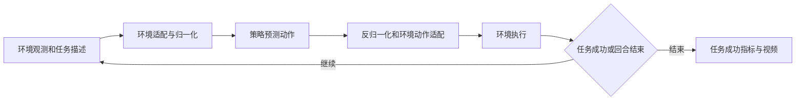
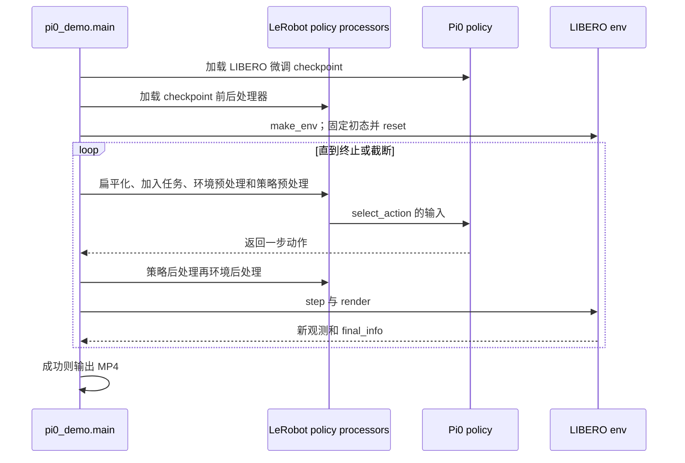

# Xbotics 第8讲：端到端策略导论 —— 从 Pipeline 到 Policy / Xbotics Lecture 8: Introduction to End-to-End Policies: From Pipeline to Policy

## 一句话定义

对比显式感知、规划、控制模块和直接观测到动作的策略。以 LeRobot 的 LIBERO 微调版 π0 演示从任务观测、预处理、执行到下一观测的闭环。

## 英文缩写速查

| 缩写 | 英文全称 | 简要说明 |
|---|---|---|
| VLA | Vision Language Action | 观测和语言感知直接接入动作预测 |
| BC | Behavior Cloning | 用专家动作监督策略训练 |
| OOD | Out of Distribution | 偏离示教覆盖的策略状态 |
| DoF | Degrees of Freedom | 描述运动独立维度 |

## 为什么重要

离线训练损失不能衡量失误如何在环境中累积。部署前应把 checkpoint、动作语义和归一化做成同一份接口契约，再用闭环成功率判断。

## 核心原理

输入可由图像、关节或末端状态和语言组成，输出可以是关节目标、末端增量或动作块。LIBERO 示例采用七维末端增量控制；模型侧与环境侧各有一对前后处理器。

## 工程实践

参照样例先用环境脚本确认观测键、动作形状、符号和夹爪方向，再跑指定初态的闭环视频。迁移真机时补做动作限位、工作空间与碰撞保护，并把多个初态分开报告。

## 源码运行时序图

依据[可运行源码入口](https://github.com/Xbotics-Embodied-AI-club/Xbotics-Embodied-AI-Handbook/blob/342247fb71dd0ee15386b6eab80543c50593d3c1/code/vla/1_policy_rollout/1_2_pi0_libero_rollout/pi0_demo.py)静态核对；本次未独立运行该实验。

## 局限与风险

演示选了匹配的 LIBERO 微调权重与验证过的初态，不是基座零样本成绩；单步裁剪也不能修复绝对/相对口径或坐标系用错。

## 关联页面

课程：端到端操作。

- [课程主节点](xbotics-embodied-ai-handbook.md)
- [第7讲：机器人操作技能](xbotics-handbook-lecture-07.md)
- [第9讲：操作数据闭环 —— 采一份能训练的数据集](xbotics-handbook-lecture-09.md)
- [行为克隆](../methods/behavior-cloning.md)
- [动作分块](../methods/action-chunking.md)
- [LeRobot](lerobot.md)

## 参考来源

- [章节来源归档](../../sources/courses/xbotics-handbook-lecture-08.md)
- [官方网页全文](https://xbotics-embodied-ai-club.github.io/Xbotics-Embodied-AI-Handbook/part3-end-to-end/08-%E7%AB%AF%E5%88%B0%E7%AB%AF%E7%AD%96%E7%95%A5%E5%AF%BC%E8%AE%BA.html)
- [固定版本书稿](https://github.com/Xbotics-Embodied-AI-club/Xbotics-Embodied-AI-Handbook/blob/342247fb71dd0ee15386b6eab80543c50593d3c1/docs/part3-end-to-end/08-%E7%AB%AF%E5%88%B0%E7%AB%AF%E7%AD%96%E7%95%A5%E5%AF%BC%E8%AE%BA.md)

## 推荐继续阅读

- [官方第 8 讲](https://xbotics-embodied-ai-club.github.io/Xbotics-Embodied-AI-Handbook/part3-end-to-end/08-%E7%AB%AF%E5%88%B0%E7%AB%AF%E7%AD%96%E7%95%A5%E5%AF%BC%E8%AE%BA.html)：查阅正文、配图和课程给出的参考资料。
