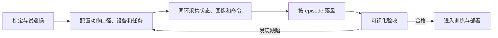
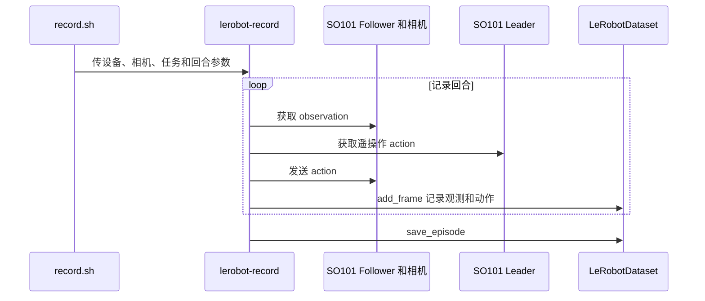

# Xbotics 第9讲：操作数据闭环 —— 采一份能训练的数据集 / Xbotics Lecture 9: Robot Manipulation Data Loop: Collecting a Trainable Dataset

## 一句话定义

比较原机遥操、人类代理、通用接口与无机器人采集；以 SO-101 Leader/Follower 演示从标定、遥操作到 LeRobot 数据集录制和回看。

## 英文缩写速查

| 缩写 | 英文全称 | 简要说明 |
|---|---|---|
| FPS | Frames Per Second | 采集回路的目标帧率 |
| UMI | Universal Manipulation Interface | 不依赖机器人在回路的手持示教方式 |
| VR | Virtual Reality | 通过头显和手柄遥操作 |
| VLA | Vision Language Action | 消费示教数据进行训练或微调的策略族 |

## 为什么重要

示教规模不是唯一变量：应围绕目标泛化轴选物体、场景或起始状态的覆盖，同时控制延迟、图像质量、任务一致性与传感对齐。

## 核心原理

真实录制在同一循环内读取 Follower 观测和 Leader 动作、发控制命令并写帧；关节、动作和索引保存于 Parquet，相机保存为 MP4，统计与结构写入元数据。绝对跟踪与锚定跟踪必须在配置、偏置记录和部署端对齐。

## 工程实践

先实测遥操与相机帧率再录制；回看至少一条 episode 的顶视、腕视、关节和动作曲线，并核对跨 episode 的任务名、时间戳和动作口径。没有真机可走仿真采集、转换、加载链，先确认字段。 评测按固定物体与初态、指令、复位规则和机判成功逐条记录，再按任务因子拆分结果。

## 源码运行时序图

依据[可运行源码入口](https://github.com/Xbotics-Embodied-AI-club/Xbotics-Embodied-AI-Handbook/blob/342247fb71dd0ee15386b6eab80543c50593d3c1/code/vla/2_data_collection/2_3_teleop_record/record.sh)静态核对；本次未独立运行该实验。

## 局限与风险

课中真机例为 30 Hz、640×480 绝对关节目标；键盘仿真例为 20 Hz、128×128 归一化关节增量。六维动作形状和容器相同并不意味语义兼容，合训前须明确转换与验收；不要靠采更多来修复标定或时间戳错误。

## 关联页面

课程：端到端操作。

- [课程主节点](xbotics-embodied-ai-handbook.md)
- [第8讲：端到端策略导论 —— 从 Pipeline 到 Policy](xbotics-handbook-lecture-08.md)
- [第10讲：模仿学习实战 —— ACT、Diffusion 与 Flow Matching](xbotics-handbook-lecture-10.md)
- [遥操作](../tasks/teleoperation.md)
- [LeRobot](lerobot.md)
- [具身数据清洗](../concepts/embodied-data-cleaning.md)
- [模仿学习](../methods/imitation-learning.md)

## 参考来源

- [章节来源归档](../../sources/courses/xbotics-handbook-lecture-09.md)
- [官方网页全文](https://xbotics-embodied-ai-club.github.io/Xbotics-Embodied-AI-Handbook/part3-end-to-end/09-%E6%93%8D%E4%BD%9C%E6%95%B0%E6%8D%AE%E9%97%AD%E7%8E%AF.html)
- [固定版本书稿](https://github.com/Xbotics-Embodied-AI-club/Xbotics-Embodied-AI-Handbook/blob/342247fb71dd0ee15386b6eab80543c50593d3c1/docs/part3-end-to-end/09-%E6%93%8D%E4%BD%9C%E6%95%B0%E6%8D%AE%E9%97%AD%E7%8E%AF.md)

## 推荐继续阅读

- [官方第 9 讲](https://xbotics-embodied-ai-club.github.io/Xbotics-Embodied-AI-Handbook/part3-end-to-end/09-%E6%93%8D%E4%BD%9C%E6%95%B0%E6%8D%AE%E9%97%AD%E7%8E%AF.html)：查阅正文、配图和课程给出的参考资料。
