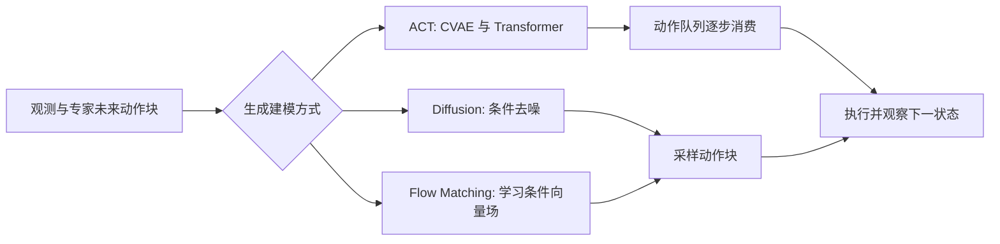
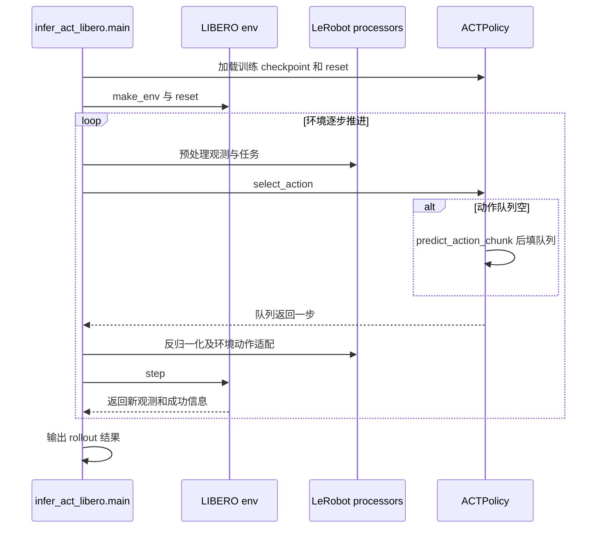

# Xbotics 第10讲：模仿学习实战 —— ACT、Diffusion 与 Flow Matching / Xbotics Lecture 10: Practical Imitation Learning: ACT, Diffusion, and Flow Matching

## 一句话定义

说明确定性单步行为克隆的误差累积和动作多模态两类问题，对比 ACT 的 CVAE、扩散去噪与 Flow Matching 向量场，并用 LIBERO 和 SO-101 实验详解 ACT。

## 英文缩写速查

| 缩写 | 英文全称 | 简要说明 |
|---|---|---|
| ACT | Action Chunking with Transformers | 分块预测并逐步执行的策略 |
| CVAE | Conditional Variational Autoencoder | 按当前观测约束的变分生成模型 |
| KL | Kullback Leibler Divergence | 约束训练隐变量后验靠近先验 |
| ODE | Ordinary Differential Equation | 积分速度场以生成动作样本 |

## 为什么重要

动作块让策略生成一段有一致性的动作；块长和执行步数分离之后，才有条件在重规划响应速度、推理成本与连贯性之间取舍。

## 核心原理

ACT 训练用未来动作块与 padding mask，最小化重建损失和 KL 正则；部署跳过 VAE 编码器，以零 latent 解码并从动作队列逐步取动作。Diffusion 通过去噪采样，Flow Matching 则拟合条件向量场并用 ODE 积分。

## 工程实践

以 LIBERO 单任务训练和 checkpoint rollout 验证 ACT。SO-101 例将 498 个仿真回合和 300 个真机回合对齐绝对关节目标、摄像头、频率及同一指令再合训；教程报告最终同一仿真场景 50 局成功率 76%，不把训练中 10 局估计当最终值。

### 已有 ACT 实验复核记录

| 实验 | 训练设置 | 作者报告的评估 |
|---|---|---|
| LIBERO bowl-to-plate | libero_goal task 8，100000 步，batch 256，256×256 | 定期 10 局闭环评估；文稿报告平台中位约 83%，非独立复现 |
| SO-101 cube40 | 498 仿真 + 300 真机 = 798 集，273889 帧；50000 步，batch 64 | 训练中每次 10 局：40/70/80/80/90%；最终独立 50 局仿真验收 76%（38/50） |

SO-101 合并前核对绝对关节目标、臂关节单位度、夹爪百分比、top/wrist 键名、640×480、30 Hz、H.264、so_follower 与指令文本。官方合并检查元数据不能保证动作语义一致，须人工检查量纲及限位。76% 是同一仿真场景混训模型的成功率；没有仅真机/仅仿真对照，不能把结果归因于混训收益，更不能宣称实机达成同样成功率。默认 100 步在 30 Hz 下覆盖约 3.33 秒，应独立调节执行时域和预测时域。

延迟评测需将重新生成 chunk 的模型调用与队列弹出分别统计，不能用大量队列命中稀释均值；若仅每 100 步重规划一次，逐步延迟的 p95 也不一定捕获重规划峰值。实际任务还需报告动作可用时延与端到端闭环表现。

## 源码运行时序图

依据[可运行源码入口](https://github.com/Xbotics-Embodied-AI-club/Xbotics-Embodied-AI-Handbook/blob/342247fb71dd0ee15386b6eab80543c50593d3c1/code/vla/3_imitation_learning/3_1_act/infer_act_libero.py)静态核对；本次未独立运行该实验。

## 局限与风险

示范混训不证明跨任务或真机泛化；固定零 latent 放弃了 ACT 部署时的多模式采样。Flow Matching 的单条条件直线路径不保证边际采样轨迹为直线，方法选型要看实际求解器与延迟。 对比采样速度时应用同硬件实测网络前向次数、端到端时延和闭环成功率。

## 关联页面

课程：端到端操作。

- [课程主节点](xbotics-embodied-ai-handbook.md)
- [第9讲：操作数据闭环 —— 采一份能训练的数据集](xbotics-handbook-lecture-09.md)
- [第11讲：VLA 模型导览 —— 从 OpenVLA 到 π0 家族](xbotics-handbook-lecture-11.md)
- [动作分块](../methods/action-chunking.md)
- [Diffusion Policy](../methods/diffusion-policy.md)
- [行为克隆](../methods/behavior-cloning.md)

## 参考来源

- [章节来源归档](../../sources/courses/xbotics-handbook-lecture-10.md)
- [官方网页全文](https://xbotics-embodied-ai-club.github.io/Xbotics-Embodied-AI-Handbook/part3-end-to-end/10-%E6%A8%A1%E4%BB%BF%E5%AD%A6%E4%B9%A0%E5%AE%9E%E6%88%98.html)
- [固定版本书稿](https://github.com/Xbotics-Embodied-AI-club/Xbotics-Embodied-AI-Handbook/blob/342247fb71dd0ee15386b6eab80543c50593d3c1/docs/part3-end-to-end/10-%E6%A8%A1%E4%BB%BF%E5%AD%A6%E4%B9%A0%E5%AE%9E%E6%88%98.md)

## 推荐继续阅读

- [官方第 10 讲](https://xbotics-embodied-ai-club.github.io/Xbotics-Embodied-AI-Handbook/part3-end-to-end/10-%E6%A8%A1%E4%BB%BF%E5%AD%A6%E4%B9%A0%E5%AE%9E%E6%88%98.html)：查阅正文、配图和课程给出的参考资料。
